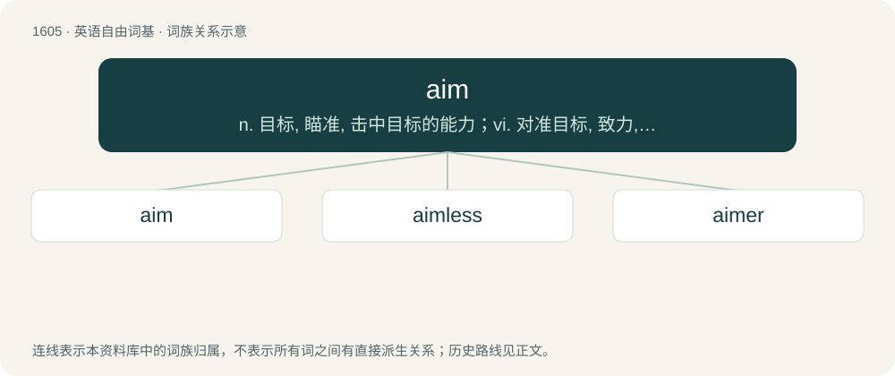

# 1701 · aim — n. 目标, 瞄准, 击中目标的能力；vi. 对准目标, 致力, 打算；vt. 瞄准

[总目录](../00_总目录_按常用程度.md)

**类型**：英语自由词基　｜　**来源语言**：见词源记录

## 核心含义与来源

- 核心含义：n. 目标, 瞄准, 击中目标的能力；vi. 对准目标, 致力, 打算；vt. 瞄准
- 英文含义：The pointing of a weapon, as a gun, a dart, or an arrow, or object, in the line of direction with the object intended to be struck; the line of fire; the direction of anything, such as a spear, a blow, a discourse, a remark, towards a particular point or object, with a view to strike or affect it.
- 词形：aim

**来源记录 1**（名词；The pointing of a weapon, as a gun, a dart, or an arrow, or object, in the line of direction with the object intended to be struck; the line of fire; the direction of anything, such as a spear, a blow, a discourse, a remark, towards a particular point or object, with a view to strike or affect it.）

The verb is from Middle English amen, aimen, eimen (“to guess at, to estimate, to aim”), borrowed from Old French esmer, aesmer, asmer, from Latin ad- plus aestimare (“to estimate”), the compound perhaps being originally formed in Medieval Latin (adaestimare), perhaps in Old French. The noun is from Middle English ame, from Old French aesme, esme.

## 词族图

## 单词速览（常用到不常用）

| 单词 | 音标 | 释义 |
|---|---|---|
| [aim](#w-1) | /eɪm/ | n. 目标, 瞄准, 击中目标的能力；vi. 对准目标, 致力, 打算；vt. 瞄准 |
| [aimless](#w-2) | /ˈeɪm.ləs/ | a. 无目的的, 没有目标的 |
| [aimer](#w-3) | 英 /ˈeɪ̯məː/；美 /ˈeɪ̯mɚ/ | n. 瞄准手 |

## 逐词详解

### 1. aim

**词性**：名词　｜　**音标**：/eɪm/

**中文释义**：n. 目标, 瞄准, 击中目标的能力；vi. 对准目标, 致力, 打算；vt. 瞄准

**英文义项**：The pointing of a weapon, as a gun, a dart, or an arrow, or object, in the line of direction with the object intended to be struck; the line of fire; the direction of anything, such as a spear, a blow, a discourse, a remark, towards a particular point or object, with a view to strike or affect it. / The level of accuracy of a weapon.

**词源与演化**：

The verb is from Middle English amen, aimen, eimen (“to guess at, to estimate, to aim”), borrowed from Old French esmer, aesmer, asmer, from Latin ad- plus aestimare (“to estimate”), the compound perhaps being originally formed in Medieval Latin (adaestimare), perhaps in Old French. The noun is from Middle English ame, from Old French aesme, esme.

**例句**：

> My number one aim in life is to make money to make my parents, siblings, and kids happy.

该用例对应义项：Intention or goal.

### 2. aimless

**词性**：形容词　｜　**音标**：/ˈeɪm.ləs/

**中文释义**：a. 无目的的, 没有目标的

**英文义项**：Without aim, purpose, or direction.

**构词拆分**：aim + -less

**词源与演化**：

From aim + -less.

**用法示例／搭配（非完整句）**：

> an aimless life

该用例对应义项：Without aim, purpose, or direction.

### 3. aimer

**词性**：名词　｜　**音标**：英 /ˈeɪ̯məː/；美 /ˈeɪ̯mɚ/

**中文释义**：n. 瞄准手

**英文义项**：One who aims; one who is responsible for aiming.

**构词拆分**：From aim + -er.

**词源与演化**：

From aim + -er.
