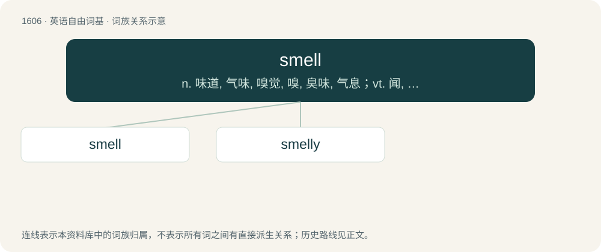

# 1702 · smell — n. 味道, 气味, 嗅觉, 嗅, 臭味, 气息；vt. 闻, 探出, 察觉, 发出...的气味；vi. 嗅, 散发气味, 发臭

[总目录](../00_总目录_按常用程度.md)

**类型**：英语自由词基　｜　**来源语言**：见词源记录

## 核心含义与来源

- 核心含义：n. 味道, 气味, 嗅觉, 嗅, 臭味, 气息；vt. 闻, 探出, 察觉, 发出...的气味；vi. 嗅, 散发气味, 发臭
- 英文含义：A sensation, pleasant or unpleasant, detected by inhaling air (or, the case of water-breathing animals, water) carrying airborne molecules of a substance.
- 词形：smell

**来源记录 1**（名词；A sensation, pleasant or unpleasant, detected by inhaling air (or, the case of water-breathing animals, water) carrying airborne molecules of a substance.）

From Middle English smellen, smillen, smyllen, smullen, from Old English \*smyllan, \*smiellan (“to smell, emit fumes”), from Proto-West Germanic \*smallijan (“to glow, burn, smoulder”), from Proto-Indo-European \*smel- (“to burn, smoke, smoulder; tar, pitch”). The noun is from Middle English smel, smil, smul (“smell, odour”). Related to Saterland Frisian smeele (“to smoulder”), Middle Dutch smōlen (“to burn, smoulder”) (whence Dutch smeulen (“to smoulder”)), Middle Low German smölen (“to be hazy, be dusty”) (whence Low German smölen (“smoulder”)), Low German smullen (“emit smoke”), West Flemish smoel (“stuffy, muggy, hazy”), Danish smul (“dust, powder”), Lithuanian smilkyti (“to incense, fumigate”), Lithuanian smilkti (“to smudge, smolder, fume, reek”), Lithuanian smalkinti (“to fume”), Middle Irish smál, smól, smúal (“fire, gleed, embers, ashes”), Russian смола́ (smolá, “resin, tar”). Compare smoulder, smother.

## 词族图

## 单词速览（常用到不常用）

| 单词 | 音标 | 释义 |
|---|---|---|
| [smell](#w-1) | 英 /smɛl/ | n. 味道, 气味, 嗅觉, 嗅, 臭味, 气息；vt. 闻, 探出, 察觉, 发出...的气味；vi. 嗅, 散发气味, 发臭 |
| [smelly](#w-2) | /ˈsmɛli/ | a. 发臭的, 有臭味的 |

## 逐词详解

### 1. smell

**词性**：名词　｜　**音标**：英 /smɛl/

**中文释义**：n. 味道, 气味, 嗅觉, 嗅, 臭味, 气息；vt. 闻, 探出, 察觉, 发出...的气味；vi. 嗅, 散发气味, 发臭

**英文义项**：A sensation, pleasant or unpleasant, detected by inhaling air (or, the case of water-breathing animals, water) carrying airborne molecules of a substance. / The sense that detects odours.

**词源与演化**：

From Middle English smellen, smillen, smyllen, smullen, from Old English \*smyllan, \*smiellan (“to smell, emit fumes”), from Proto-West Germanic \*smallijan (“to glow, burn, smoulder”), from Proto-Indo-European \*smel- (“to burn, smoke, smoulder; tar, pitch”). The noun is from Middle English smel, smil, smul (“smell, odour”). Related to Saterland Frisian smeele (“to smoulder”), Middle Dutch smōlen (“to burn, smoulder”) (whence Dutch smeulen (“to smoulder”)), Middle Low German smölen (“to be hazy, be dusty”) (whence Low German smölen (“smoulder”)), Low German smullen (“emit smoke”), West Flemish smoel (“stuffy, muggy, hazy”), Danish smul (“dust, powder”), Lithuanian smilkyti (“to incense, fumigate”), Lithuanian smilkti (“to smudge, smolder, fume, reek”), Lithuanian smalkinti (“to fume”), Middle Irish smál, smól, smúal (“fire, gleed, embers, ashes”), Russian смола́ (smolá, “resin, tar”). Compare smoulder, smother.

**例句**：

> I love the smell of fresh bread.

该用例对应义项：A sensation, pleasant or unpleasant, detected by inhaling air (or, the case of water-breathing animals, water) carrying airborne molecules of a substance.

### 2. smelly

**词性**：形容词　｜　**音标**：/ˈsmɛli/

**中文释义**：a. 发臭的, 有臭味的

**英文义项**：Having a bad smell. / Having a quality that arouses suspicion.

**构词拆分**：smell + -y

**词源与演化**：

From smell + -y.

**例句**：

> The detective read the documents and thought, "Something sure is smelly about this case."

该用例对应义项：Having a quality that arouses suspicion.
