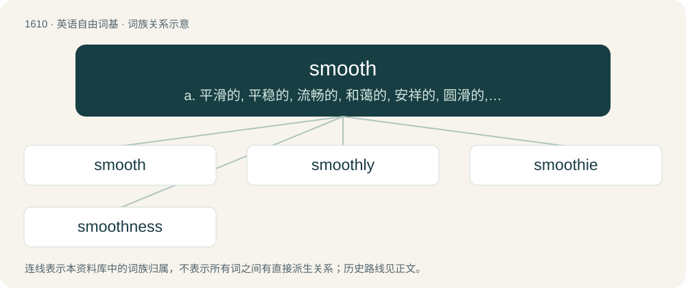

# 1707 · smooth — a. 平滑的, 平稳的, 流畅的, 和蔼的, 安祥的, 圆滑的, 调匀的, 无毛的；vt. 使光滑, 烫平, 使平和, 消除；vi. 变平滑, 变平静

[总目录](../00_总目录_按常用程度.md)

**类型**：英语自由词基　｜　**来源语言**：见词源记录

## 核心含义与来源

- 核心含义：a. 平滑的, 平稳的, 流畅的, 和蔼的, 安祥的, 圆滑的, 调匀的, 无毛的；vt. 使光滑, 烫平, 使平和, 消除；vi. 变平滑, 变平静
- 英文含义：Having a texture that lacks friction. Not rough.
- 词形：smooth

**来源记录 1**（形容词；Having a texture that lacks friction. Not rough.）

From Middle English smothe, smethe, from Old English smēþe, smōþ, both from Proto-West Germanic \*smanþī, of unknown origin. Cognate with Scots smuith (“smooth”), Saterland Frisian smoud (“smooth”), Low German smood and smödig (“smooth, malleable, ductile”), Dutch smeuïg (“smooth”) (from earlier smeudig).

## 词族图

## 单词速览（常用到不常用）

| 单词 | 音标 | 释义 |
|---|---|---|
| [smooth](#w-1) | /smuːð/ | a. 平滑的, 平稳的, 流畅的, 和蔼的, 安祥的, 圆滑的, 调匀的, 无毛的；vt. 使光滑, 烫平, 使平和, 消除；vi. 变平滑, 变平静 |
| [smoothly](#w-2) | /ˈsmuːðli/ | adv. 平滑地, 流畅地, 流利地 |
| [smoothie](#w-3) | /ˈsmuːði/ | n. 举止优雅的人, 善于奉承的人, 油嘴滑舌的人 |
| [smoothness](#w-4) | /ˈsmuːðnis/ | n. 柔滑, 平滑, 平坦；\[化\] 平稳性; 平稳度 |

## 逐词详解

### 1. smooth

**词性**：形容词　｜　**音标**：/smuːð/

**中文释义**：a. 平滑的, 平稳的, 流畅的, 和蔼的, 安祥的, 圆滑的, 调匀的, 无毛的；vt. 使光滑, 烫平, 使平和, 消除；vi. 变平滑, 变平静

**英文义项**：Having a texture that lacks friction. Not rough. / Without difficulty, problems, or unexpected consequences or incidents.

**词源与演化**：

From Middle English smothe, smethe, from Old English smēþe, smōþ, both from Proto-West Germanic \*smanþī, of unknown origin. Cognate with Scots smuith (“smooth”), Saterland Frisian smoud (“smooth”), Low German smood and smödig (“smooth, malleable, ductile”), Dutch smeuïg (“smooth”) (from earlier smeudig).

**例句**：

> We hope for a smooth transition to the new system.

该用例对应义项：Without difficulty, problems, or unexpected consequences or incidents.

### 2. smoothly

**词性**：副词　｜　**音标**：/ˈsmuːðli/

**中文释义**：adv. 平滑地, 流畅地, 流利地

**英文义项**：in a smooth manner; smooth

**构词拆分**：smooth + -ly

**词源与演化**：

From Middle English smoþely; equivalent to smooth + -ly.

**例句**：

> The plans didn't go/run as smoothly as we'd hoped.

该用例对应义项：in a smooth manner; smooth

### 3. smoothie

**词性**：名词　｜　**音标**：/ˈsmuːði/

**中文释义**：n. 举止优雅的人, 善于奉承的人, 油嘴滑舌的人

**英文义项**：A smooth-talking person. / A drink made from whole fruit, thus thicker than fruit juice.

**构词拆分**：smooth + -ie

**词源与演化**：

From smooth + -ie.

**例句**：

> My favorite smoothie is one made with green tea, frozen raspberries and blueberries.

### 4. smoothness

**词性**：名词　｜　**音标**：/ˈsmuːðnis/

**中文释义**：n. 柔滑, 平滑, 平坦；\[化\] 平稳性; 平稳度

**英文义项**：The condition of being smooth; the degree or measure of said condition. / The highest order of derivative (the differentiability class) over a given domain.

**构词拆分**：smooth + -ness

**词源与演化**：

From Middle English smothenesse; equivalent to smooth + -ness. Compare Old English smēþnes (“smoothness, a smooth place, a level surface”).

**例句**：

> Smoothness can vary from 0 (for a nondifferentiable function) to infinity (for a smooth function).

该用例对应义项：The highest order of derivative (the differentiability class) over a given domain.
