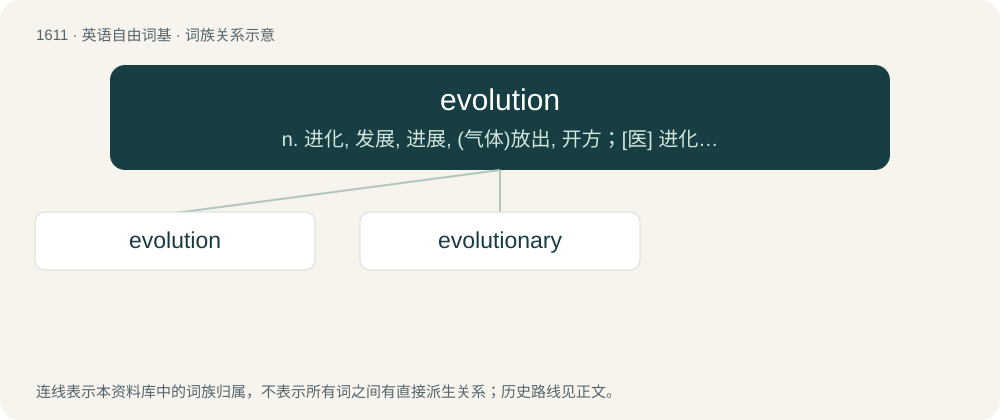

# 1708 · evolution — n. 进化, 发展, 进展, (气体)放出, 开方；\[医\] 进化, 演化, 旋出

[总目录](../00_总目录_按常用程度.md)

**类型**：英语自由词基　｜　**来源语言**：见词源记录

## 核心含义与来源

- 核心含义：n. 进化, 发展, 进展, (气体)放出, 开方；\[医\] 进化, 演化, 旋出
- 英文含义：A manoeuvre of troops or ships.
- 词形：evolution

**来源记录 1**（名词；A manoeuvre of troops or ships.）

Borrowed from Latin ēvolūtiō, ēvolūtiōnis (“the act of unrolling, unfolding or opening (of a book)”), from ēvolūtus, perfect passive participle of ēvolvō (“unroll, unfold”), from ex + volvō (“roll”). Compare typologically Czech vývoj, Serbo-Croatian развој, Russian разви́ть (razvítʹ), развива́ть (razvivátʹ), разви́ться (razvítʹsja), развива́ться (razvivátʹsja), Russian разви́тие (razvítije), related to Proto-Slavic \*viti (whence Czech vít, Russian вить (vitʹ)).

## 词族图

## 单词速览（常用到不常用）

| 单词 | 音标 | 释义 |
|---|---|---|
| [evolution](#w-1) | 英 /ˌiːvəˈluːʃ(ə)n/；美 /ˌɛvəˈluʃ(ə)n/ | n. 进化, 发展, 进展, (气体)放出, 开方；\[医\] 进化, 演化, 旋出 |
| [evolutionary](#w-2) | 英 /ˌiː.vəˈl(j)uː.ʃən.ɹi/；美 /ˌiː.vəˈluː.ʃən.ɛɹ.i/ | a. 展开的, 进化论的, 进化的, 发展的；\[计\] 进化的, 改良的, 发展的 |

## 逐词详解

### 1. evolution

**词性**：名词　｜　**音标**：英 /ˌiːvəˈluːʃ(ə)n/；美 /ˌɛvəˈluʃ(ə)n/

**中文释义**：n. 进化, 发展, 进展, (气体)放出, 开方；\[医\] 进化, 演化, 旋出

**英文义项**：A manoeuvre of troops or ships. / A turning movement, especially of the body.

**词源与演化**：

Borrowed from Latin ēvolūtiō, ēvolūtiōnis (“the act of unrolling, unfolding or opening (of a book)”), from ēvolūtus, perfect passive participle of ēvolvō (“unroll, unfold”), from ex + volvō (“roll”). Compare typologically Czech vývoj, Serbo-Croatian развој, Russian разви́ть (razvítʹ), развива́ть (razvivátʹ), разви́ться (razvítʹsja), развива́ться (razvivátʹsja), Russian разви́тие (razvítije), related to Proto-Slavic \*viti (whence Czech vít, Russian вить (vitʹ)).

**例句**：

> The ongoing evolution of Lolita subculture fashion includes, among other things, the ballet style.

该用例对应义项：Development; the act or result of developing what was implicit in an idea, argument etc.

### 2. evolutionary

**词性**：形容词　｜　**音标**：英 /ˌiː.vəˈl(j)uː.ʃən.ɹi/；美 /ˌiː.vəˈluː.ʃən.ɛɹ.i/

**中文释义**：a. 展开的, 进化论的, 进化的, 发展的；\[计\] 进化的, 改良的, 发展的

**英文义项**：Of or relating to the biological theory of evolution. / Having formal similarities to the biological theory of evolution.

**构词拆分**：evolution + -ary

**词源与演化**：

From evolution + -ary.

**例句**：

> The evolutionary history of marine mammals includes land-dwelling ancestors.

该用例对应义项：Of or relating to the biological theory of evolution.
