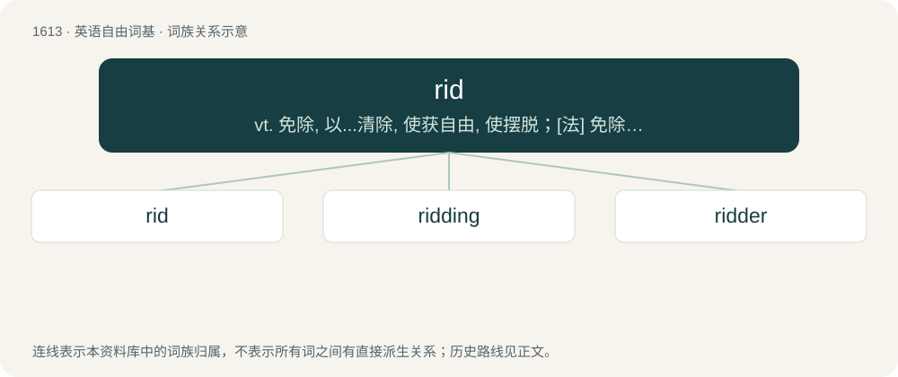

# 1709 · rid — vt. 免除, 以...清除, 使获自由, 使摆脱；\[法\] 免除, 清除, 摆脱

[总目录](../00_总目录_按常用程度.md)

**类型**：英语自由词基　｜　**来源语言**：见词源记录

## 核心含义与来源

- 核心含义：vt. 免除, 以...清除, 使获自由, 使摆脱；\[法\] 免除, 清除, 摆脱
- 英文含义：Followed by of: to free (oneself or someone, or a place) from an annoyance or hindrance.
- 词形：rid

**来源记录 1**（动词；Followed by of: to free (oneself or someone, or a place) from an annoyance or hindrance.）

The verb is derived from Middle English ridden (“to remove debris, obstructions, etc., from (a place), to clear; to complete (something unfinished); to free (someone or something); to relieve (someone); etc.”), probably from Old English \*ryddan (“to remove debris, obstructions, etc., from (a place), to clear”) (the past participle form ġeryd is attested), from Proto-Germanic \*riudijaną (“to clear”), from Proto-Indo-European \*Hrewdʰ- (“to clear land”), or possibly from \*Hrew- (“to dig out, tear out; to open; to acquire”). The verb was probably also influenced by the following: \* Middle English redden (“to rescue (someone), deliver, save; to rid (someone) of a burden; to free (someone)”) (from which redd (obsolete except Northern England, Scotland) is partly derived), from Old English hreddan (“to deliver, rescue, save; to free; to recover; to take away”), from Proto-West Germanic \*hraddjan (“to rescue, save”), from Proto-Germanic \*hradjaną (“to rescue, save; to free; to loosen”), possibly ultimately from Proto-Indo-European \*kret- (“to move quickly; to rattle; to shake”); and \* Middle English reden (“to arrange; to get ready, prepare; to put in order, tidy; to remove debris, obstructions, etc., from (a place), to clear; to unblock; etc.”) (whence rede (chiefly Scotland, archaic)), from Old English rǣdan, Early Old English rēdan, from Proto-West Germanic \*raidijan (“to arrange”), from Proto-Germanic \*raidijaną (“to arrange”), ultimately from Proto-Indo-European \*h₂rey- (“to arrange; to count, count out”). The adjective is derived from rid, the past participle of the verb. The noun is derived from the verb. As regards noun etymology 1, noun sense 1 (“progress which has been made; speed”), compare verb etymology 1, verb sense 1.4.5 (“to complete or get through (a task, or work)”). cognates \* Dutch redden (“to save, deliver”) \* German retten (“to save, deliver”), reuten (“to clear”), roden (“to clear”) \* Old Frisian hredda (“to save”) \* Old Norse hrōðja (“to clear, strip”), Old Norse ryðja (“to clear, empty”)

## 词族图

## 单词速览（常用到不常用）

| 单词 | 音标 | 释义 |
|---|---|---|
| [rid](#w-1) | 英 /ɹɪd/ | vt. 免除, 以...清除, 使获自由, 使摆脱；\[法\] 免除, 清除, 摆脱 |
| [ridding](#w-2) | /ridɪŋ/ | v. 使摆脱, 解除…的负担, 从…中清除( rid的现在分词 ); 摆脱, 丢弃, 扔掉 |
| [ridder](#w-3) |  | 【英文】One who, or that which, rids. |

## 逐词详解

### 1. rid

**词性**：动词　｜　**音标**：英 /ɹɪd/

**中文释义**：vt. 免除, 以...清除, 使获自由, 使摆脱；\[法\] 免除, 清除, 摆脱

**英文义项**：Followed by of: to free (oneself or someone, or a place) from an annoyance or hindrance. / Followed by away, from, or out of: to remove (oneself or someone, or something, that is annoying, troublesome, or unwanted).

**词源与演化**：

The verb is derived from Middle English ridden (“to remove debris, obstructions, etc., from (a place), to clear; to complete (something unfinished); to free (someone or something); to relieve (someone); etc.”), probably from Old English \*ryddan (“to remove debris, obstructions, etc., from (a place), to clear”) (the past participle form ġeryd is attested), from Proto-Germanic \*riudijaną (“to clear”), from Proto-Indo-European \*Hrewdʰ- (“to clear land”), or possibly from \*Hrew- (“to dig out, tear out; to open; to acquire”). The verb was probably also influenced by the following: \* Middle English redden (“to rescue (someone), deliver, save; to rid (someone) of a burden; to free (someone)”) (from which redd (obsolete except Northern England, Scotland) is partly derived), from Old English hreddan (“to deliver, rescue, save; to free; to recover; to take away”), from Proto-West Germanic \*hraddjan (“to rescue, save”), from Proto-Germanic \*hradjaną (“to rescue, save; to free; to loosen”), possibly ultimately from Proto-Indo-European \*kret- (“to move quickly; to rattle; to shake”); and \* Middle English reden (“to arrange; to get ready, prepare; to put in order, tidy; to remove debris, obstructions, etc., from (a place), to clear; to unblock; etc.”) (whence rede (chiefly Scotland, archaic)), from Old English rǣdan, Early Old English rēdan, from Proto-West Germanic \*raidijan (“to arrange”), from Proto-Germanic \*raidijaną (“to arrange”), ultimately from Proto-Indo-European \*h₂rey- (“to arrange; to count, count out”). The adjective is derived from rid, the past participle of the verb. The noun is derived from the verb. As regards noun etymology 1, noun sense 1 (“progress which has been made; speed”), compare verb etymology 1, verb sense 1.4.5 (“to complete or get through (a task, or work)”). cognates \* Dutch redden (“to save, deliver”) \* German retten (“to save, deliver”), reuten (“to clear”), roden (“to clear”) \* Old Frisian hredda (“to save”) \* Old Norse hrōðja (“to clear, strip”), Old Norse ryðja (“to clear, empty”)

**例句**：

> I’m glad to be rid of that stupid nickname.

该用例对应义项：Followed by of: to free (oneself or someone, or a place) from an annoyance or hindrance.

### 2. ridding

**词性**：名词　｜　**音标**：/ridɪŋ/

**中文释义**：v. 使摆脱, 解除…的负担, 从…中清除( rid的现在分词 ); 摆脱, 丢弃, 扔掉

**英文义项**：an area of land which has been cleared of trees, an assart

**构词拆分**：rid + -ing

**词源与演化**：

From Middle English riddyng, reddyng, ryddyng, rudyng, from Old English hryding (“a clearing, a patch of cleared land”), equivalent to rid + -ing.

### 3. ridder

**词性**：名词

**英文义项**：One who, or that which, rids.

**构词拆分**：From rid + -er.

**词源与演化**：

From rid + -er.
