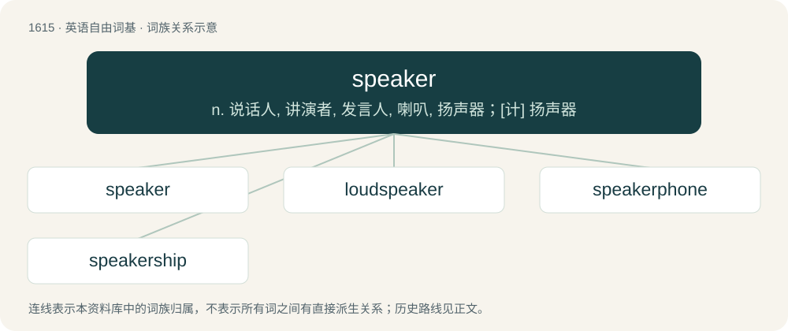

# 1712 · speaker — n. 说话人, 讲演者, 发言人, 喇叭, 扬声器；\[计\] 扬声器

[总目录](../00_总目录_按常用程度.md)

**类型**：英语自由词基　｜　**来源语言**：见词源记录

## 核心含义与来源

- 核心含义：n. 说话人, 讲演者, 发言人, 喇叭, 扬声器；\[计\] 扬声器
- 英文含义：One who speaks.
- 词形：speaker

**来源记录 1**（名词；One who speaks.）

From Middle English speker, spekere, an alteration (with change of suffix) of Old English speca, spreca (“speaker”), from Proto-Germanic \*sprekô (“speaker”), equivalent to speak + -er. Compare Saterland Frisian Spreeker (“speaker”), West Frisian sprekker (“speaker”), Dutch spreker (“speaker”), German Low German Spreker (“speaker”), German Sprecher (“speaker”).

## 词族图

## 单词速览（常用到不常用）

| 单词 | 音标 | 释义 |
|---|---|---|
| [speaker](#w-1) | 英 /ˈspiːkə/；美 /ˈspikɚ/ | n. 说话人, 讲演者, 发言人, 喇叭, 扬声器；\[计\] 扬声器 |
| [loudspeaker](#w-2) | 英 /laʊdˈspiːkə/；美 /ˈlaʊdspiːkɚ/ | n. 扩音器, 喇叭；\[电\] 扬声器 |
| [speakerphone](#w-3) | 英 /ˈspiːkəˌfəʊn/；美 /ˈspikɚˌfoʊn/ | n. 扬声电话 |
| [speakership](#w-4) | /ˈspiːkəʃip/ | n. 议长的职位；\[法\] 议长的职务, 议长的任期 |

## 逐词详解

### 1. speaker

**词性**：名词　｜　**音标**：英 /ˈspiːkə/；美 /ˈspikɚ/

**中文释义**：n. 说话人, 讲演者, 发言人, 喇叭, 扬声器；\[计\] 扬声器

**英文义项**：One who speaks. / Loudspeaker.

**构词拆分**：speak + -er

**词源与演化**：

From Middle English speker, spekere, an alteration (with change of suffix) of Old English speca, spreca (“speaker”), from Proto-Germanic \*sprekô (“speaker”), equivalent to speak + -er. Compare Saterland Frisian Spreeker (“speaker”), West Frisian sprekker (“speaker”), Dutch spreker (“speaker”), German Low German Spreker (“speaker”), German Sprecher (“speaker”).

**例句**：

> She lost her hearing after standing too close to the speaker at the festival.

该用例对应义项：Loudspeaker.

### 2. loudspeaker

**词性**：名词　｜　**音标**：英 /laʊdˈspiːkə/；美 /ˈlaʊdspiːkɚ/

**中文释义**：n. 扩音器, 喇叭；\[电\] 扬声器

**英文义项**：An electromechanical transducer that converts an electrical signal into audible sound. / Any such transducer that is loud, as opposed to quiet ones such as those found in headphones.

**构词拆分**：loud + speaker

**词源与演化**：

From loud + speaker.

**例句**：

> The police used a drone with a loudspeaker to disperse the crowd.

### 3. speakerphone

**词性**：名词　｜　**音标**：英 /ˈspiːkəˌfəʊn/；美 /ˈspikɚˌfoʊn/

**中文释义**：n. 扬声电话

**英文义项**：A telephone with a microphone and loudspeaker separate from those in the handset. / A loudspeaker on a telephone that broadcasts the sound, in order to use it hands-free.

**构词拆分**：speaker + phone

**词源与演化**：

From speaker + phone.

**例句**：

> Sami put the call on the speakerphone so that Layla could hear.

### 4. speakership

**词性**：名词　｜　**音标**：/ˈspiːkəʃip/

**中文释义**：n. 议长的职位；\[法\] 议长的职务, 议长的任期

**英文义项**：The position or tenure of the speaker of a legislative body.

**构词拆分**：speaker + -ship

**词源与演化**：

From speaker + -ship.
