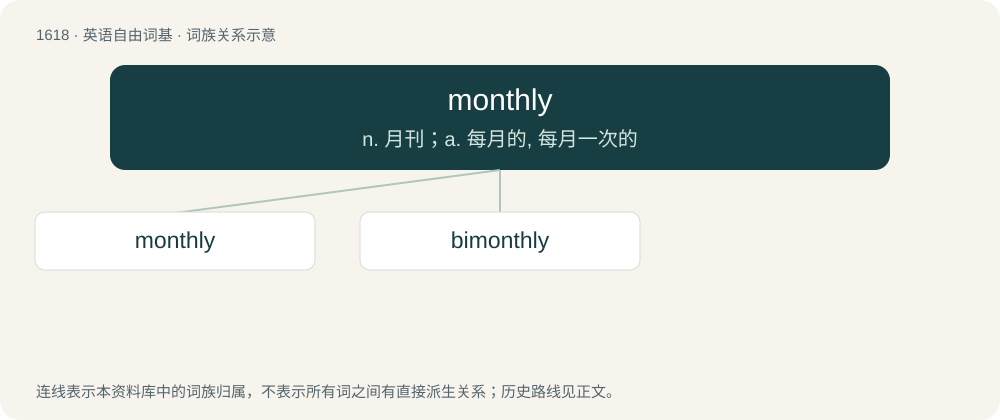

# 1713 · monthly — n. 月刊；a. 每月的, 每月一次的

[总目录](../00_总目录_按常用程度.md)

**类型**：英语自由词基　｜　**来源语言**：见词源记录

## 核心含义与来源

- 核心含义：n. 月刊；a. 每月的, 每月一次的
- 英文含义：Occurring every month.
- 词形：monthly

**多个词源／构词路径**：同一拼写可能有不同来源；以下按词性和含义分别列出。

**来源记录 1**（形容词；Occurring every month.）

From month + -ly (adjectival suffix), perhaps via Middle English \*monethly (attested only adverbially), from Old English mōnaþlīċ (“monthly”), from Proto-West Germanic \*mānōþlīk, from Proto-Germanic \*mēnōþlīkaz (“monthly”). Cognate with Saterland Frisian moundelk (“monthly”), German monatlich (“monthly”), Danish månedlig (“monthly”), Swedish månatlig (“monthly”), Norwegian Bokmål månedlig (“monthly”), Icelandic mánaðarlegur (“monthly”).

**来源记录 2**（副词；Every month.）

From Middle English monethly, equivalent to month + -ly (adverbial suffix). Cognate with Saterland Frisian moundelk (“monthly”), Dutch maandelijks (“monthly”), German monatlich (“monthly”), Swedish månatligen (“monthly”).

## 词族图

## 单词速览（常用到不常用）

| 单词 | 音标 | 释义 |
|---|---|---|
| [monthly](#w-1) | /ˈmʌnθli/ | n. 月刊；a. 每月的, 每月一次的 |
| [bimonthly](#w-2) | /.baiˈmʌnθli/ | a. 两月一次的, 每月两次的 |

## 逐词详解

### 1. monthly

**词性**：形容词　｜　**音标**：/ˈmʌnθli/

**中文释义**：n. 月刊；a. 每月的, 每月一次的

**英文义项**：Occurring every month.

**构词拆分**：month + -ly (adjectival suffix)

**词源与演化**：

From month + -ly (adjectival suffix), perhaps via Middle English \*monethly (attested only adverbially), from Old English mōnaþlīċ (“monthly”), from Proto-West Germanic \*mānōþlīk, from Proto-Germanic \*mēnōþlīkaz (“monthly”). Cognate with Saterland Frisian moundelk (“monthly”), German monatlich (“monthly”), Danish månedlig (“monthly”), Swedish månatlig (“monthly”), Norwegian Bokmål månedlig (“monthly”), Icelandic mánaðarlegur (“monthly”).

**例句**：

> It's time give the dog its monthly bath.

该用例对应义项：Occurring every month.

### 2. bimonthly

**词性**：形容词　｜　**音标**：/.baiˈmʌnθli/

**中文释义**：a. 两月一次的, 每月两次的

**英文义项**：Occurring once every two months / Occurring twice every month.

**构词拆分**：bi- + monthly

**词源与演化**：

From bi- + monthly.

**例句**：

> The organization's bimonthly meetings allow for two discussions each quarter.

该用例对应义项：Occurring once every two months
