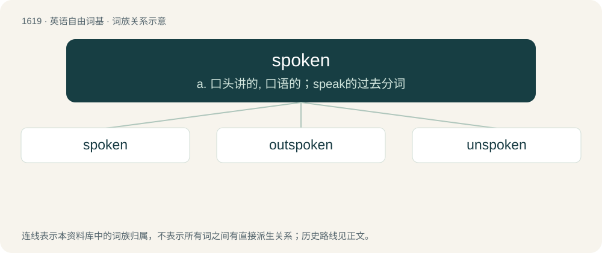

# 1714 · spoken — a. 口头讲的, 口语的；speak的过去分词

[总目录](../00_总目录_按常用程度.md)

**类型**：英语自由词基　｜　**来源语言**：见词源记录

## 核心含义与来源

- 核心含义：a. 口头讲的, 口语的；speak的过去分词
- 英文含义：Expressed in speech.
- 词形：spoken

**来源记录 1**（形容词；Expressed in speech.）

Morphologically spoke + -n.

## 词族图

## 单词速览（常用到不常用）

| 单词 | 音标 | 释义 |
|---|---|---|
| [spoken](#w-1) | 英 /ˈspəʊ.k(ə)n/；美 /ˈspoʊ.kən/ | a. 口头讲的, 口语的；speak的过去分词 |
| [outspoken](#w-2) | /.autˈspəukən/ | a. 直言无讳的, 坦率的, 坦白无隐的 |
| [unspoken](#w-3) | /ʌnˈspoʊkən/ | unspeak的过去分词 |

## 逐词详解

### 1. spoken

**词性**：形容词　｜　**音标**：英 /ˈspəʊ.k(ə)n/；美 /ˈspoʊ.kən/

**中文释义**：a. 口头讲的, 口语的；speak的过去分词

**英文义项**：Expressed in speech. / Speaking in a specified way.

**构词拆分**：spoke + -n

**词源与演化**：

Morphologically spoke + -n.

**用法示例／搭配（非完整句）**：

> soft-spoken

该用例对应义项：Speaking in a specified way.

### 2. outspoken

**词性**：形容词　｜　**音标**：/.autˈspəukən/

**中文释义**：a. 直言无讳的, 坦率的, 坦白无隐的

**英文义项**：Speaking, or spoken, freely, openly, or boldly; vocal; frank.

**构词拆分**：out- + spoken

**词源与演化**：

From outspeak, equivalent to out- + spoken.

**用法示例／搭配（非完整句）**：

> an outspoken rebuke

该用例对应义项：Speaking, or spoken, freely, openly, or boldly; vocal; frank.

### 3. unspoken

**词性**：形容词　｜　**音标**：/ʌnˈspoʊkən/

**中文释义**：unspeak的过去分词

**英文义项**：Not spoken; not said. / Not formally articulated or stated; implicit or understood.

**构词拆分**：un- + spoken

**词源与演化**：

From un- + spoken.

**例句**：

> The unspoken rule is to start a new pot of coffee when it is empty.

该用例对应义项：Not formally articulated or stated; implicit or understood.
