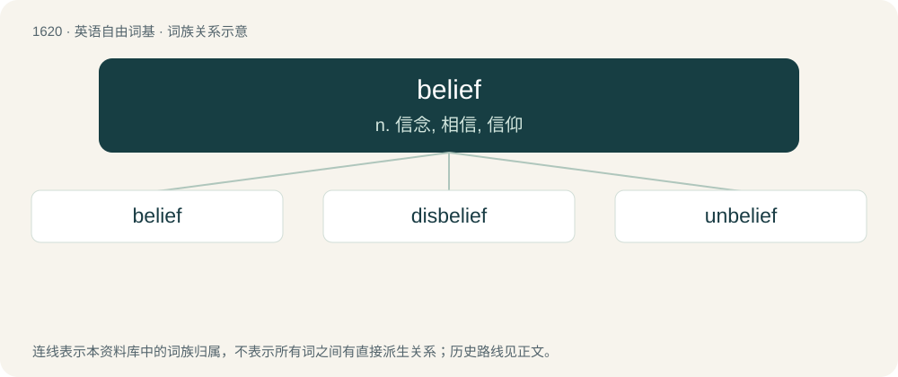

# 1715 · belief — n. 信念, 相信, 信仰

[总目录](../00_总目录_按常用程度.md)

**类型**：英语自由词基　｜　**来源语言**：见词源记录

## 核心含义与来源

- 核心含义：n. 信念, 相信, 信仰
- 英文含义：Mental acceptance of a claim as true.
- 词形：belief

**来源记录 1**（名词；Mental acceptance of a claim as true.）

From Middle English bileve, from Old English lēafa, from Proto-West Germanic \*laubu from Proto-Germanic \*laubō. Compare German Glaube (“faith, belief”). The replacement of final /v/ with /f/ is due to the analogy of noun-verb pairs with /f/ in the noun but /v/ in the verb, creating a pair belief : believe on the model of e.g. grief : grieve or proof : prove.

## 词族图

## 单词速览（常用到不常用）

| 单词 | 音标 | 释义 |
|---|---|---|
| [belief](#w-1) | /bɪˈliːf/ | n. 信念, 相信, 信仰 |
| [disbelief](#w-2) | 英 /dɪsbɪˈliːf/ | n. 不信, 怀疑 |
| [unbelief](#w-3) | 英 /ʌnbɪˈliːf/ | n. 不信, 疑惑, 不信仰 |

## 逐词详解

### 1. belief

**词性**：名词　｜　**音标**：/bɪˈliːf/

**中文释义**：n. 信念, 相信, 信仰

**英文义项**：Mental acceptance of a claim as true. / Faith or trust in the reality of something; often based upon one's own reasoning, trust in a claim, desire of actuality, and/or evidence considered.

**词源与演化**：

From Middle English bileve, from Old English lēafa, from Proto-West Germanic \*laubu from Proto-Germanic \*laubō. Compare German Glaube (“faith, belief”). The replacement of final /v/ with /f/ is due to the analogy of noun-verb pairs with /f/ in the noun but /v/ in the verb, creating a pair belief : believe on the model of e.g. grief : grieve or proof : prove.

**例句**：

> She often said it was her belief that carried her through the hard times.

该用例对应义项：Religious faith.

### 2. disbelief

**词性**：名词　｜　**音标**：英 /dɪsbɪˈliːf/

**中文释义**：n. 不信, 怀疑

**英文义项**：An unpreparedness, unwillingness, or an inability to believe that something is the case. / Astonishment.

**构词拆分**：dis- + belief

**词源与演化**：

From dis- + belief.

**例句**：

> She cried out in disbelief on hearing that terrorists had crashed an airplane into the World Trade Center in New York City.

该用例对应义项：An unpreparedness, unwillingness, or an inability to believe that something is the case.

### 3. unbelief

**词性**：名词　｜　**音标**：英 /ʌnbɪˈliːf/

**中文释义**：n. 不信, 疑惑, 不信仰

**英文义项**：An absence (or rejection) of belief, especially religious belief.

**构词拆分**：un- + belief

**词源与演化**：

From Middle English unbilefe, unbileve, equivalent to un- + belief.

**例句**：

> And Jesus wondered because of their unbelief, and he went through the villages round about teaching.
