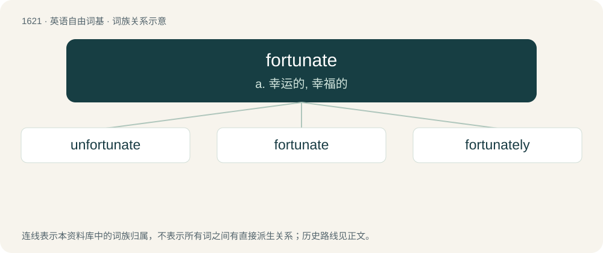

# 1716 · fortunate — a. 幸运的, 幸福的

[总目录](../00_总目录_按常用程度.md)

**类型**：英语自由词基　｜　**来源语言**：见词源记录

## 核心含义与来源

- 核心含义：a. 幸运的, 幸福的
- 英文含义：Auspicious.
- 词形：fortunate

**来源记录 1**（形容词；Auspicious.）

From Middle English fortunat(e) (“fortunate”), from Latin fortūnātus, from fortūna (“fortune, luck”) + -ātus (adjective-forming suffix), see -ate (adjective-forming suffix). See also Middle English fortunaten (“to assure the success (of), make fortunate”); cognate with French fortuné (“lucky”). By surface analysis, fortune + -ate.

## 词族图

## 单词速览（常用到不常用）

| 单词 | 音标 | 释义 |
|---|---|---|
| [unfortunate](#w-1) | 英 /ʌnˈfɔː.t͡ʃə.nɪt/；美 /ʌnˈfɔɹ.t͡ʃə.nɪt/ | a. 不幸的, 不合适的, 不吉利的 |
| [fortunate](#w-2) | 英 /ˈfɔː.t͡ʃə.nɪt/；美 /ˈfɔɹ.t͡ʃə.nɪt/ | a. 幸运的, 幸福的 |
| [fortunately](#w-3) | 英 /ˈfɔː.t͡ʃə.nɪt.li/；美 /ˈfɔɹ.t͡ʃə.nɪt.li/ | adv. 幸运地, 幸亏 |

## 逐词详解

### 1. unfortunate

**词性**：形容词　｜　**音标**：英 /ʌnˈfɔː.t͡ʃə.nɪt/；美 /ʌnˈfɔɹ.t͡ʃə.nɪt/

**中文释义**：a. 不幸的, 不合适的, 不吉利的

**英文义项**：Not favored by fortune. / Marked or accompanied by or resulting in misfortune.

**构词拆分**：un- + fortunate

**词源与演化**：

From un- + fortunate, doublet of infortunate.

**例句**：

> An unfortunate turn of events.

该用例对应义项：not favored by fortune; marked or accompanied by or resulting in ill fortune

### 2. fortunate

**词性**：形容词　｜　**音标**：英 /ˈfɔː.t͡ʃə.nɪt/；美 /ˈfɔɹ.t͡ʃə.nɪt/

**中文释义**：a. 幸运的, 幸福的

**英文义项**：Auspicious. / Happening by good luck or favorable chance.

**词源与演化**：

From Middle English fortunat(e) (“fortunate”), from Latin fortūnātus, from fortūna (“fortune, luck”) + -ātus (adjective-forming suffix), see -ate (adjective-forming suffix). See also Middle English fortunaten (“to assure the success (of), make fortunate”); cognate with French fortuné (“lucky”). By surface analysis, fortune + -ate.

**例句**：

> Patrick was the unlikely match-winner as Berkeley earned a fortunate victory over Chisolm.

该用例对应义项：Happening by good luck or favorable chance.

### 3. fortunately

**词性**：副词　｜　**音标**：英 /ˈfɔː.t͡ʃə.nɪt.li/；美 /ˈfɔɹ.t͡ʃə.nɪt.li/

**中文释义**：adv. 幸运地, 幸亏

**英文义项**：In a fortunate manner. / It is (or was, etc) fortunate that.

**构词拆分**：fortunate + -ly

**词源与演化**：

From fortunate + -ly.

**例句**：

> My mom has fortunately agreed to help us with the science project for school.

该用例对应义项：It is (or was, etc) fortunate that.
