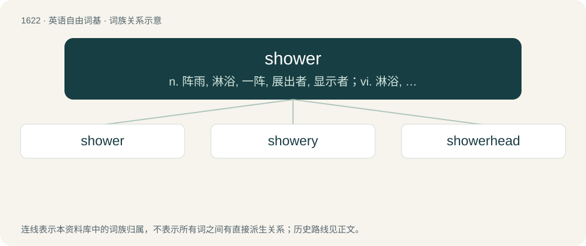

# 1717 · shower — n. 阵雨, 淋浴, 一阵, 展出者, 显示者；vi. 淋浴, 下阵雨；vt. 淋湿, 倾注

[总目录](../00_总目录_按常用程度.md)

**类型**：英语自由词基　｜　**来源语言**：见词源记录

## 核心含义与来源

- 核心含义：n. 阵雨, 淋浴, 一阵, 展出者, 显示者；vi. 淋浴, 下阵雨；vt. 淋湿, 倾注
- 英文含义：A brief fall of precipitation (spell of rain, or a similar fall of snow, sleet, or cascade); burst of hefty precipitation.
- 词形：shower

**多个词源／构词路径**：同一拼写可能有不同来源；以下按词性和含义分别列出。

**来源记录 1**（名词；A brief fall of precipitation (spell of rain, or a similar fall of snow, sleet, or cascade); burst of hefty precipitation.）

From Middle English schour (“shower”), from Old English sċūr (“shower”), from Proto-West Germanic \*skūru (“shower”), from Proto-Germanic \*skūrō (“storm, short shower”), probably from Proto-Indo-European \*(s)ḱēwer- (“north, north wind, cold wind, rain shower”). Cognates Cognate with Dutch schoer (“downpour, heavy rainshower”), German Schauer (“shower”), Danish, Norwegian, and Swedish skur (“shower”), Faroese skúrur (“shower”), Icelandic skúr (“shower”), Norn skur (“squall”), Gothic 𐍃𐌺𐌿𐍂𐌰 (skūra, “storm”), Italian coro (“northwestern wind”), Spanish cauro (“northwestern wind”), Belarusian се́вер (sjévjer), сі́вер (sívjer), Bulgarian and Russian се́вер (séver, “north”), Czech and Slovak sever (“north”), Macedonian север (sever, “north”), Serbo-Croatian sȅvēr, sjȅvēr (“north”), Slovene sẹ́ver (“north”), Ukrainian сі́вер (síver, “cold, cold, bitter wind”).

**来源记录 2**（名词；One who shows.）

Inherited from Middle English schewere, schewer, shewere (“one who exhibits something, actor; watchman; sign; mirror; index finger”), from Old English sċēawere (“an observer, one who examines into a matter; a spy; mirror; actor, buffoon”), equivalent to show + -er. Cognate with Dutch schouwer (“observer, visionary, clairvoyant”), German Schauer (“an inspector”).

## 词族图

## 单词速览（常用到不常用）

| 单词 | 音标 | 释义 |
|---|---|---|
| [shower](#w-1) | 英 /ˈʃaʊ.ə(ɹ)/；美 /ˈʃaʊ.ɚ/ | n. 阵雨, 淋浴, 一阵, 展出者, 显示者；vi. 淋浴, 下阵雨；vt. 淋湿, 倾注 |
| [showery](#w-2) | 英 /ˈʃaʊəɹi/ | a. 阵雨的 |
| [showerhead](#w-3) | /ˈʃaʊəhed/ | n. 淋喷头, 莲蓬头 |

## 逐词详解

### 1. shower

**词性**：名词　｜　**音标**：英 /ˈʃaʊ.ə(ɹ)/；美 /ˈʃaʊ.ɚ/

**中文释义**：n. 阵雨, 淋浴, 一阵, 展出者, 显示者；vi. 淋浴, 下阵雨；vt. 淋湿, 倾注

**英文义项**：A brief fall of precipitation (spell of rain, or a similar fall of snow, sleet, or cascade); burst of hefty precipitation. / A device for bathing by which water is made to fall on the body from a height, either from a tank or by the action of a pump.

**词源与演化**：

From Middle English schour (“shower”), from Old English sċūr (“shower”), from Proto-West Germanic \*skūru (“shower”), from Proto-Germanic \*skūrō (“storm, short shower”), probably from Proto-Indo-European \*(s)ḱēwer- (“north, north wind, cold wind, rain shower”). Cognates Cognate with Dutch schoer (“downpour, heavy rainshower”), German Schauer (“shower”), Danish, Norwegian, and Swedish skur (“shower”), Faroese skúrur (“shower”), Icelandic skúr (“shower”), Norn skur (“squall”), Gothic 𐍃𐌺𐌿𐍂𐌰 (skūra, “storm”), Italian coro (“northwestern wind”), Spanish cauro (“northwestern wind”), Belarusian се́вер (sjévjer), сі́вер (sívjer), Bulgarian and Russian се́вер (séver, “north”), Czech and Slovak sever (“north”), Macedonian север (sever, “north”), Serbo-Croatian sȅvēr, sjȅvēr (“north”), Slovene sẹ́ver (“north”), Ukrainian сі́вер (síver, “cold, cold, bitter wind”).

**例句**：

> Today there will be frequent showers and some sunny spells.

该用例对应义项：A brief fall of precipitation (spell of rain, or a similar fall of snow, sleet, or cascade); burst of hefty precipitation.

### 2. showery

**词性**：形容词　｜　**音标**：英 /ˈʃaʊəɹi/

**中文释义**：a. 阵雨的

**英文义项**：Given to showers; having frequent rainfall. / Of or relating to a shower or showers.

**构词拆分**：shower + -y

**词源与演化**：

From shower + -y.

**例句**：

> Today will be another showery, stormy day, with hail and snow mixed in at times.

### 3. showerhead

**词性**：名词　｜　**音标**：/ˈʃaʊəhed/

**中文释义**：n. 淋喷头, 莲蓬头

**英文义项**：A perforated nozzle that showers water on a bather, sometimes in adjustable patterns. / A part of a coffeemaker for dispersing water evenly over the grounds.

**构词拆分**：shower + head

**词源与演化**：

From shower + head.

**例句**：

> The water suddenly stopped spraying from the showerhead.
