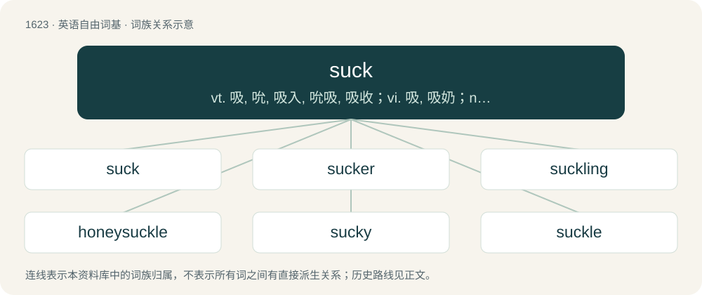

# 1718 · suck — vt. 吸, 吮, 吸入, 吮吸, 吸收；vi. 吸, 吸奶；n. 吸, 吸入, 吮吸

[总目录](../00_总目录_按常用程度.md)

**类型**：英语自由词基　｜　**来源语言**：见词源记录

## 核心含义与来源

- 核心含义：vt. 吸, 吮, 吸入, 吮吸, 吸收；vi. 吸, 吸奶；n. 吸, 吸入, 吮吸
- 英文含义：An instance of drawing something into one's lungs by inhaling or into one's mouth by suction.
- 词形：suck

**来源记录 1**（名词；An instance of drawing something into one's lungs by inhaling or into one's mouth by suction.）

From Middle English souken, suken, from Old English sūcan (“to suck”), from Proto-West Germanic \*sūkan, from Proto-Germanic \*sūkaną (“to suck, suckle”), from Proto-Indo-European \*sewg-, \*sewk- (“to suck”). Cognate with Scots souke (“to suck”), obsolete Dutch zuiken (“to suck”), Limburgish zuken, zoeken (“to suck”). Akin also to Old English sūgan (“to suck”), West Frisian sûge, sûge (“to suck”), Dutch zuigen (“to suck”), German saugen (“to suck”), Danish and Norwegian Bokmål suge (“to suck”), Norwegian Nynorsk and Swedish suga (“to suck”), Icelandic sjúga (“to suck”), Latin sūgō (“suck”), Welsh sugno (“suck”). Related to soak.

## 词族图

## 单词速览（常用到不常用）

| 单词 | 音标 | 释义 |
|---|---|---|
| [suck](#w-1) | 美 /sʌk/ | vt. 吸, 吮, 吸入, 吮吸, 吸收；vi. 吸, 吸奶；n. 吸, 吸入, 吮吸 |
| [sucker](#w-2) | 英 /ˈsʌk.ə/；美 /ˈsʌk.ɚ/ | n. 乳儿, 吸管；\[医\] 吸盘 |
| [suckling](#w-3) | /ˈsʌkliŋ/ | n. 乳儿, 乳臭未干的小子 |
| [honeysuckle](#w-4) | 英 /ˈhʌnɪsʌk(ə)l/；美 /ˈhʌn.i.sʌk.əl/ | n. 忍冬, 杜鹃花 |
| [sucky](#w-5) | /ˈsʌki/ | a. \[俚语\]令人不快的, 让人讨厌的 |
| [suckle](#w-6) | /ˈsʌk.əl/ | vt. 哺乳, 养育, 吮吸；\[医\] 哺乳 |

## 逐词详解

### 1. suck

**词性**：动词　｜　**音标**：美 /sʌk/

**中文释义**：vt. 吸, 吮, 吸入, 吮吸, 吸收；vi. 吸, 吸奶；n. 吸, 吸入, 吮吸

**英文义项**：To use the mouth and lips to pull in (a liquid, especially milk from the breast). / To perform such an action; to feed from a breast or teat.

**词源与演化**：

From Middle English souken, suken, from Old English sūcan (“to suck”), from Proto-West Germanic \*sūkan, from Proto-Germanic \*sūkaną (“to suck, suckle”), from Proto-Indo-European \*sewg-, \*sewk- (“to suck”). Cognate with Scots souke (“to suck”), obsolete Dutch zuiken (“to suck”), Limburgish zuken, zoeken (“to suck”). Akin also to Old English sūgan (“to suck”), West Frisian sûge, sûge (“to suck”), Dutch zuigen (“to suck”), German saugen (“to suck”), Danish and Norwegian Bokmål suge (“to suck”), Norwegian Nynorsk and Swedish suga (“to suck”), Icelandic sjúga (“to suck”), Latin sūgō (“suck”), Welsh sugno (“suck”). Related to soak.

**例句**：

> The baby sucked (milk) on her bottle.

该用例对应义项：To use the mouth and lips to pull in (a liquid, especially milk from the breast).

### 2. sucker

**词性**：名词　｜　**音标**：英 /ˈsʌk.ə/；美 /ˈsʌk.ɚ/

**中文释义**：n. 乳儿, 吸管；\[医\] 吸盘

**英文义项**：A person or animal that sucks, especially a breast or udder; especially a suckling animal, young mammal before it is weaned. / An undesired stem growing out of the roots or lower trunk of a shrub or tree, especially from the rootstock of a grafted plant or tree.

**构词拆分**：suck (verb) + -er

**词源与演化**：

From Middle English souker, sokere, sukkere, soukere, equivalent to suck (verb) + -er. Compare Saterland Frisian Suuger, West Frisian sûker (“sucker”), Dutch zuiger (“sucker”), German Sauger (“dummy; vacuum”).

**例句**：

> He must be a sucker for punishment to try to climb that mountain barefoot.

该用例对应义项：A person irresistibly attracted by something specified.

### 3. suckling

**词性**：名词　｜　**音标**：/ˈsʌkliŋ/

**中文释义**：n. 乳儿, 乳臭未干的小子

**英文义项**：An infant that is still being breastfed (being suckled) by its mother. / A young mammal not yet weaned and still being fed milk by its mother.

**构词拆分**：suck + -ling

**词源与演化**：

From Middle English sukling, sukeling, sokeling, equivalent to suck + -ling. Cognate with Middle Dutch sogelinc (“suckling”), Dutch zuigeling (“suckling”), German Säugling (“suckling”).

**例句**：

> The baby giraffe stood up and started suckling.

### 4. honeysuckle

**词性**：名词　｜　**音标**：英 /ˈhʌnɪsʌk(ə)l/；美 /ˈhʌn.i.sʌk.əl/

**中文释义**：n. 忍冬, 杜鹃花

**英文义项**：Any of the many species of arching shrubs and climbing vines of the genus Lonicera in the Caprifoliaceae family, many with sweet-smelling, bell-shaped flowers. / A light yellow color inspired by the color of honeysuckle blossoms.

**构词拆分**：honey + suck + -le；honeysuck + -le

**词源与演化**：

From Middle English honysokel, honisokel, honysocle, hunisuccle, perhaps an alteration of Middle English honysoke, honysouke (“honeysuckle”) (whence honeysuck), from Old English huniġsūce, huniġsūge (“honeysuckle”); equivalent to honey + suck + -le, or honeysuck + -le.

**例句**：

> The trellis was covered with honeysuckle.

### 5. sucky

**词性**：形容词　｜　**音标**：/ˈsʌki/

**中文释义**：a. \[俚语\]令人不快的, 让人讨厌的

**英文义项**：Suitable for sucking / Being something which sucks, which is unpleasant or inferior.

**构词拆分**：suck + -y

**词源与演化**：

From suck + -y.

**例句**：

> That comedian was pretty sucky on TV last night.

该用例对应义项：Being something which sucks, which is unpleasant or inferior.

### 6. suckle

**词性**：名词　｜　**音标**：/ˈsʌk.əl/

**中文释义**：vt. 哺乳, 养育, 吮吸；\[医\] 哺乳

**英文义项**：An act of suckling

**构词拆分**：suck + -le (frequentative suffix)

**词源与演化**：

From Middle English sukelen; probably a back-formation of Middle English sukeling (“a suckling; infant”), formally equivalent to suck + -le (frequentative suffix). See suckling.

**例句**：

> The baby was having a suckle at its mother's breast.

该用例对应义项：An act of suckling
