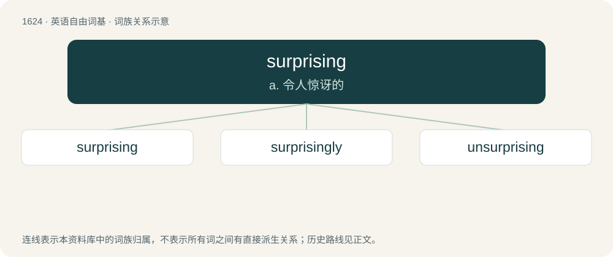

# 1719 · surprising — a. 令人惊讶的

[总目录](../00_总目录_按常用程度.md)

**类型**：英语自由词基　｜　**来源语言**：见词源记录

## 核心含义与来源

- 核心含义：a. 令人惊讶的
- 英文含义：Causing surprise.
- 词形：surprising

**来源记录 1**（形容词；Causing surprise.）

From surprise + -ing.

## 词族图

## 单词速览（常用到不常用）

| 单词 | 音标 | 释义 |
|---|---|---|
| [surprising](#w-1) | 英 /səˈpɹaɪzɪŋ/；美 /sɚˈpɹaɪzɪŋ/ | a. 令人惊讶的 |
| [surprisingly](#w-2) | /səˈpɹaɪzɪŋli/ | adv. 使人惊奇, 出人意外, 惊人, 令人惊讶 |
| [unsurprising](#w-3) | /ˌʌnsəˈpraɪzɪŋ/ | a. 不令人吃惊的 |

## 逐词详解

### 1. surprising

**词性**：形容词　｜　**音标**：英 /səˈpɹaɪzɪŋ/；美 /sɚˈpɹaɪzɪŋ/

**中文释义**：a. 令人惊讶的

**英文义项**：Causing surprise.

**构词拆分**：From surprise + -ing.

**词源与演化**：

From surprise + -ing.

**例句**：

> A surprising number of people attended the rally.

该用例对应义项：Causing surprise.

### 2. surprisingly

**词性**：副词　｜　**音标**：/səˈpɹaɪzɪŋli/

**中文释义**：adv. 使人惊奇, 出人意外, 惊人, 令人惊讶

**英文义项**：In a way that causes surprise because it is unexpected, or unusual.

**构词拆分**：surprising + -ly

**词源与演化**：

From surprising + -ly.

**例句**：

> Not surprisingly, the electrician didn't come at the time he had said.

该用例对应义项：In a way that causes surprise because it is unexpected, or unusual.

### 3. unsurprising

**词性**：形容词　｜　**音标**：/ˌʌnsəˈpraɪzɪŋ/

**中文释义**：a. 不令人吃惊的

**英文义项**：Not surprising; expected.

**构词拆分**：un- + surprising

**词源与演化**：

From un- + surprising.

**例句**：

> It's unsurprising that Yoko would have said something like that.
