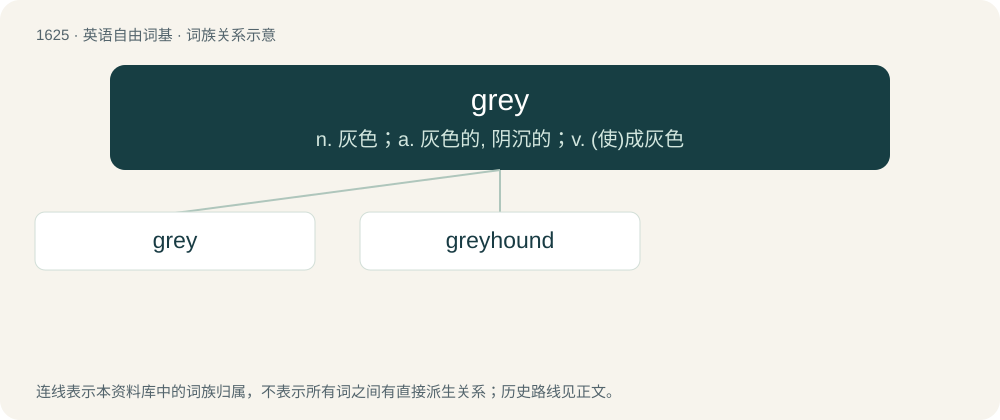

# 1721 · grey — n. 灰色；a. 灰色的, 阴沉的；v. (使)成灰色

[总目录](../00_总目录_按常用程度.md)

**类型**：英语自由词基　｜　**来源语言**：见词源记录

## 核心含义与来源

- 核心含义：n. 灰色；a. 灰色的, 阴沉的；v. (使)成灰色
- 英文含义：Commonwealth standard spelling of gray.
- 词形：grey

**来源记录 1**（形容词；Commonwealth standard spelling of gray.）

From Middle English grey, from Old English grēġ (Anglian). The spelling grey reflects the Anglian vowel development, whereas the variant gray stems from the West Saxon form grǣġ (through Middle English gray). Further derived from Proto-Germanic \*grēwaz (compare Dutch grauw, German grau, Old Norse grár), from Proto-Indo-European \*ǵʰreh₁- (“to green, to grow”) (compare Latin rāvus (“grey”), Old Church Slavonic зьрѭ (zĭrjǫ, “to see, to glance”), Russian зреть (zretʹ, “to watch, to look at”) (archaic), Lithuanian žeriù (“to shine”)).

## 词族图

## 单词速览（常用到不常用）

| 单词 | 音标 | 释义 |
|---|---|---|
| [grey](#w-1) | 英 /ɡɹeɪ/ | n. 灰色；a. 灰色的, 阴沉的；v. (使)成灰色 |
| [greyhound](#w-2) | /ˈɡɹeɪhaʊnd/ | n. 快速船 |

## 逐词详解

### 1. grey

**词性**：形容词　｜　**音标**：英 /ɡɹeɪ/

**中文释义**：n. 灰色；a. 灰色的, 阴沉的；v. (使)成灰色

**英文义项**：Commonwealth standard spelling of gray. / Synonym of coloured (pertaining to the mixed race of black and white).

**词源与演化**：

From Middle English grey, from Old English grēġ (Anglian). The spelling grey reflects the Anglian vowel development, whereas the variant gray stems from the West Saxon form grǣġ (through Middle English gray). Further derived from Proto-Germanic \*grēwaz (compare Dutch grauw, German grau, Old Norse grár), from Proto-Indo-European \*ǵʰreh₁- (“to green, to grow”) (compare Latin rāvus (“grey”), Old Church Slavonic зьрѭ (zĭrjǫ, “to see, to glance”), Russian зреть (zretʹ, “to watch, to look at”) (archaic), Lithuanian žeriù (“to shine”)).

**例句**：

> The little grey cells.

该用例对应义项：of an achromatic color of any lightness intermediate between the extremes of white and black

### 2. greyhound

**词性**：名词　｜　**音标**：/ˈɡɹeɪhaʊnd/

**中文释义**：n. 快速船

**英文义项**：A lean breed of dog used in hunting and racing. / A highball cocktail of vodka and grapefruit juice.

**构词拆分**：grey + hound

**词源与演化**：

From Old English grīġhund, from a cognate or borrowing of Old Norse grøy (“bitch”) (whence Icelandic grey, thus not related to the colour grey) plus hund (“hound”). Altered by folk etymology to appear to be grey + hound.

**例句**：

> Ziri's dog is a mix of a Greyhound and a Yellow Lab.
