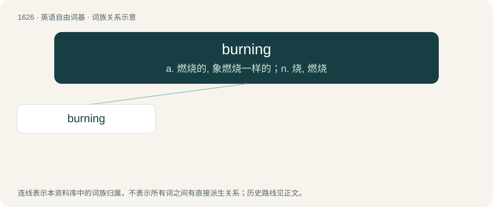

# 1722 · burning — a. 燃烧的, 象燃烧一样的；n. 烧, 燃烧

[总目录](../00_总目录_按常用程度.md)

**类型**：英语自由词基　｜　**来源语言**：见词源记录

## 核心含义与来源

- 核心含义：a. 燃烧的, 象燃烧一样的；n. 烧, 燃烧
- 英文含义：So hot as to seem to burn (something).
- 词形：burning

**来源记录 1**（形容词；So hot as to seem to burn (something).）

By surface analysis, burn + -ing.

## 词族图

## 单词速览（常用到不常用）

| 单词 | 音标 | 释义 |
|---|---|---|
| [burning](#w-1) | 英 /ˈbɜːnɪŋ/；美 /ˈbɝnɪŋ/ | a. 燃烧的, 象燃烧一样的；n. 烧, 燃烧 |

## 逐词详解

### 1. burning

**词性**：形容词　｜　**音标**：英 /ˈbɜːnɪŋ/；美 /ˈbɝnɪŋ/

**中文释义**：a. 燃烧的, 象燃烧一样的；n. 烧, 燃烧

**英文义项**：So hot as to seem to burn (something). / Feeling very hot.

**词源与演化**：

By surface analysis, burn + -ing.

**用法示例／搭配（非完整句）**：

> a burning question; a burning issue

该用例对应义项：Being keenly discussed.
