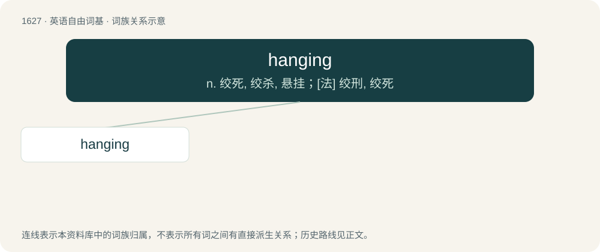

# 1723 · hanging — n. 绞死, 绞杀, 悬挂；\[法\] 绞刑, 绞死

[总目录](../00_总目录_按常用程度.md)

**类型**：英语自由词基　｜　**来源语言**：见词源记录

## 核心含义与来源

- 核心含义：n. 绞死, 绞杀, 悬挂；\[法\] 绞刑, 绞死
- 英文含义：Suspended.
- 词形：hanging

**多个词源／构词路径**：同一拼写可能有不同来源；以下按词性和含义分别列出。

**来源记录 1**（形容词；Suspended.）

See the etymology of the corresponding lemma form.

**来源记录 2**（名词；The act of hanging a person (or oneself) by the neck in order to kill that person (or to commit suicide).）

From Middle English hangynge, honginge, equivalent to hang + -ing. Compare Old English hengen (“hanging”) and hōhing (“hanging”).

## 词族图

## 单词速览（常用到不常用）

| 单词 | 音标 | 释义 |
|---|---|---|
| [hanging](#w-1) | 英 /ˈhæŋɪŋ/；美 /hæŋɪŋ/ | n. 绞死, 绞杀, 悬挂；\[法\] 绞刑, 绞死 |

## 逐词详解

### 1. hanging

**词性**：形容词　｜　**音标**：英 /ˈhæŋɪŋ/；美 /hæŋɪŋ/

**中文释义**：n. 绞死, 绞杀, 悬挂；\[法\] 绞刑, 绞死

**英文义项**：Suspended. / Unprotected and exposed to capture.

**词源与演化**：

See the etymology of the corresponding lemma form.

**例句**：

> The hanging vines made the house look older than it was.

该用例对应义项：Suspended.
