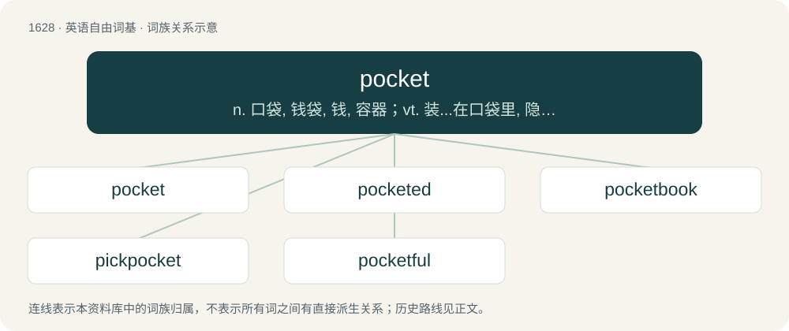

# 1724 · pocket — n. 口袋, 钱袋, 钱, 容器；vt. 装...在口袋里, 隐藏, 抑制, 私吞, 搁置, 击...入袋；a. 袖珍的, 小型的, 压缩的, 金钱上的

[总目录](../00_总目录_按常用程度.md)

**类型**：英语自由词基　｜　**来源语言**：见词源记录

## 核心含义与来源

- 核心含义：n. 口袋, 钱袋, 钱, 容器；vt. 装...在口袋里, 隐藏, 抑制, 私吞, 搁置, 击...入袋；a. 袖珍的, 小型的, 压缩的, 金钱上的
- 英文含义：A bag stitched to an item of clothing, used for carrying small items.
- 词形：pocket

**来源记录 1**（名词；A bag stitched to an item of clothing, used for carrying small items.）

From Middle English pocket (“bag, sack”), from Anglo-Norman poket, Old Northern French poquet, poquete, diminutive of poque, poke (“bag, sack”) (compare modern Norman pouquette and modern French pochette from Old French pochete, from puche), from Frankish \*pokō (“pouch”), from Proto-Germanic \*puhô (“bag; pouch”), from Proto-Indo-European \*bew- (“to blow, swell”). Equivalent to poke + -et. Doublet of pochette. Cognate with Middle Dutch poke, Alemannic German Pfoch (“purse, bag”), Old English pocca, pohha (“poke, pouch, pocket, bag”), Old Norse poki (“bag, pocket”). Compare the related poke (“sack or bag”). See also Modern French pochette and Latin bucca.

## 词族图

## 单词速览（常用到不常用）

| 单词 | 音标 | 释义 |
|---|---|---|
| [pocket](#w-1) | 英 /ˈpɒk.ɪt/；美 /ˈpɑ.kɪt/ | n. 口袋, 钱袋, 钱, 容器；vt. 装...在口袋里, 隐藏, 抑制, 私吞, 搁置, 击...入袋；a. 袖珍的, 小型的, 压缩的, 金钱上的 |
| [pocketed](#w-2) | /ˈpɔkitid/ | \[体\]运动员被挤在人群里 |
| [pocketbook](#w-3) | 英 /ˈpɒ.kɪt.bʊk/；美 /ˈpɑ.kɪtˌbʊk/ | n. 笔记本, 钱袋, 皮夹, 经济来源 |
| [pickpocket](#w-4) | 英 /ˈpɪkpɒkɪt/ | n. 扒手；\[法\] 扒手 |
| [pocketful](#w-5) |  | n. 一口袋(的容量) |

## 逐词详解

### 1. pocket

**词性**：名词　｜　**音标**：英 /ˈpɒk.ɪt/；美 /ˈpɑ.kɪt/

**中文释义**：n. 口袋, 钱袋, 钱, 容器；vt. 装...在口袋里, 隐藏, 抑制, 私吞, 搁置, 击...入袋；a. 袖珍的, 小型的, 压缩的, 金钱上的

**英文义项**：A bag stitched to an item of clothing, used for carrying small items. / A person's financial resources.

**构词拆分**：poke + -et

**词源与演化**：

From Middle English pocket (“bag, sack”), from Anglo-Norman poket, Old Northern French poquet, poquete, diminutive of poque, poke (“bag, sack”) (compare modern Norman pouquette and modern French pochette from Old French pochete, from puche), from Frankish \*pokō (“pouch”), from Proto-Germanic \*puhô (“bag; pouch”), from Proto-Indo-European \*bew- (“to blow, swell”). Equivalent to poke + -et. Doublet of pochette. Cognate with Middle Dutch poke, Alemannic German Pfoch (“purse, bag”), Old English pocca, pohha (“poke, pouch, pocket, bag”), Old Norse poki (“bag, pocket”). Compare the related poke (“sack or bag”). See also Modern French pochette and Latin bucca.

**例句**：

> The drilling expedition discovered a pocket of natural gas.

该用例对应义项：An enclosed volume of one substance surrounded by another.

### 2. pocketed

**词性**：形容词　｜　**音标**：/ˈpɔkitid/

**中文释义**：\[体\]运动员被挤在人群里

**英文义项**：Having a pocket; with pockets. / Having a certain type or number of pockets.

**构词拆分**：pocket + -ed

**词源与演化**：

From pocket + -ed.

**用法示例／搭配（非完整句）**：

> two-pocketed

该用例对应义项：Having a certain type or number of pockets.

### 3. pocketbook

**词性**：名词　｜　**音标**：英 /ˈpɒ.kɪt.bʊk/；美 /ˈpɑ.kɪtˌbʊk/

**中文释义**：n. 笔记本, 钱袋, 皮夹, 经济来源

**英文义项**：A purse or handbag. / A wallet for paper money.

**构词拆分**：pocket + book

**词源与演化**：

1610s, from pocket + book, popularized in its sense as a paperback by the success of Pocket Books in the United States after its 1939 launch.

**例句**：

> The publishers brought out small format pocketbooks of the whole of their nature series.

该用例对应义项：A small book, particularly (US) a paperback or (UK) notebook able to fit into a pocket (of any genre, from reference work to fine art).

### 4. pickpocket

**词性**：名词　｜　**音标**：英 /ˈpɪkpɒkɪt/

**中文释义**：n. 扒手；\[法\] 扒手

**英文义项**：One who steals from the pocket of a passerby, usually by sleight of hand.

**构词拆分**：pick + pocket

**词源与演化**：

From pick + pocket.

**例句**：

> The only one who enjoys a crowded subway car is a pickpocket.

### 5. pocketful

**词性**：名词

**中文释义**：n. 一口袋(的容量)

**英文义项**：The amount that a pocket would hold. / A small or moderate amount.

**构词拆分**：pocket + -ful

**词源与演化**：

From pocket + -ful.

**例句**：

> It will cost you only a pocketful of change.
