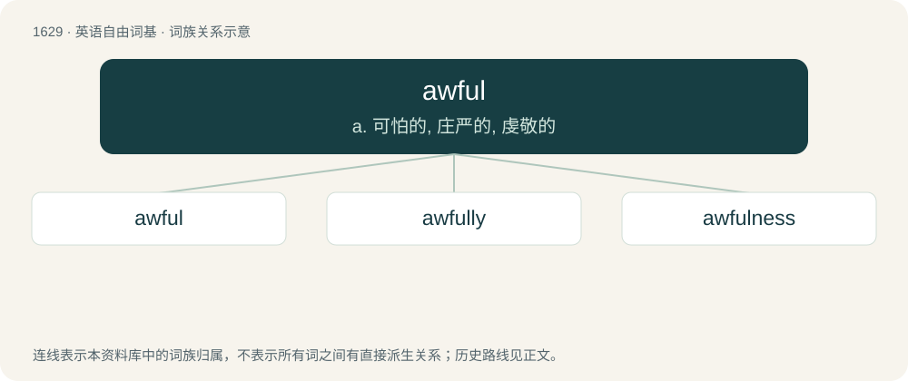

# 1725 · awful — a. 可怕的, 庄严的, 虔敬的

[总目录](../00_总目录_按常用程度.md)

**类型**：英语自由词基　｜　**来源语言**：见词源记录

## 核心含义与来源

- 核心含义：a. 可怕的, 庄严的, 虔敬的
- 英文含义：Very bad.
- 词形：awful

**来源记录 1**（形容词；Very bad.）

From Middle English agheful, awfull, auful, aȝefull, equivalent to awe + -ful. Compare Old English eġeful, eġefull (“terrifying; awful”). The “very bad” sense is a pejorative semantic shift from the original sense of “awe-inspiring”.

## 词族图

## 单词速览（常用到不常用）

| 单词 | 音标 | 释义 |
|---|---|---|
| [awful](#w-1) | 英 /ˈɔːfʊl/；/ˈɔfəl/ | a. 可怕的, 庄严的, 虔敬的 |
| [awfully](#w-2) | 英 /ˈɔː.fʊ.li/；美 /ˈɔ.f(ə.)li/ | adv. 恶劣地, 非常地, 极端地 |
| [awfulness](#w-3) | /ˈɒːfulnis/ | n. 庄严, 可怕, 虔敬 |

## 逐词详解

### 1. awful

**词性**：形容词　｜　**音标**：英 /ˈɔːfʊl/；/ˈɔfəl/

**中文释义**：a. 可怕的, 庄严的, 虔敬的

**英文义项**：Very bad. / Exceedingly great; usually applied intensively.

**构词拆分**：awe + -ful

**词源与演化**：

From Middle English agheful, awfull, auful, aȝefull, equivalent to awe + -ful. Compare Old English eġeful, eġefull (“terrifying; awful”). The “very bad” sense is a pejorative semantic shift from the original sense of “awe-inspiring”.

**例句**：

> We saw such an awful film last night that we left the theater before the end.

该用例对应义项：Very bad.

### 2. awfully

**词性**：副词　｜　**音标**：英 /ˈɔː.fʊ.li/；美 /ˈɔ.f(ə.)li/

**中文释义**：adv. 恶劣地, 非常地, 极端地

**英文义项**：Badly, terribly. / Very; exceedingly; extremely; excessively.

**构词拆分**：awful + -ly

**词源与演化**：

From awful + -ly.

**例句**：

> She led after the swimming and cycling, but ran awfully and came in fourth.

该用例对应义项：Badly, terribly.

### 3. awfulness

**词性**：名词　｜　**音标**：/ˈɒːfulnis/

**中文释义**：n. 庄严, 可怕, 虔敬

**英文义项**：The state or quality of being awful. / The quality of striking with awe, or with reverence

**构词拆分**：awful + -ness

**词源与演化**：

From Middle English aghfulnesse, equivalent to awful + -ness.
