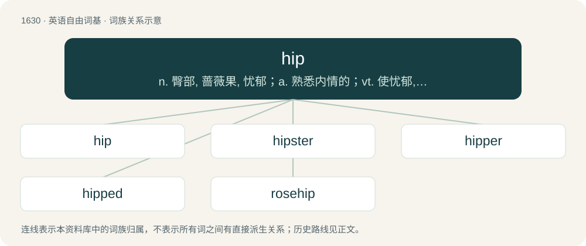

# 1726 · hip — n. 臀部, 蔷薇果, 忧郁；a. 熟悉内情的；vt. 使忧郁, 给(屋顶)造屋脊

[总目录](../00_总目录_按常用程度.md)

**类型**：英语自由词基　｜　**来源语言**：见词源记录

## 核心含义与来源

- 核心含义：n. 臀部, 蔷薇果, 忧郁；a. 熟悉内情的；vt. 使忧郁, 给(屋顶)造屋脊
- 英文含义：The outward-projecting parts of the pelvis and top of the femur and the overlying tissue.
- 词形：hip

**多个词源／构词路径**：同一拼写可能有不同来源；以下按词性和含义分别列出。

**来源记录 1**（名词；The outward-projecting parts of the pelvis and top of the femur and the overlying tissue.）

From Middle English hipe, hupe, from Old English hype, from Proto-Germanic \*hupiz (compare Dutch heup, Low German Huop, German Hüfte), from Proto-Indo-European \*ḱewb- (compare Welsh cysgu (“to sleep”), Latin cubāre (“to lie”), Ancient Greek κύβος (kúbos, “hollow in the hips”), Albanian sup (“shoulder”), Sanskrit शुप्ति (śúpti, “shoulder”)), from \*ḱew- (“to bend”). More at high. The sense "drug addict" derives from addicts lying on their hips while using certain drugs such as opium.

**来源记录 2**（名词；The fruit of a rose.）

From Middle English hepe, heppe, hipe, from Old English hēope, from Proto-Germanic \*heupǭ (compare Dutch joop, German Hiefe, Faroese hjúpa), from Proto-Indo-European \*ḱewb- (“briar, thorn”) (compare Old Prussian kaāubri (“thorn”), Lithuanian kaubrė̃ (“heap”)).

**来源记录 3**（形容词；Aware, informed, up-to-date, trendy.）

Unknown or disputed. Probably a variant of hep; both forms are attested from the first decade of the 20th century. Some sources suggest derivation from Wolof hepi (“to see”) or hipi (“to open one’s eyes”). Others suggest connection to the noun, as opium smokers were said to lie on a hip. Neither of these suggestions is widely accepted, however.

## 词族图

## 单词速览（常用到不常用）

| 单词 | 音标 | 释义 |
|---|---|---|
| [hip](#w-1) | /hɪp/ | n. 臀部, 蔷薇果, 忧郁；a. 熟悉内情的；vt. 使忧郁, 给(屋顶)造屋脊 |
| [hipster](#w-2) | 英 /ˈhɪp.stə/；美 /ˈhɪp.stɚ/ | n. 世面灵通的人 |
| [hipper](#w-3) | 英 /ˈhɪpə/；美 /ˈhɪpɚ/ | (hip 的比较级) n. 臀部, 蔷薇果, 忧郁；a. 熟悉内情的；vt. 使忧郁, 给(屋顶)造屋脊 |
| [hipped](#w-4) | /hipt/ | a. 沮丧的, 生气的, 抑郁的, 着迷的；\[医\] 臀骨折的(马) |
| [rosehip](#w-5) | 英 /ˈɹəʊzˌhɪp/；美 /ˈɹoʊzˌhɪp/ | n. 玫瑰果；蔷薇果 |

## 逐词详解

### 1. hip

**词性**：名词　｜　**音标**：/hɪp/

**中文释义**：n. 臀部, 蔷薇果, 忧郁；a. 熟悉内情的；vt. 使忧郁, 给(屋顶)造屋脊

**英文义项**：The outward-projecting parts of the pelvis and top of the femur and the overlying tissue. / The inclined external angle formed by the intersection of two sloping roof planes.

**词源与演化**：

From Middle English hipe, hupe, from Old English hype, from Proto-Germanic \*hupiz (compare Dutch heup, Low German Huop, German Hüfte), from Proto-Indo-European \*ḱewb- (compare Welsh cysgu (“to sleep”), Latin cubāre (“to lie”), Ancient Greek κύβος (kúbos, “hollow in the hips”), Albanian sup (“shoulder”), Sanskrit शुप्ति (śúpti, “shoulder”)), from \*ḱew- (“to bend”). More at high. The sense "drug addict" derives from addicts lying on their hips while using certain drugs such as opium.

**例句**：

> When I had surgery on my hip, I had an out-of-body experience.

### 2. hipster

**词性**：名词　｜　**音标**：英 /ˈhɪp.stə/；美 /ˈhɪp.stɚ/

**中文释义**：n. 世面灵通的人

**英文义项**：A person who is hip, being keenly interested in the latest trends or fashions. / A person who rejects mainstream culture; an anti-conformist.

**构词拆分**：hip + -ster

**词源与演化**：

From hip + -ster. First attested for someone carrying something on their hip in the U.S. in the 1920s. Attested as a variant of hepster in the 1940s, for a follower of the latest fashions/trends/styles.

**例句**：

> The magazine declares a new king of hipster "music" every two weeks.

### 3. hipper

**词性**：名词　｜　**音标**：英 /ˈhɪpə/；美 /ˈhɪpɚ/

**中文释义**：(hip 的比较级) n. 臀部, 蔷薇果, 忧郁；a. 熟悉内情的；vt. 使忧郁, 给(屋顶)造屋脊

**英文义项**：A hip boot.

**构词拆分**：From hip + -er.

**词源与演化**：

From hip + -er.

### 4. hipped

**词性**：形容词　｜　**音标**：/hipt/

**中文释义**：a. 沮丧的, 生气的, 抑郁的, 着迷的；\[医\] 臀骨折的(马)

**英文义项**：Having hips or a feature resembling hips. / Having hips of a specific kind.

**构词拆分**：hip + -ed

**词源与演化**：

From hip (anatomy sense) + -ed.

**用法示例／搭配（非完整句）**：

> a wide-hipped woman

该用例对应义项：Having hips of a specific kind.

### 5. rosehip

**词性**：名词　｜　**音标**：英 /ˈɹəʊzˌhɪp/；美 /ˈɹoʊzˌhɪp/

**中文释义**：n. 玫瑰果；蔷薇果

**英文义项**：The fleshy false fruit of a wild rose plant (e.g. sweetbrier, dog rose, burnet rose, etc.), containing the achenes or true fruits.

**构词拆分**：rose + hip

**词源与演化**：

From rose + hip.
