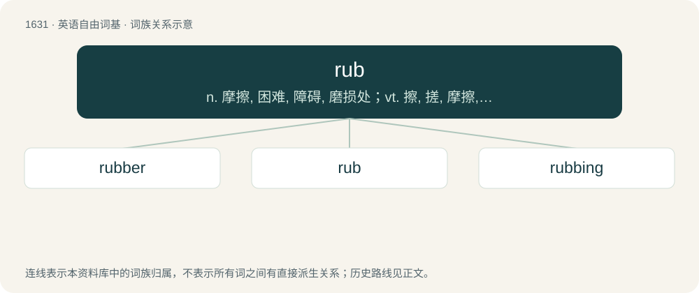

# 1728 · rub — n. 摩擦, 困难, 障碍, 磨损处；vt. 擦, 搓, 摩擦, 惹怒；vi. 摩擦, 擦破

[总目录](../00_总目录_按常用程度.md)

**类型**：英语自由词基　｜　**来源语言**：见词源记录

## 核心含义与来源

- 核心含义：n. 摩擦, 困难, 障碍, 磨损处；vt. 擦, 搓, 摩擦, 惹怒；vi. 摩擦, 擦破
- 英文含义：An act of rubbing.
- 词形：rub

**来源记录 1**（名词；An act of rubbing.）

Inherited from Middle English rubben, of unknown origin; possibly ultimately from Proto-Germanic \*rubbōną, related to \*reufaną (“to tear”). Cognate with Saterland Frisian rubje (“to rub, scrape”), German Low German rubben (“to rub”), Low German rubblig (“rough, uneven”), Dutch robben, rubben (“to rub smooth; scrape; scrub”), Danish rubbe (“to rub, scrub”), Icelandic and Norwegian rubba (“to scrape”). More at reave. Compare typologically Latin fricō &lt; friō &lt; Proto-Indo-European \*bʰreyH- (whence also Russian брить (britʹ, “to shave”)).

## 词族图

## 单词速览（常用到不常用）

| 单词 | 音标 | 释义 |
|---|---|---|
| [rubber](#w-1) | 英 /ˈɹʌbə/；美 /ˈɹʌbɚ/ | n. 橡皮, 橡胶, 做摩擦动作的人, 按摩师, 决胜盘；vt. 用橡胶制造, 涂橡胶于 |
| [rub](#w-2) | 英 /ɹʌb/ | n. 摩擦, 困难, 障碍, 磨损处；vt. 擦, 搓, 摩擦, 惹怒；vi. 摩擦, 擦破 |
| [rubbing](#w-3) | /ˈɹʌbɪŋ/ | n. 摩擦, 研磨, 摹拓；\[化\] 打磨 |

## 逐词详解

### 1. rubber

**词性**：名词　｜　**音标**：英 /ˈɹʌbə/；美 /ˈɹʌbɚ/

**中文释义**：n. 橡皮, 橡胶, 做摩擦动作的人, 按摩师, 决胜盘；vt. 用橡胶制造, 涂橡胶于

**英文义项**：Pliable material derived from the sap of the rubber tree; a hydrocarbon biopolymer of isoprene. / Natural rubber or any of various synthetic materials with similar properties as natural rubber.

**构词拆分**：rub + -er

**词源与演化**：

From rub + -er. The sense of the substance comes from its ability to function as an eraser, displacing earlier caoutchouc. The senses not pertaining to rubbing or erasing are secondarily derived from the name of the substance.

**例句**：

> Jones toes the rubber and then fires to the plate.

该用例对应义项：The rectangular pad on the pitcher's mound from which the pitcher must pitch.

### 2. rub

**词性**：名词　｜　**音标**：英 /ɹʌb/

**中文释义**：n. 摩擦, 困难, 障碍, 磨损处；vt. 擦, 搓, 摩擦, 惹怒；vi. 摩擦, 擦破

**英文义项**：An act of rubbing. / A difficulty or problem.

**词源与演化**：

Inherited from Middle English rubben, of unknown origin; possibly ultimately from Proto-Germanic \*rubbōną, related to \*reufaną (“to tear”). Cognate with Saterland Frisian rubje (“to rub, scrape”), German Low German rubben (“to rub”), Low German rubblig (“rough, uneven”), Dutch robben, rubben (“to rub smooth; scrape; scrub”), Danish rubbe (“to rub, scrub”), Icelandic and Norwegian rubba (“to scrape”). More at reave. Compare typologically Latin fricō &lt; friō &lt; Proto-Indo-European \*bʰreyH- (whence also Russian брить (britʹ, “to shave”)).

**例句**：

> Give that lamp a good rub and see if any genies come out.

该用例对应义项：An act of rubbing.

### 3. rubbing

**词性**：名词　｜　**音标**：/ˈɹʌbɪŋ/

**中文释义**：n. 摩擦, 研磨, 摹拓；\[化\] 打磨

**英文义项**：An impression of an embossed or incised surface made by placing a piece of paper over it and rubbing with graphite, crayon or other coloring agent.

**构词拆分**：rub + -ing

**词源与演化**：

From Middle English rubbinge, rubbynge, equivalent to rub + -ing.

**例句**：

> Cut that out. You're just rubbing salt in the poor guy's wounds.
