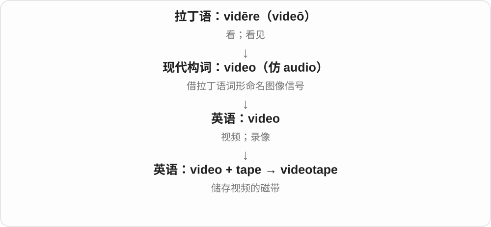
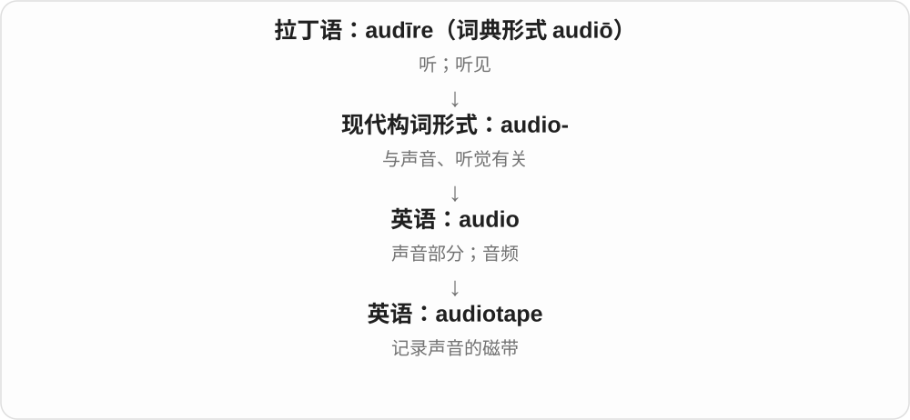

# 1730 · tape — 狭长带状物及胶粘、记录；taper 常用义另源

[逐词精讲目录](../00_逐词精讲目录.md) · [总目录](../00_总目录_按常用程度.md)

## 核心词根与来源

把用途和形态分开，扩展就好懂。尤其 taper 的拼写看似 tape 加 r，最常用的渐细义却不是录制者。

**TAPE：同一条带，能粘、能量、也能记录**

tape → mixtape、videotape、audiotape；tapeworm 取带状外形；taper 渐细义另走蜡烛、火焰形状线。

- **基本带状材料及录制**：tape · mixtape · videotape · audiotape
- **动物外形**：tapeworm
- **同形分路：渐细**：taper
- **tape 的物件、黏贴与录制形式**：tape · tapes · taped · taping

## 词形与演化规律

tæppa → tape；mix/video/audio + tape；tape + worm；古英语 tapor 蜡烛旧词 → taper，与 tape 另分来路。

带状物名称扩大为胶带、录音录像带；相关动词按对象选择。

## 单词速览（按词族由简到繁）

同一基础词的相关扩展放在一起，先读基础形式，再读扩展；各组之间优先读常用的。具体词源关系见各词讲解。

| 单词 | 音标 | 核心意思 |
|---|---|---|
| [tape](#w-1) | /teɪp/ | 带子、胶带、磁带；用胶带粘；录音录像 |
| [tapes](#w-7) | /teɪps/ | 录音带、录像带；不同胶带等〔复数〕；黏贴、录制〔第三人称单数〕 |
| [taped](#w-8) | /teɪpt/ | 用胶带贴了、固定了；录制了、录下的 |
| [taper](#w-3) | 英 /ˈteɪpə/；美 /ˈteɪpər/ | 逐渐变细、减少；细蜡烛；锥度 |
| [taping](#w-9) | /ˈteɪpɪŋ/ | 正在用胶带固定；录制、录制过程 |
| [tapeworm](#w-5) | 英 /ˈteɪpwɜːm/；美 /ˈteɪpwɜːrm/ | 绦虫 |
| [mixtape](#w-2) | /ˈmɪksteɪp/ | 自选混录曲集；以混音带名义发行的音乐作品 |
| [videotape](#w-4) | 英 /ˈvɪdiəʊteɪp/；美 /ˈvɪdioʊteɪp/ | 录像带；用录像带录制 |
| [audiotape](#w-6) | 英 /ˈɔːdiəʊteɪp/；美 /ˈɑːdioʊteɪp/ | 录音磁带；磁带录音 |

## 逐词讲解

### 1. tape — 带子、胶带、磁带；用胶带粘；录音录像

**音标**：/teɪp/

**先抓住这个画面**

一条长而窄的柔性材料：一面有胶能粘，覆磁性材料能记录，带刻度又能量长度。先抓带状，再选用途。

**怎么拆**

接古英语 tæppa 等带子词，具体更早来源不清。胶带、录制介质都是旧带状物名称的新用途，tape 作动词跟着相应器物义走。

**怎么变成今天的意思**

**古英语 tæppa/tæppe → 中古英语 tape**  
狭长的带子、带状材料

↓

**英语 tape**  
胶带、磁带；用胶带粘、录音录像

adhesive tape 胶带，magnetic tape 磁带，a tape measure 卷尺，tape the box shut 用胶带封箱；tape a show 录节目。

**常见搭配与例句**

adhesive tape；magnetic tape；a tape measure；tape the box shut。

> She taped the box shut.

她用胶带把箱子封好。

> He found an old tape of the concert.

他找到了那场音乐会的一盒旧录音带。

**别混淆**

tape 不都带胶，也不都装在盒里；record 录制不限定磁带，现代 tape 作录制动词有时仍保留旧名称。

### 2. tapes — 录音带、录像带；不同胶带等〔复数〕；黏贴、录制〔第三人称单数〕

**音标**：/teɪps/

**先抓住这个画面**

长长一条带状物，可以用来黏东西，也能在旧介质上记录声音、影像，形成 tapes 的不同常用场景。

**怎么拆**

tape 承古英语 tæppa 等带状物名，后来扩大到胶带、记录介质，并形成相应动词。现代加 -s，/p/ 后读 /s/。

**怎么变成今天的意思**

**古英语带状物材料 → tape**  
胶带、录制用带等新用途

↓

**tape + -s → tapes；相关动词**  
多份记录带、胶带种类；某人黏贴、录制

old video tapes 旧录像带；adhesive tapes 胶带种类；tapes the interview 录下采访。

**常见搭配与例句**

tapes the label on 用胶带贴上标签；audio tapes 录音带。

> The box contained old video tapes.

盒子里装着旧录像带。

> She tapes a label onto each box.

她用胶带给每个箱子贴上标签。

**别混淆**

胶带材料常用不可数 tape，比较种类可用 tapes；一份份录音、录像介质则常可数。动词靠 label、interview 等对象选义。

### 3. taped — 用胶带贴了、固定了；录制了、录下的

**音标**：/teɪpt/

**先抓住这个画面**

一条胶带把两边贴住，是 taped；节目被记录下来，也可以说 taped。两个动作都沿 tape 的具体用途而来。

**怎么拆**

tape 的旧带状物名形成胶带、录制介质用法及相关动词；现代去 e 加完整 -ed，/p/ 后读 /t/。

**怎么变成今天的意思**

**带状物名 tape → 黏贴、记录动词**  
不同用途形成不同动作

↓

**tape 去 e + -ed → taped**  
过去贴了、录制了；相应结果

taped the box shut 用胶带封住箱子；a taped interview 录下的采访。

**常见搭配与例句**

taped to the wall 用胶带贴在墙上；taped the programme 录下节目。

> He taped the box shut.

他用胶带封上了箱子。

> The taped interview was kept in the archive.

录下的采访被保存在档案中。

**别混淆**

taped 描述黏贴还是录制，靠对象判断。录制用语也可保留在后来设备、技术语境中，不必每次都指正在用老式磁带。

### 4. taper — 逐渐变细、减少；细蜡烛；锥度

**音标**：英 /ˈteɪpə/；美 /ˈteɪpər/

**先抓住这个画面**

一支细长蜡烛，或火焰向上收成尖头；把这种慢慢收拢的轮廓搬到雨声、数量上，就成逐渐减弱。

**怎么拆**

常用渐细义接古英语 tapor 蜡烛、灯芯等旧词，具体更早来源不确定，不是 tape + -er。另有 tape + -er 指录制者，但不拿罕见人物义替常用渐细义作词源。

**怎么变成今天的意思**

**古英语 tapor → taper**  
蜡烛、灯芯，后尤指细蜡烛

↓

**形状比喻与动词**  
向尖端收拢 → 逐渐变细、减少

taper toward the end 向末端渐细，taper off 逐渐减弱、停止，tapered legs 渐细的桌椅腿。

**常见搭配与例句**

taper toward the end；taper off；tapered legs。

> The chair legs taper toward the floor.

椅子腿越靠近地面越细。

> The rain tapered off during the afternoon.

下午雨逐渐小了下来。

**别混淆**

taper 强调逐渐收小，cut 可突然截断；taper off 不等于已经完全停止，只看当前逐渐减弱过程。

### 5. taping — 正在用胶带固定；录制、录制过程

**音标**：/ˈteɪpɪŋ/

**先抓住这个画面**

手还在把胶带贴上去，或节目正在被记录，就是 taping。它把 tape 的用途写成进行中的工作。

**怎么拆**

tape 去 e 加完整 -ing，保留原来的长元音，不双写 p。相应过程名词与用途动词相连。

**怎么变成今天的意思**

**tape 的胶带、录制介质用法 → 相关动词**  
黏贴；记录声音、影像

↓

**tape 去 e + -ing → taping**  
正在黏贴、录制；过程活动

taping the box shut 正在用胶带封箱；a taping of the show 节目的一次录制。

**常见搭配与例句**

finish taping 完成贴胶带、录制；taping a label on 正在贴标签。

> She was taping a label onto the box.

她正在用胶带把标签贴到箱子上。

> The audience attended a taping of the show.

观众参加了节目的一次录制。

**别混淆**

a taping 把录制当作一次活动来数；is taping 写动作进行。与 taped 的已处理状态并读，就能区分过程和结果。

### 6. tapeworm — 绦虫

**音标**：英 /ˈteɪpwɜːm/；美 /ˈteɪpwɜːrm/

**先抓住这个画面**

身体扁长、像一条带子而得名的一类寄生虫；tape 描外形，不是吞了录音磁带。

**怎么拆**

tape 带状物 + worm 虫，按形态形成动物名。worm 在这种名称里比日常蚯蚓范围宽。

**怎么变成今天的意思**

**古英语 tæppa/tæppe → 中古英语 tape**  
狭长的带子、带状材料

↓

**英语 tape**  
胶带、磁带；用胶带粘、录音录像

↓

**tape + worm → tapeworm**  
像带子一样扁长的寄生虫

a tapeworm 绦虫，tapeworm segments 绦虫节片，the life cycle of a tapeworm 绦虫生活史。

**常见搭配与例句**

a tapeworm；tapeworm segments；the life cycle of a tapeworm。

> The diagram shows the segments of a tapeworm.

图示出了绦虫的节片。

> The students compared a tapeworm with an earthworm.

学生们比较了绦虫和蚯蚓。

**别混淆**

tapeworm 与 earthworm 蚯蚓是不同动物；名称中的 worm 只是宽泛虫类材料，不保证生物分类相同。

### 7. mixtape — 自选混录曲集；以混音带名义发行的音乐作品

**音标**：/ˈmɪksteɪp/

**先抓住这个画面**

把喜欢的歌按自己的顺序录到一盘带上，送人或传听；后来即使只发数字文件，也能沿用 mixtape 这个名字。

**怎么拆**

mix 混合、选编 + tape 磁带，早期也写 mix tape。音乐文化中的用法后来扩展，不要求有实体磁带，也不总是多位歌手的精选。

**怎么变成今天的意思**

**古英语 tæppa/tæppe → 中古英语 tape**  
狭长的带子、带状材料

↓

**英语 tape**  
胶带、磁带；用胶带粘、录音录像

↓

**mix + tape → mixtape**  
自制、选编的磁带曲集

↓

**数字和音乐发行扩展**  
仍叫 mixtape 的歌单、音乐项目

make a mixtape 做一份混录曲集，release a mixtape 发行一张 mixtape，a digital mixtape 数字混音曲集。

**常见搭配与例句**

make a mixtape；release a mixtape；a digital mixtape。

> He made a mixtape of songs from their road trip.

他把公路旅行时听的歌做成了一份混录曲集。

> The artist released the mixtape online.

这位音乐人在网上发布了这张 mixtape。

**别混淆**

mixtape 可是歌单式汇编，也可是艺人自己的音乐项目；album 专辑与它的边界依发行传统，不用有没有磁带作唯一判断。

### 8. videotape — 录像带；用录像带录制

**音标**：英 /ˈvɪdiəʊteɪp/；美 /ˈvɪdioʊteɪp/

**先抓住这个画面**

videotape 是把活动画面存进磁带，也可以指这盘磁带里的录像。

**怎么拆**

video + tape（磁带），现代英语组合。

**怎么变成今天的意思**

实体录像带曾是常见载体；今天数字录像常直接说 video。动词仍可见于保留旧习惯的表达。

**常见搭配与例句**

an old videotape；record on videotape；videotape a ceremony。

> We found a videotape of the school play.

我们找到了一盘学校话剧的录像带。

> My uncle videotaped the ceremony.

我叔叔录下了那场仪式。

**别混淆**

audiotape 只记录声音；videotape 记录图像，通常也带声音。

### 9. audiotape — 录音磁带；磁带录音

**音标**：英 /ˈɔːdiəʊteɪp/；美 /ˈɑːdioʊteɪp/

**先抓住这个画面**

audiotape 是把声音记录在磁带上的载体，也可以指磁带里保存的录音。

**怎么拆**

audio（音频）+ tape（带子、磁带）。它的词源构成直接说明“记录声音的带子”。

**怎么变成今天的意思**

早期录音保存常依赖实体磁带，因此这个组合把媒体类型和材料连在一起。如今谈数字文件一般直接说 audio file。

**常见搭配与例句**

an old audiotape；record something on audiotape；an audiotape recording；transfer audiotapes to digital files。

> We found an audiotape of my grandfather telling stories.

我们找到一盘祖父讲故事的录音磁带。

> The archive is converting its audiotapes into digital recordings.

档案馆正在把录音磁带转成数字录音。

**别混淆**

audiotape 是声音磁带；videotape 通常记录视频及其声音。不要把手机里的每个录音文件都叫 audiotape。

## 这一组要分清什么

tape 不都粘，也不都录音；mixtape 可数字发布；taper 渐细不是 tape + -er 的普通人物义。

## 串起来练习

The tape marks where the wooden pole begins to taper.

胶带标出了木杆开始逐渐变细的位置。
