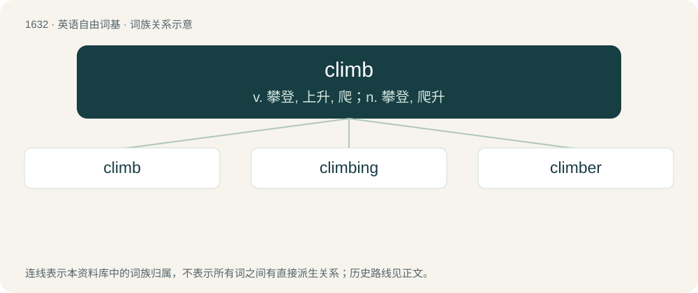

# 1731 · climb — v. 攀登, 上升, 爬；n. 攀登, 爬升

[总目录](../00_总目录_按常用程度.md)

**类型**：英语自由词基　｜　**来源语言**：见词源记录

## 核心含义与来源

- 核心含义：v. 攀登, 上升, 爬；n. 攀登, 爬升
- 英文含义：To traverse a slope or contour, either upwards (ascending) or downwards (descending).
- 词形：climb

**来源记录 1**（动词；To traverse a slope or contour, either upwards (ascending) or downwards (descending).）

From Middle English climben, clymben, from Old English climban (“to climb”), from Proto-West Germanic \*klimban, from Proto-Germanic \*klimbaną (“to climb, go up by clinging”), believed to be a nasalised variant of Proto-Germanic \*klibaną, \*klibāną (“to stick, cleave”), from Proto-Indo-European \*gley- (“to stick”). Cognate with West Frisian klimme (“to climb”), Dutch klimmen (“to climb”), German klimmen (“to climb”), Old Norse klembra (“to squeeze”), Icelandic klifra (“to climb”). Related to clamber. See also clay, glue.

## 词族图

## 单词速览（常用到不常用）

| 单词 | 音标 | 释义 |
|---|---|---|
| [climb](#w-1) | /ˈklaɪ̯m/ | v. 攀登, 上升, 爬；n. 攀登, 爬升 |
| [climbing](#w-2) | 美 /ˈklaɪ̯mɪŋ/ | a. 攀缘而登的, 上升的；n. 攀登 |
| [climber](#w-3) | 英 /ˈklaɪmə/；美 /ˈklaɪmɚ/ | n. 登山者；\[电\] 登杆器 |

## 逐词详解

### 1. climb

**词性**：动词　｜　**音标**：/ˈklaɪ̯m/

**中文释义**：v. 攀登, 上升, 爬；n. 攀登, 爬升

**英文义项**：To traverse a slope or contour, either upwards (ascending) or downwards (descending). / (literally or figuratively): To ascend; rise; to go up.

**词源与演化**：

From Middle English climben, clymben, from Old English climban (“to climb”), from Proto-West Germanic \*klimban, from Proto-Germanic \*klimbaną (“to climb, go up by clinging”), believed to be a nasalised variant of Proto-Germanic \*klibaną, \*klibāną (“to stick, cleave”), from Proto-Indo-European \*gley- (“to stick”). Cognate with West Frisian klimme (“to climb”), Dutch klimmen (“to climb”), German klimmen (“to climb”), Old Norse klembra (“to squeeze”), Icelandic klifra (“to climb”). Related to clamber. See also clay, glue.

**例句**：

> My legs were so stiff and my arms so sore that this morning I could barely climb out of bed.

该用例对应义项：To move (especially up and down something) by gripping with the hands and using the feet.

### 2. climbing

**词性**：名词　｜　**音标**：美 /ˈklaɪ̯mɪŋ/

**中文释义**：a. 攀缘而登的, 上升的；n. 攀登

**英文义项**：The sport of climbing, ascending a wall or a rock or another object using available holds, generally with the safety of a rope and belayer. / Climb; ascent.

**构词拆分**：climb + -ing

**词源与演化**：

From Middle English clymbyng, clymbynge; equivalent to climb + -ing.

**例句**：

> The next day, the team had to wear special ice climbing footwear while repairing other research devices on the glacier.

该用例对应义项：The sport of climbing, ascending a wall or a rock or another object using available holds, generally with the safety of a rope and belayer.

### 3. climber

**词性**：名词　｜　**音标**：英 /ˈklaɪmə/；美 /ˈklaɪmɚ/

**中文释义**：n. 登山者；\[电\] 登杆器

**英文义项**：Someone or something that climbs (such as a mountain climber). / A plant such as a vine that climbs upwards as it grows by attaching itself to some support.

**构词拆分**：climb (verb) + -er (suffix forming agent nouns)

**词源与演化**：

From Middle English clymbere, clymber (“one who climbs, climber”), from climben (“to climb; to ascend, fly upward, rise; to slope upwards; to approach God in prayer; to advance; to overcome, triumph; to aspire; to be presumptuous”) + -er, -ere (suffix forming agent nouns). The English word is analysable as climb (verb) + -er (suffix forming agent nouns).

**例句**：

> The lead climber looked strong still but his partner often slumped in his ropes.

该用例对应义项：someone who climbs as a sport; especially someone who climbs mountains
