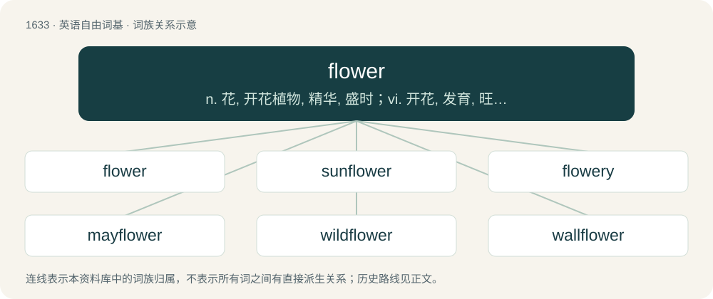

# 1732 · flower — n. 花, 开花植物, 精华, 盛时；vi. 开花, 发育, 旺盛, 成熟；vt. 用花装饰, 使开花

[总目录](../00_总目录_按常用程度.md)

**类型**：英语自由词基　｜　**来源语言**：见词源记录

## 核心含义与来源

- 核心含义：n. 花, 开花植物, 精华, 盛时；vi. 开花, 发育, 旺盛, 成熟；vt. 用花装饰, 使开花
- 英文含义：A colorful, conspicuous structure associated with angiosperms, frequently scented and attracting various insects, and which may or may not be used for sexual reproduction.
- 词形：flower

**多个词源／构词路径**：同一拼写可能有不同来源；以下按词性和含义分别列出。

**来源记录 1**（名词；A colorful, conspicuous structure associated with angiosperms, frequently scented and attracting various insects, and which may or may not be used for sexual reproduction.）

From Middle English flour, from Anglo-Norman flur, from Latin flōrem, accusative of flōs, from Proto-Italic \*flōs, from Proto-Indo-European \*bʰleh₃- (“to thrive, bloom”). Doublet of fleur, flor, flour, bloom, and blossom. Partly displaced native Old English blostma (which is cognate), whence Modern English blossom.

**来源记录 2**（名词；Something that flows, such as a river.）

From flow + -er.

## 词族图

## 单词速览（常用到不常用）

| 单词 | 音标 | 释义 |
|---|---|---|
| [flower](#w-1) | 英 /ˈflaʊ̯.ə/；美 /ˈflaʊ̯.ɚ/ | n. 花, 开花植物, 精华, 盛时；vi. 开花, 发育, 旺盛, 成熟；vt. 用花装饰, 使开花 |
| [sunflower](#w-2) | 英 /ˈsʌn.flaʊ.ə/；美 /ˈsʌn.flaʊ.əɹ/ | n. 向日葵 |
| [flowery](#w-3) | 英 /ˈflaʊəɹi/；美 /ˈflaʊəɹi/ | a. 多花的, 绚丽的, 华丽的 |
| [mayflower](#w-4) | /ˈmei.flauə/ | n. 五月开花的草木 |
| [wildflower](#w-5) | /ˈwaild,flajə(r)/ | n. 野花 |
| [wallflower](#w-6) | 英 /ˈwɔːlˌflaʊ.ə/；美 /ˈwɔlˌflaʊ.ɚ/ | n. \[植\]桂足香,桂香香水, 局外人 |
| [bellflower](#w-7) | /ˈbel.flauə/ | n. 风铃草 |
| [cornflower](#w-8) | 美 /ˈkɔɹnˌflaʊ.ɚ/ | n. 矢车菊 |
| [elderflower](#w-9) |  | 接骨木花（用于制作果酒等饮料） |

## 逐词详解

### 1. flower

**词性**：名词　｜　**音标**：英 /ˈflaʊ̯.ə/；美 /ˈflaʊ̯.ɚ/

**中文释义**：n. 花, 开花植物, 精华, 盛时；vi. 开花, 发育, 旺盛, 成熟；vt. 用花装饰, 使开花

**英文义项**：A colorful, conspicuous structure associated with angiosperms, frequently scented and attracting various insects, and which may or may not be used for sexual reproduction. / A reproductive structure in angiosperms (flowering plants), often conspicuously colourful and typically including sepals, petals, and either or both stamens and/or a pistil.

**词源与演化**：

From Middle English flour, from Anglo-Norman flur, from Latin flōrem, accusative of flōs, from Proto-Italic \*flōs, from Proto-Indo-European \*bʰleh₃- (“to thrive, bloom”). Doublet of fleur, flor, flour, bloom, and blossom. Partly displaced native Old English blostma (which is cognate), whence Modern English blossom.

**例句**：

> He always keeps a vase full of flowers in his office.

该用例对应义项：The stem of a flowering plant with the blossom or blossoms attached, used for decoration, as a gift, etc.

### 2. sunflower

**词性**：名词　｜　**音标**：英 /ˈsʌn.flaʊ.ə/；美 /ˈsʌn.flaʊ.əɹ/

**中文释义**：n. 向日葵

**英文义项**：Any plant of the genus Helianthus, so called probably from the form and color of its floral head, having the form of a large disk surrounded by yellow ray flowers. / The commonly cultivated species, Helianthus annuus, a native of America.

**构词拆分**：sun + flower

**词源与演化**：

From sun + flower. Compare English sunbloom.

**例句**：

> You bought sunflower oil, but I asked you to buy olive oil.

### 3. flowery

**词性**：形容词　｜　**音标**：英 /ˈflaʊəɹi/；美 /ˈflaʊəɹi/

**中文释义**：a. 多花的, 绚丽的, 华丽的

**英文义项**：Pertaining to or characteristic of flowers. / Decorated with or abundant in flowers.

**构词拆分**：flower + -y (adjectival suffix)

**词源与演化**：

From Middle English floury, equivalent to flower + -y (adjectival suffix). Piecewise doublet of floury.

**例句**：

> One day in a wide, flowery field he met a bear, a big Russian bear.

### 4. mayflower

**词性**：名词　｜　**音标**：/ˈmei.flauə/

**中文释义**：n. 五月开花的草木

**英文义项**：Any of several plants that flower in May - especially the hawthorn (in Britain) and the trailing arbutus (in the US).

**构词拆分**：May + flower

**词源与演化**：

From May + flower.

**例句**：

> Puritanism brought over with it in the Mayflower the anti-Christmas feeling to New England.

### 5. wildflower

**词性**：名词　｜　**音标**：/ˈwaild,flajə(r)/

**中文释义**：n. 野花

**英文义项**：A wild (uncultivated) flowering plant. / A flower from such a plant.

**构词拆分**：wild + flower

**词源与演化**：

From wild + flower.

**例句**：

> Wildflower honey is harvested from various nectar sources, resulting in a unique blend of flavors.

### 6. wallflower

**词性**：名词　｜　**音标**：英 /ˈwɔːlˌflaʊ.ə/；美 /ˈwɔlˌflaʊ.ɚ/

**中文释义**：n. \[植\]桂足香,桂香香水, 局外人

**英文义项**：Any of several short-lived herbs or shrubs of the Erysimum genus with bright yellow to red flowers. / Gastrolobium grandiflorum, a poisonous bushy shrub, endemic to Australia.

**构词拆分**：wall + flower

**词源与演化**：

From wall + flower.

**例句**：

> It's just too pathetic that this henpecked husband ended up hooking up with a wallflower.

### 7. bellflower

**词性**：名词　｜　**音标**：/ˈbel.flauə/

**中文释义**：n. 风铃草

**英文义项**：Any flowering plants in the genus Campanula. / Flowering plants in the genera, Campanulastrum, Codonopsis, or Platycodon, in the family Campanulaceae.

**构词拆分**：bell + flower

**词源与演化**：

From bell + flower.

### 8. cornflower

**词性**：名词　｜　**音标**：美 /ˈkɔɹnˌflaʊ.ɚ/

**中文释义**：n. 矢车菊

**英文义项**：A small annual plant in the family Asteraceae, Centaurea cyanus, usually with bushy blue flowers which grows natively in European cornfields (i.e. wheatfields). / A plant of the species Cichorium intybus.

**构词拆分**：corn + flower

**词源与演化**：

From corn + flower. Piecewise doublet of cornflour.

**例句**：

> Far out at sea the water is as blue as the bluest cornflower and as clear as the clearest crystal.

### 9. elderflower

**词性**：名词

**中文释义**：接骨木花（用于制作果酒等饮料）

**英文义项**：The blossom of the elderberry, often specifically the European species Sambucus nigra

**构词拆分**：elder + flower

**词源与演化**：

From elder + flower.
