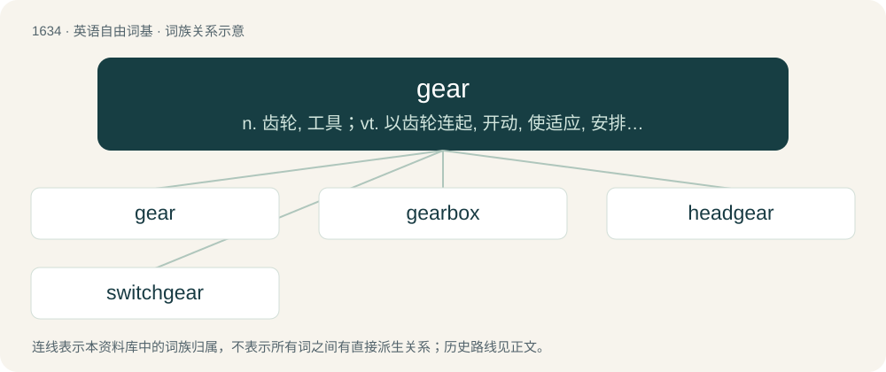

# 1733 · gear — n. 齿轮, 工具；vt. 以齿轮连起, 开动, 使适应, 安排；vi. 连接上, 适合

[总目录](../00_总目录_按常用程度.md)

**类型**：英语自由词基　｜　**来源语言**：见词源记录

## 核心含义与来源

- 核心含义：n. 齿轮, 工具；vt. 以齿轮连起, 开动, 使适应, 安排；vi. 连接上, 适合
- 英文含义：Equipment or paraphernalia, especially that used for an athletic endeavor.
- 词形：gear

**来源记录 1**（名词；Equipment or paraphernalia, especially that used for an athletic endeavor.）

From Middle English gere, a borrowing from Old Norse gervi, from Proto-Germanic \*garwijaną (“to prepare”). See also adjective yare, yar from the same root via Old English.

## 词族图

## 单词速览（常用到不常用）

| 单词 | 音标 | 释义 |
|---|---|---|
| [gear](#w-1) | 英 /ɡɪə/；美 /ɡɪɚ/ | n. 齿轮, 工具；vt. 以齿轮连起, 开动, 使适应, 安排；vi. 连接上, 适合 |
| [gearbox](#w-2) | 英 /ˈɡɪəˌbɒks/；美 /ˈɡɪəɹˌbɒks/ | n. 变速箱；\[化\] 齿轮箱; 变速箱 |
| [headgear](#w-3) | 英 /ˈhɛdɡɪə(ɹ)/；美 /ˈhɛdɡɪɹ/ | n. 头饰, 马首挽具, 井架；\[医\] 头网, 连轮装置 |
| [switchgear](#w-4) | /ˈswitʃ^iə/ | n. 开关齿轮 |

## 逐词详解

### 1. gear

**词性**：名词　｜　**音标**：英 /ɡɪə/；美 /ɡɪɚ/

**中文释义**：n. 齿轮, 工具；vt. 以齿轮连起, 开动, 使适应, 安排；vi. 连接上, 适合

**英文义项**：Equipment or paraphernalia, especially that used for an athletic endeavor. / Clothing; garments.

**词源与演化**：

From Middle English gere, a borrowing from Old Norse gervi, from Proto-Germanic \*garwijaną (“to prepare”). See also adjective yare, yar from the same root via Old English.

**用法示例／搭配（非完整句）**：

> getting on gear

该用例对应义项：Recreational drugs, including steroids.

### 2. gearbox

**词性**：名词　｜　**音标**：英 /ˈɡɪəˌbɒks/；美 /ˈɡɪəɹˌbɒks/

**中文释义**：n. 变速箱；\[化\] 齿轮箱; 变速箱

**英文义项**：An enclosed gear train. / That part of a car's transmission containing the train of gears, and to which the gear lever is connected.

**构词拆分**：gear + box

**词源与演化**：

From gear + box.

**例句**：

> Tom had to have a new gearbox fitted to his car.

### 3. headgear

**词性**：名词　｜　**音标**：英 /ˈhɛdɡɪə(ɹ)/；美 /ˈhɛdɡɪɹ/

**中文释义**：n. 头饰, 马首挽具, 井架；\[医\] 头网, 连轮装置

**英文义项**：Anything worn on the head, such as a hat, hood, helmet, etc. / The harness that fits on a horse's head.

**构词拆分**：head + gear

**词源与演化**：

From head + gear.

**例句**：

> Tom was late for wrestling practice because he left his headgear at home.

### 4. switchgear

**词性**：名词　｜　**音标**：/ˈswitʃ^iə/

**中文释义**：n. 开关齿轮

**英文义项**：A device used to control, meter, protect, and regulate electronics as part of electricity generation, transmission, and distribution.

**构词拆分**：switch + gear

**词源与演化**：

From switch + gear.
