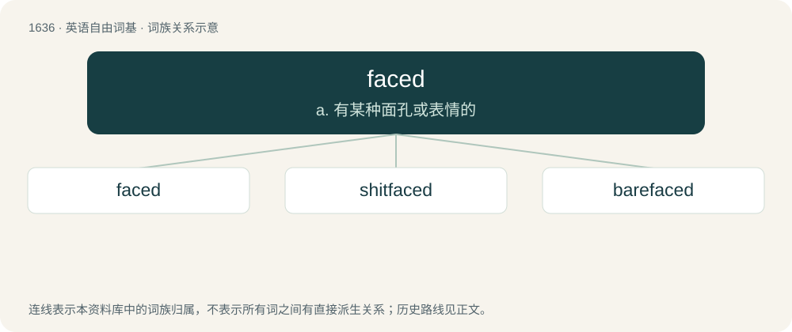

# 1735 · faced — a. 有某种面孔或表情的

[总目录](../00_总目录_按常用程度.md)

**类型**：英语自由词基　｜　**来源语言**：见词源记录

## 核心含义与来源

- 核心含义：a. 有某种面孔或表情的
- 英文含义：Having a specified type or number of faces.
- 词形：faced

**多个词源／构词路径**：同一拼写可能有不同来源；以下按词性和含义分别列出。

**来源记录 1**（形容词；Having a specified type or number of faces.）

From face + -ed.

**来源记录 2**（形容词；drunk）

Abbreviation of shit-faced.

## 词族图

## 单词速览（常用到不常用）

| 单词 | 音标 | 释义 |
|---|---|---|
| [faced](#w-1) | /feɪst/ | a. 有某种面孔或表情的 |
| [shitfaced](#w-2) | /ˈʃɪtfeɪst/ | 【英文】Very drunk. |
| [barefaced](#w-3) | 英 /ˈbeə(ɹ)feɪst/ | a. 公然的, 无耻的, 无面具的 |

## 逐词详解

### 1. faced

**词性**：形容词　｜　**音标**：/feɪst/

**中文释义**：a. 有某种面孔或表情的

**英文义项**：Having a specified type or number of faces. / Having the outer surface dressed, with the front, as of a dress, covered ornamentally with another material.

**构词拆分**：face + -ed

**词源与演化**：

From face + -ed.

**例句**：

> The cuffs were faced with velvet.

该用例对应义项：Having the outer surface dressed, with the front, as of a dress, covered ornamentally with another material.

### 2. shitfaced

**词性**：形容词　｜　**音标**：/ˈʃɪtfeɪst/

**英文义项**：Very drunk. / Under the influence of mind-altering drugs.

**构词拆分**：shit + faced

**词源与演化**：

From shit + faced.

**例句**：

> When they brought in that keg, I knew I was going to get shitfaced.

该用例对应义项：Very drunk.

### 3. barefaced

**词性**：形容词　｜　**音标**：英 /ˈbeə(ɹ)feɪst/

**中文释义**：a. 公然的, 无耻的, 无面具的

**英文义项**：Undisguisedly offensive and bold; crude. / Open, undisguised.

**构词拆分**：bare + faced

**词源与演化**：

Perhaps an alteration of barefast (compare shamefast); or from bare + faced. Compare typologically cheeky; Italian sfacciato (&lt; Latin ex- + faciēs); French effronté, Italian sfrontato (&lt; Latin ex- + frōns), Polish czelny (&lt; czoło).

**例句**：

> How dare you tell such a barefaced lie?
