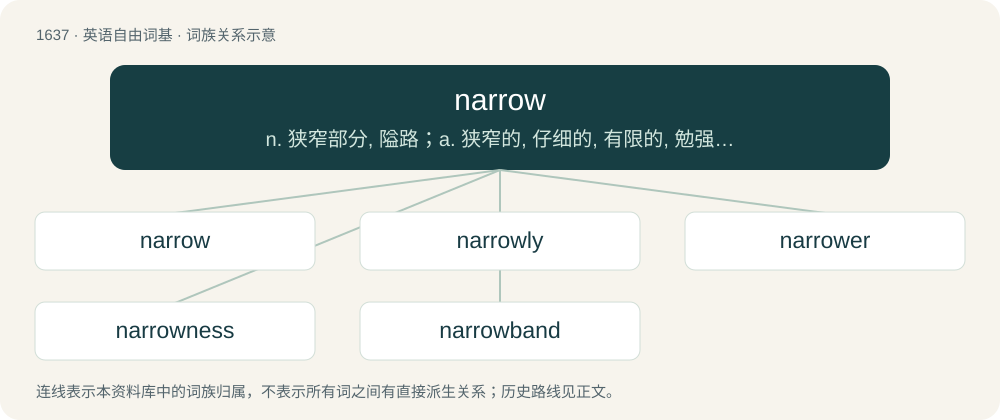

# 1736 · narrow — n. 狭窄部分, 隘路；a. 狭窄的, 仔细的, 有限的, 勉强的, 狭隘的, 手紧的；vi. 变窄

[总目录](../00_总目录_按常用程度.md)

**类型**：英语自由词基　｜　**来源语言**：见词源记录

## 核心含义与来源

- 核心含义：n. 狭窄部分, 隘路；a. 狭窄的, 仔细的, 有限的, 勉强的, 狭隘的, 手紧的；vi. 变窄
- 英文含义：Having a small width; not wide; having opposite edges or sides that are close, especially by comparison to length or depth.
- 词形：narrow

**多个词源／构词路径**：同一拼写可能有不同来源；以下按词性和含义分别列出。

**来源记录 1**（形容词；Having a small width; not wide; having opposite edges or sides that are close, especially by comparison to length or depth.）

From Middle English narow, narowe, narewe, narwe, naru, from Old English nearu (“narrow, strait, confined, constricted, not spacious, limited, petty; limited, poor, restricted; oppressive, causing anxiety (of that which restricts free action of body or mind), causing or accompanied by difficulty, hardship, oppressive; oppressed, not having free action; strict, severe”), from Proto-West Germanic \*naru, from Proto-Germanic \*narwaz (“constricted, narrow”), from Proto-Indo-European \*(s)ner- (“to turn, bend, twist, constrict”). Cognates Cognate with North Frisian naar, noar, noor, nåår (“narrow”), Saterland Frisian noar (“narrow”), Dutch naar (“nasty, scary; sickening, unpleasant”), Danish and Swedish nor (“narrow strait”); also Sanskrit नृत् (nṛt, “to dance; act on stage, represent”).

**来源记录 2**（动词；To reduce in width or extent; to contract.）

From Middle English narwen (“to narrow”); see there for more details, but ultimately derived from the noun.

## 词族图

## 单词速览（常用到不常用）

| 单词 | 音标 | 释义 |
|---|---|---|
| [narrow](#w-1) | 英 /ˈnæɹəʊ/；/ˈnæɹoʊ/ | n. 狭窄部分, 隘路；a. 狭窄的, 仔细的, 有限的, 勉强的, 狭隘的, 手紧的；vi. 变窄 |
| [narrowly](#w-2) | 英 /ˈnæɹəʊli/；美 /ˈnæɹoʊli/ | adv. 狭窄地, 严密地, 仔细地, 几乎不, 勉强地, 仅仅 |
| [narrower](#w-3) |  | a. 比较狭窄的（narrow的比较级） |
| [narrowness](#w-4) | /ˈnærəunis/ | n. 狭小, 小气 |
| [narrowband](#w-5) |  | \[计\] 窄带 |

## 逐词详解

### 1. narrow

**词性**：形容词　｜　**音标**：英 /ˈnæɹəʊ/；/ˈnæɹoʊ/

**中文释义**：n. 狭窄部分, 隘路；a. 狭窄的, 仔细的, 有限的, 勉强的, 狭隘的, 手紧的；vi. 变窄

**英文义项**：Having a small width; not wide; having opposite edges or sides that are close, especially by comparison to length or depth. / Of little extent; very limited; circumscribed.

**词源与演化**：

From Middle English narow, narowe, narewe, narwe, naru, from Old English nearu (“narrow, strait, confined, constricted, not spacious, limited, petty; limited, poor, restricted; oppressive, causing anxiety (of that which restricts free action of body or mind), causing or accompanied by difficulty, hardship, oppressive; oppressed, not having free action; strict, severe”), from Proto-West Germanic \*naru, from Proto-Germanic \*narwaz (“constricted, narrow”), from Proto-Indo-European \*(s)ner- (“to turn, bend, twist, constrict”). Cognates Cognate with North Frisian naar, noar, noor, nåår (“narrow”), Saterland Frisian noar (“narrow”), Dutch naar (“nasty, scary; sickening, unpleasant”), Danish and Swedish nor (“narrow strait”); also Sanskrit नृत् (nṛt, “to dance; act on stage, represent”).

**例句**：

> The Republicans won by a narrow majority.

该用例对应义项：Having a small margin or degree.

### 2. narrowly

**词性**：副词　｜　**音标**：英 /ˈnæɹəʊli/；美 /ˈnæɹoʊli/

**中文释义**：adv. 狭窄地, 严密地, 仔细地, 几乎不, 勉强地, 仅仅

**英文义项**：In a narrow manner; without flexibility or latitude. / Closely; by a narrow margin.

**构词拆分**：narrow + -ly

**词源与演化**：

From Middle English narowly, equivalent to narrow + -ly.

**例句**：

> They regarded the new idea rather narrowly.

该用例对应义项：In a narrow manner; without flexibility or latitude.

### 3. narrower

**词性**：名词

**中文释义**：a. 比较狭窄的（narrow的比较级）

**英文义项**：One who, or that which, narrows.

**构词拆分**：From narrow + -er.

**词源与演化**：

From narrow + -er.

**例句**：

> This sidewalk is a lot narrower than the one across the road.

### 4. narrowness

**词性**：名词　｜　**音标**：/ˈnærəunis/

**中文释义**：n. 狭小, 小气

**英文义项**：The state of being narrow. / A constriction; a narrow passage or place; an instance or aspect of being narrow, or having a limited scope or extent.

**构词拆分**：narrow + -ness

**词源与演化**：

From Middle English narwenesse; equivalent to narrow + -ness.

**例句**：

> The narrowness of the road.

该用例对应义项：the property of being narrow; having little width

### 5. narrowband

**词性**：形容词

**中文释义**：\[计\] 窄带

**英文义项**：Describing communication systems with a smaller bandwidth than wideband.

**构词拆分**：narrow + band

**词源与演化**：

From narrow + band.
