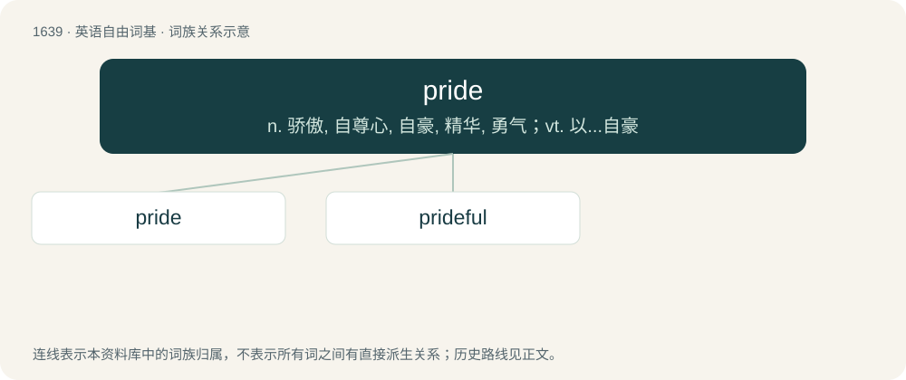

# 1738 · pride — n. 骄傲, 自尊心, 自豪, 精华, 勇气；vt. 以...自豪

[总目录](../00_总目录_按常用程度.md)

**类型**：英语自由词基　｜　**来源语言**：见词源记录

## 核心含义与来源

- 核心含义：n. 骄傲, 自尊心, 自豪, 精华, 勇气；vt. 以...自豪
- 英文含义：A sense of one's own worth; reasonable self-esteem and satisfaction (in oneself, in one's work, one's family, etc).
- 词形：pride

**多个词源／构词路径**：同一拼写可能有不同来源；以下按词性和含义分别列出。

**来源记录 1**（名词；A sense of one's own worth; reasonable self-esteem and satisfaction (in oneself, in one's work, one's family, etc).）

From Middle English pryde, pride, from Old English prȳde, prȳte (“pride”) (compare Old Norse prýði (“bravery, pomp”)), derivative of Old English prūd (“proud”). More at proud. The verb derives from the noun, at least since the 12th century.

**来源记录 2**（名词；The small European lamprey species Petromyzon branchialis.）

From Middle English pryde, from Middle Low German lampride, from Medieval Latin lampreda.

## 词族图

## 单词速览（常用到不常用）

| 单词 | 音标 | 释义 |
|---|---|---|
| [pride](#w-1) | /pɹaɪd/ | n. 骄傲, 自尊心, 自豪, 精华, 勇气；vt. 以...自豪 |
| [prideful](#w-2) | 英 /ˈpɹʌɪdfəl/ | a. 自傲的 |

## 逐词详解

### 1. pride

**词性**：名词　｜　**音标**：/pɹaɪd/

**中文释义**：n. 骄傲, 自尊心, 自豪, 精华, 勇气；vt. 以...自豪

**英文义项**：A sense of one's own worth; reasonable self-esteem and satisfaction (in oneself, in one's work, one's family, etc). / An unreasonable overestimation of one's own superiority in terms of talents, or looks, wealth, importance, etc., which comes across as being haughty, lofty, and often showing contempt of others; exaggerated self-worth.

**词源与演化**：

From Middle English pryde, pride, from Old English prȳde, prȳte (“pride”) (compare Old Norse prýði (“bravery, pomp”)), derivative of Old English prūd (“proud”). More at proud. The verb derives from the noun, at least since the 12th century.

**例句**：

> He swelled with pride as he held the trophy. His family watched with pride from the bleachers.

该用例对应义项：A sense of one's own worth; reasonable self-esteem and satisfaction (in oneself, in one's work, one's family, etc).

### 2. prideful

**词性**：形容词　｜　**音标**：英 /ˈpɹʌɪdfəl/

**中文释义**：a. 自傲的

**英文义项**：Full of pride. / Taking pride in something.

**构词拆分**：pride + -ful

**词源与演化**：

From Middle English pridefulle, prydefull, equivalent to pride + -ful.

**例句**：

> Your friend shouldn't be so prideful!
