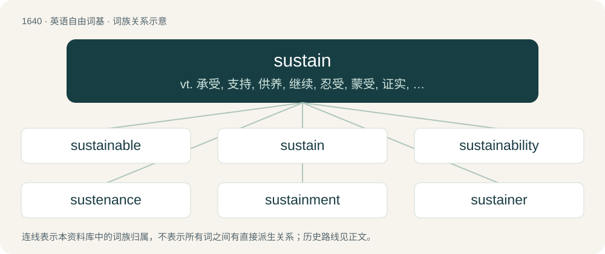

# 1739 · sustain — vt. 承受, 支持, 供养, 继续, 忍受, 蒙受, 证实, 准许；\[电\] 持续

[总目录](../00_总目录_按常用程度.md)

**类型**：英语自由词基　｜　**来源语言**：见词源记录

## 核心含义与来源

- 核心含义：vt. 承受, 支持, 供养, 继续, 忍受, 蒙受, 证实, 准许；\[电\] 持续
- 英文含义：To maintain, or keep in existence.
- 词形：sustain

**来源记录 1**（动词；To maintain, or keep in existence.）

From Middle English susteinen, sustenen, from Old French sustenir (French soutenir), from Latin sustineō, sustinēre (“to uphold”), from sub- (“from below, up”) + teneō (“hold”, verb).

## 词族图

## 单词速览（常用到不常用）

| 单词 | 音标 | 释义 |
|---|---|---|
| [sustainable](#w-1) | /səˈsteɪnəbəl/ | a. 足可支撑的, 养得起的, 可以忍受的 |
| [sustain](#w-2) | 英 /səˈsteɪn/ | vt. 承受, 支持, 供养, 继续, 忍受, 蒙受, 证实, 准许；\[电\] 持续 |
| [sustainability](#w-3) | 英 /səˌsteɪnəˈbɪlɪti/；美 /səˌsteɪnəˈbɪləti/ | n. 持续性, 能维持性, 永续性 |
| [sustenance](#w-4) | /ˈsʌs.tə.nəns/ | n. 生活资料, 生计, 食物, 支持；\[法\] 营养物, 维持, 支持 |
| [sustainment](#w-5) | /səˈsteɪnmənt/ | 支持, 维持, 支持物 |
| [sustainer](#w-6) | /səˈsteinə/ | n. 支持者, 维持者；\[法\] 证实者, 认可者, 扶养者 |

## 逐词详解

### 1. sustainable

**词性**：形容词　｜　**音标**：/səˈsteɪnəbəl/

**中文释义**：a. 足可支撑的, 养得起的, 可以忍受的

**英文义项**：Able to be sustained. / Able to be produced or sustained for an indefinite period without damaging the environment, or without depleting a resource; renewable.

**构词拆分**：sustain + -able

**词源与演化**：

From sustain + -able.

**用法示例／搭配（非完整句）**：

> sustainable economy

该用例对应义项：Able to be produced or sustained for an indefinite period without damaging the environment, or without depleting a resource; renewable.

### 2. sustain

**词性**：动词　｜　**音标**：英 /səˈsteɪn/

**中文释义**：vt. 承受, 支持, 供养, 继续, 忍受, 蒙受, 证实, 准许；\[电\] 持续

**英文义项**：To maintain, or keep in existence. / To provide for or nourish.

**词源与演化**：

From Middle English susteinen, sustenen, from Old French sustenir (French soutenir), from Latin sustineō, sustinēre (“to uphold”), from sub- (“from below, up”) + teneō (“hold”, verb).

**例句**：

> The professor had trouble sustaining students’ interest until the end of her lectures.

该用例对应义项：To maintain, or keep in existence.

### 3. sustainability

**词性**：名词　｜　**音标**：英 /səˌsteɪnəˈbɪlɪti/；美 /səˌsteɪnəˈbɪləti/

**中文释义**：n. 持续性, 能维持性, 永续性

**英文义项**：A means of configuring civilization and human activity so that society, its members and its economies are able to meet their needs and express their greatest potential in the present, while preserving biodiversity and natural ecosystems, planning and acting for the ability to maintain these necessary resources for future generations. / The ability to sustain a business in the long term, which is a state that is partly dependent on, but broader than, profitability today or in the short term; it involves aspects of a plausible path toward eventual profitability (as applies to a startup) and ecologic sustainability (for example, the long-term dependence of the timber/lumber industry on forest preservation and renewal, or of fisheries on viable fish stocks).

**构词拆分**：sustain + -ability

**词源与演化**：

From sustain + -ability.

**例句**：

> The making of buggy whips is the proverbial exemplar of a business without sustainability in the face of technological change.

该用例对应义项：The ability to sustain a business in the long term, which is a state that is partly dependent on, but broader than, profitability today or in the short term; it involves aspects of a plausible path toward eventual profitability (as applies to a startup) and ecologic sustainability (for example, the long-term dependence of the timber/lumber industry on forest preservation and renewal, or of fisheries on viable fish stocks).

### 4. sustenance

**词性**：名词　｜　**音标**：/ˈsʌs.tə.nəns/

**中文释义**：n. 生活资料, 生计, 食物, 支持；\[法\] 营养物, 维持, 支持

**英文义项**：Something that provides support or nourishment.

**构词拆分**：sustain + -ance

**词源与演化**：

From Middle English sustenaunce, from Old French sustenance, from sustenir with the suffix -ance, from Vulgar Latin \*sustenire, from Latin sustinere. Compare also Late Latin sustinentia. Equivalent to sustain + -ance.

**例句**：

> Tom kept two or three cows for the sustenance of his family.

### 5. sustainment

**词性**：名词　｜　**音标**：/səˈsteɪnmənt/

**中文释义**：支持, 维持, 支持物

**英文义项**：The act of sustaining something.

**构词拆分**：sustain + -ment

**词源与演化**：

From sustain + -ment.

**例句**：

> Fishing was their main sustainment.

该用例对应义项：the act of sustaining life by food or providing a means of subsistence

### 6. sustainer

**词性**：名词　｜　**音标**：/səˈsteinə/

**中文释义**：n. 支持者, 维持者；\[法\] 证实者, 认可者, 扶养者

**英文义项**：A person or thing that sustains. / A rocket engine that remains with a spacecraft during its ascent after the separation of the booster engines.

**构词拆分**：From sustain + -er.

**词源与演化**：

From sustain + -er.

**例句**：

> Brahma is the creator, Vishnu the sustainer, and Shiva the destroyer.
