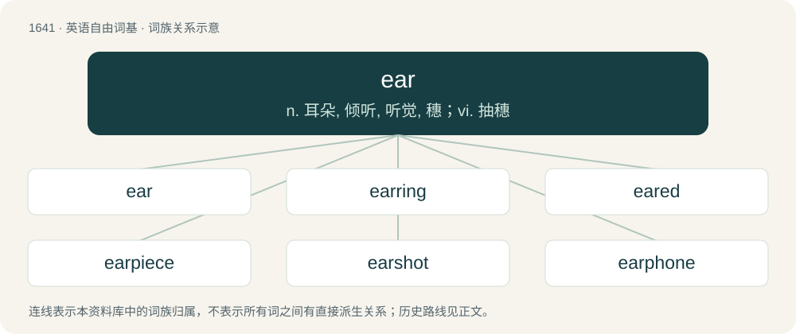

# 1740 · ear — n. 耳朵, 倾听, 听觉, 穗；vi. 抽穗

[总目录](../00_总目录_按常用程度.md)

**类型**：英语自由词基　｜　**来源语言**：见词源记录

## 核心含义与来源

- 核心含义：n. 耳朵, 倾听, 听觉, 穗；vi. 抽穗
- 英文含义：The organ of hearing, consisting of the pinna or auricle, auditory canal, eardrum, malleus, incus, stapes and cochlea.
- 词形：ear

**多个词源／构词路径**：同一拼写可能有不同来源；以下按词性和含义分别列出。

**来源记录 1**（名词；The organ of hearing, consisting of the pinna or auricle, auditory canal, eardrum, malleus, incus, stapes and cochlea.）

From Middle English eare, eere, ere, eyr, ire, yere, ȝhere, from Old English ēare (“ear”), from Proto-West Germanic \*auʀā, from the voiced Verner alternant of Proto-Germanic \*ausô (“ear”), from Proto-Indo-European \*h₂ṓws (“ear”), from \*h₂ew- (“to perceive”). Cognates Cognate with North Frisian uaar, uar, uur (“ear”), Saterland Frisian Oor (“ear”), West Frisian ear (“ear”), Alemannic German Oor (“ear”), Central Franconian Uhr (“ear”), Dutch oor (“ear”), German Ohr (“ear”), Low German Ohr, Oor, Or, our, Ur (“ear”), Luxembourgish Ouer (“ear”), Vilamovian ür (“ear”), Yiddish אויער (oyer, “ear”), Danish and Norwegian Bokmål øre (“ear”), Elfdalian ära (“ear”), Faroese oyra (“ear”), Icelandic eyra (“ear”), Jamtish ǿre (“ear”), Norwegian Nynorsk øra, øre, øyra, øyre (“ear”), Swedish öra (“ear”), Gothic 𐌰𐌿𐍃𐍉 (ausō, “ear”); also Old Irish áu, ó (“ear”), Latin auris, ōris (“ear”), Greek αφτί (aftí), αυτί (aftí, “ear”), Albanian vesh (“ear; handle”), Latvian auss (“ear”), Lithuanian ausis (“ear”), Belarusian ву́ха (vúxa, “ear”), Bulgarian ухо́ (uhó, “ear”), Czech, Polish, Silesian, and Slovak ucho (“ear”), Kashubian ùchò (“ear”), Lower Sorbian and Upper Sorbian wucho (“ear”), Macedonian уво (uvo, “ear”), Polabian vaux’ü (“ear”), Russian у́хо (úxo, “ear”), Serbo-Croatian у̏во, у̏хо, ȕho, ȕvo (“ear”), Slovene uho (“ear”), Slovincian wùchô (“ear”), Ukrainian ву́хо (vúxo, “ear”), Armenian ունկ (unk, “ear”), Persian هوش (hōš / huš, “intellect; intelligence; understanding”), Sanskrit उषस् (uṣas, “outer passage of the ear”).

**来源记录 2**（名词；The fruiting body of a grain plant.）

From Middle English er, ere, from Old English ēar (Northumbrian dialect æhher), from Proto-West Germanic \*ahaʀ, from Proto-Germanic \*ahaz, from Proto-Indo-European \*h₂eḱ- (“sharp”). Cognate with Dutch aar, German Ähre, and West Frisian ier; also Latin acus (“needle; husk”), Tocharian B āk (“ear, awn”), and Old Church Slavonic ость (ostĭ, “wheat spike, sharp point”). More at edge.

## 词族图

## 单词速览（常用到不常用）

| 单词 | 音标 | 释义 |
|---|---|---|
| [ear](#w-1) | 英 /ˈɪə̯/；美 /ˈɪɚ/ | n. 耳朵, 倾听, 听觉, 穗；vi. 抽穗 |
| [earring](#w-2) | 英 /ˈɪəɹɪŋ/；美 /ˈɪɹɪŋ/ | n. 耳环, 耳饰 |
| [eared](#w-3) | 英 /ɪəd/；美 /ɪ(ə)ɹd/ | a. 有...耳的, 有把的, 有穗的 |
| [earpiece](#w-4) | 英 /ˈɪəpiːs/；美 /ˈɪɹpiːs/ | n. 耳机, 护耳片, 眼镜脚, 头戴式耳机；\[电\] 听筒 |
| [earshot](#w-5) | 英 /ˈɪəˌʃɒt/；美 /ˈɪɹˌʃɑt/ | n. 听力所及之范围, 可听距离 |
| [earphone](#w-6) | /ˈɪə(ɹ)fəʊn/ | n. 耳机, 听筒；\[电\] 耳机 |
| [eardrum](#w-7) | 英 /ˈɪəˌdɹʌm/；美 /ˈiɚˌdɹʌm/ | n. 中耳, 鼓膜；\[医\] 鼓室 |
| [earful](#w-8) | 英 /ˈɪəfəl/；美 /ˈɪɹfəl/ | n. 惊人(或重要)新闻的透露, (说话、闲话等的)大量, 过多, 斥责 |
| [earmark](#w-9) | 英 /ˈɪəmɑːk/；美 /ˈɪ(ə)ɹˌmɑɹk/ | n. 耳上记号, 特征, 记号, 标记；vt. 在耳朵上做记号, 标记, 指定...作特定用途 |
| [earwax](#w-10) | 美 /ˈiɹ.wæks/ | n. 耳垢；\[医\] 耵聍, 耳垢 |
| [earworm](#w-11) | 英 /ˈɪəwɜːm/；美 /ˈɪ(ə)ɹˌwɚm/ | n. 螟蛉 |
| [earache](#w-12) | 英 /ˈɪə̯ɹeɪk/；美 /ˈiɹeɪk/ | n. 耳朵痛；\[医\] 耳痛 |

## 逐词详解

### 1. ear

**词性**：名词　｜　**音标**：英 /ˈɪə̯/；美 /ˈɪɚ/

**中文释义**：n. 耳朵, 倾听, 听觉, 穗；vi. 抽穗

**英文义项**：The organ of hearing, consisting of the pinna or auricle, auditory canal, eardrum, malleus, incus, stapes and cochlea. / The external part of the organ of hearing, the auricle.

**词源与演化**：

From Middle English eare, eere, ere, eyr, ire, yere, ȝhere, from Old English ēare (“ear”), from Proto-West Germanic \*auʀā, from the voiced Verner alternant of Proto-Germanic \*ausô (“ear”), from Proto-Indo-European \*h₂ṓws (“ear”), from \*h₂ew- (“to perceive”). Cognates Cognate with North Frisian uaar, uar, uur (“ear”), Saterland Frisian Oor (“ear”), West Frisian ear (“ear”), Alemannic German Oor (“ear”), Central Franconian Uhr (“ear”), Dutch oor (“ear”), German Ohr (“ear”), Low German Ohr, Oor, Or, our, Ur (“ear”), Luxembourgish Ouer (“ear”), Vilamovian ür (“ear”), Yiddish אויער (oyer, “ear”), Danish and Norwegian Bokmål øre (“ear”), Elfdalian ära (“ear”), Faroese oyra (“ear”), Icelandic eyra (“ear”), Jamtish ǿre (“ear”), Norwegian Nynorsk øra, øre, øyra, øyre (“ear”), Swedish öra (“ear”), Gothic 𐌰𐌿𐍃𐍉 (ausō, “ear”); also Old Irish áu, ó (“ear”), Latin auris, ōris (“ear”), Greek αφτί (aftí), αυτί (aftí, “ear”), Albanian vesh (“ear; handle”), Latvian auss (“ear”), Lithuanian ausis (“ear”), Belarusian ву́ха (vúxa, “ear”), Bulgarian ухо́ (uhó, “ear”), Czech, Polish, Silesian, and Slovak ucho (“ear”), Kashubian ùchò (“ear”), Lower Sorbian and Upper Sorbian wucho (“ear”), Macedonian уво (uvo, “ear”), Polabian vaux’ü (“ear”), Russian у́хо (úxo, “ear”), Serbo-Croatian у̏во, у̏хо, ȕho, ȕvo (“ear”), Slovene uho (“ear”), Slovincian wùchô (“ear”), Ukrainian ву́хо (vúxo, “ear”), Armenian ունկ (unk, “ear”), Persian هوش (hōš / huš, “intellect; intelligence; understanding”), Sanskrit उषस् (uṣas, “outer passage of the ear”).

**例句**：

> the ears of a tub, skillet, or dish; The ears of a boat are outside kneepieces near the bow.

该用例对应义项：That which resembles in shape or position the ear of an animal; a prominence or projection on an object, usually for support or attachment; a lug; a handle; a foot-rest or step of a spade or a similar digging tool.

### 2. earring

**词性**：名词　｜　**音标**：英 /ˈɪəɹɪŋ/；美 /ˈɪɹɪŋ/

**中文释义**：n. 耳环, 耳饰

**英文义项**：A piece of jewelry worn on the ear.

**构词拆分**：ear + ring

**词源与演化**：

From Middle English erering, from Old English ēarhring (“ear-ring”), from Proto-West Germanic \*auʀahring, equivalent to ear + ring. Cognate with West Frisian earring (“earring”), Dutch oorring (“earring”), German Low German Ohrring (“earring”), German Ohrring (“earring”), Danish ørering (“earring”), Swedish örring (“earring”).

**例句**：

> I dropped a earring down the pipe. I must call the plumber.

### 3. eared

**词性**：形容词　｜　**音标**：英 /ɪəd/；美 /ɪ(ə)ɹd/

**中文释义**：a. 有...耳的, 有把的, 有穗的

**英文义项**：Having ears (of a specified type). / Having ears.

**构词拆分**：ear + -ed

**词源与演化**：

From ear + -ed.

**例句**：

> He was a large-eared man.

该用例对应义项：Having ears (of a specified type).

### 4. earpiece

**词性**：名词　｜　**音标**：英 /ˈɪəpiːs/；美 /ˈɪɹpiːs/

**中文释义**：n. 耳机, 护耳片, 眼镜脚, 头戴式耳机；\[电\] 听筒

**英文义项**：A speaker placed inside or held near to the ear. / A receiver of a telephone to hold near to one's ear.

**构词拆分**：ear + piece

**词源与演化**：

From ear + piece.

**例句**：

> Holding the earpiece to my ear, I could hear him speaking clearly.

该用例对应义项：A speaker placed inside or held near to the ear.

### 5. earshot

**词性**：名词　｜　**音标**：英 /ˈɪəˌʃɒt/；美 /ˈɪɹˌʃɑt/

**中文释义**：n. 听力所及之范围, 可听距离

**英文义项**：A distance from which sound is still audible.

**构词拆分**：ear + shot

**词源与演化**：

From ear + shot.

**例句**：

> I'll row out on the lake but stay within earshot.

该用例对应义项：A distance from which sound is still audible.

### 6. earphone

**词性**：名词　｜　**音标**：/ˈɪə(ɹ)fəʊn/

**中文释义**：n. 耳机, 听筒；\[电\] 耳机

**英文义项**：A transducer that converts electric signals into sound and is held near the ear, especially as part of a telephone; an earpiece or headphone.

**构词拆分**：ear + phone

**词源与演化**：

From ear + phone.

### 7. eardrum

**词性**：名词　｜　**音标**：英 /ˈɪəˌdɹʌm/；美 /ˈiɚˌdɹʌm/

**中文释义**：n. 中耳, 鼓膜；\[医\] 鼓室

**英文义项**：A thin membrane that separates the outer ear from the middle ear and transmits sound from the air to the malleus.

**构词拆分**：ear + drum

**词源与演化**：

From ear + drum.

**例句**：

> Is it safe to fly with a perforated eardrum?

### 8. earful

**词性**：名词　｜　**音标**：英 /ˈɪəfəl/；美 /ˈɪɹfəl/

**中文释义**：n. 惊人(或重要)新闻的透露, (说话、闲话等的)大量, 过多, 斥责

**英文义项**：an angry reprimand, castigation or telling off / intimate gossip

**构词拆分**：ear + -ful

**词源与演化**：

From ear + -ful.

**用法示例／搭配（非完整句）**：

> give someone an earful

该用例对应义项：an angry reprimand, castigation or telling off

### 9. earmark

**词性**：动词　｜　**音标**：英 /ˈɪəmɑːk/；美 /ˈɪ(ə)ɹˌmɑɹk/

**中文释义**：n. 耳上记号, 特征, 记号, 标记；vt. 在耳朵上做记号, 标记, 指定...作特定用途

**英文义项**：To make a mark or attach a tag to the ear of (an animal, chiefly a livestock animal), generally to identify or indicate something about the animal, such as ownership. / To put a distinguishing or identifying mark or sign on (something); to make (something) distinctive or identifiable.

**构词拆分**：ear + mark

**词源与演化**：

The noun is derived from ear + mark. The verb is derived from the noun.

**例句**：

> You can donate to the organization as a whole, or you can earmark your contribution for a particular project.

该用例对应义项：Chiefly followed by for: to designate (certain funds) to be used for a specific purpose.

### 10. earwax

**词性**：名词　｜　**音标**：美 /ˈiɹ.wæks/

**中文释义**：n. 耳垢；\[医\] 耵聍, 耳垢

**英文义项**：A waxy substance secreted by the ear.

**构词拆分**：ear + wax

**词源与演化**：

From Middle English erewax, from ere + wax. Equivalent to ear + wax.

**例句**：

> I'm trying to get the earwax out of my earbuds with a pencil.

### 11. earworm

**词性**：名词　｜　**音标**：英 /ˈɪəwɜːm/；美 /ˈɪ(ə)ɹˌwɚm/

**中文释义**：n. 螟蛉

**英文义项**：A tune that keeps replaying in one's head or that one keeps thinking about, especially if unwanted.

**构词拆分**：ear + worm

**词源与演化**：

From ear + worm; senses 1 and 3 (“tune that keeps replaying in one’s head”; “earwig”) are a calque of German Ohrwurm (“tune that pops up in one’s memory all the time; earwig”) (from the idea of a creature burrowing into the ear, an erroneous belief where earwigs are concerned), while sense 2 (“moth larva”) refers to the fact that these pests infest, among other things, ears of maize or sweet corn.

**例句**：

> The best way to get rid of an earworm is to replace it with another.

### 12. earache

**词性**：名词　｜　**音标**：英 /ˈɪə̯ɹeɪk/；美 /ˈiɹeɪk/

**中文释义**：n. 耳朵痛；\[医\] 耳痛

**英文义项**：A pain in the middle or inner ear. / Annoyance or aggravation caused by noise, especially the sound of someone nagging, complaining, issuing orders, etc.

**构词拆分**：ear + ache

**词源与演化**：

From ear + ache.

**例句**：

> I can't stay too late at the pub, otherwise I'll get a load of earache from the missus.

该用例对应义项：Annoyance or aggravation caused by noise, especially the sound of someone nagging, complaining, issuing orders, etc.
