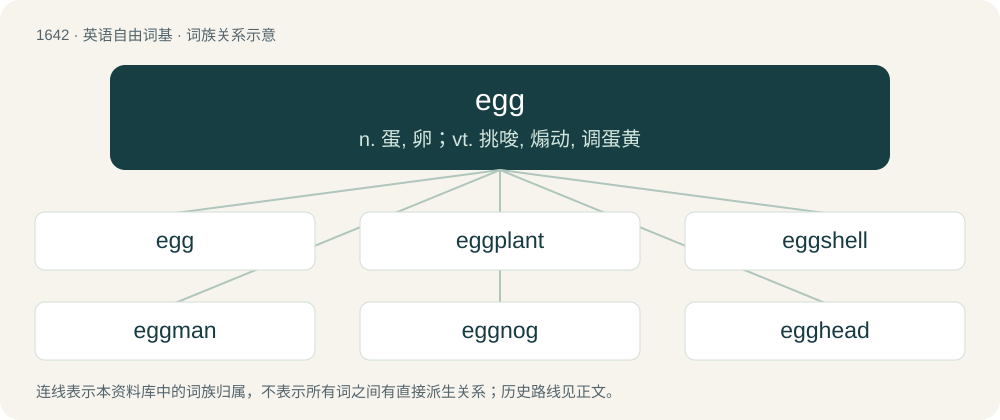

# 1741 · egg — n. 蛋, 卵；vt. 挑唆, 煽动, 调蛋黄

[总目录](../00_总目录_按常用程度.md)

**类型**：英语自由词基　｜　**来源语言**：见词源记录

## 核心含义与来源

- 核心含义：n. 蛋, 卵；vt. 挑唆, 煽动, 调蛋黄
- 英文含义：An approximately spherical or ellipsoidal body produced by birds, insects, reptiles, and other animals, often housing an embryo within a membrane or shell during its development.
- 词形：egg

**多个词源／构词路径**：同一拼写可能有不同来源；以下按词性和含义分别列出。

**来源记录 1**（名词；An approximately spherical or ellipsoidal body produced by birds, insects, reptiles, and other animals, often housing an embryo within a membrane or shell during its development.）

The noun is derived from Middle English eg, egg, egge (“egg of a domestic or wild fowl; egg of a snake”) \[and other forms\] (originally Northern England and Northeast Midlands), from Old Norse egg (“egg”), from Proto-Germanic \*ajją (“egg”) (by Holtzmann’s law), from Proto-Indo-European \*h₂ōwyóm (“egg”), probably from \*h₂éwis (“bird”), from \*h₂ew- (“to consume”). Doublet of huevo, oeuf, and ovum. Cognates Cognate with North Frisian ai (“egg”), Saterland Frisian Oai (“egg”), West Frisian aai, aei (“egg”), Bavarian Oa (“egg”), Dutch ei (“egg”), German Ei (“egg”), German Low German Ai, Ägg (“egg”), Limburgish ei, Éï (“egg”), Luxembourgish Ee (“egg”), Mòcheno oi (“egg”), Vilamovian e (“egg”), Yiddish איי (ey, “egg”), Danish æg (“egg”), Faroese, Icelandic, Norwegian Bokmål, and Norwegian Nynorsk egg (“egg”), Swedish ägg (“egg”), Crimean Gothic ada (“egg”); also Breton vi (“egg”), Cornish oy (“egg”), Welsh wy (“egg”), Latin ōvum (“egg”), Greek αβγό (avgó), αυγό (avgó, “egg”), Albanian vo (“egg”), Belarusian and Russian яйцо́ (jajcó, “egg”), Bulgarian яйце́ (jajcé, “egg”), Czech vejce (“egg”), Macedonian јајце (jajce, “egg”), Polish jajo (“egg”), Serbo-Croatian ја́јце, jájce (“egg”), Slovak vajce (“egg”), Slovene jájce (“egg”), Ukrainian яйце́ (jajcé, “egg”), Ossetian айк (ajk), айкӕ (ajkæ, “egg”), Armenian ձու (ju, “egg”), Northern Kurdish hêk (“egg”), Southern Kurdish خا (xa, “egg”), Zazaki hak (“egg”), Pashto هګۍ (hagë́y), ويه (wë́ya, “egg”), Persian خاگ (xâg), خایه (xâye, “egg”). The native English ey \[and other forms\] (plural eyren) (obsolete), from Old English ǣġ, is also derived from Proto-Germanic \*ajją. It survived into at least c. 16th century before being fully displaced by egg. The verb is derived from the noun.

**来源记录 2**（动词；To encourage, incite, or urge (someone).）

From Middle English eggen (“to urge on; to entice, incite, lure, tempt; to encourage, exhort, stimulate; (reflexive) to bestir (oneself); to challenge, taunt; to enrage, irritate”), from Old English eggian (“to egg, excite”), from Old Norse eggja (“to incite, egg on”), from egg (“an edge”), from Proto-Germanic \*agjō (“a corner; an edge”), ultimately from Proto-Indo-European \*h₂eḱ- (“sharp”). Cognates \* Danish ægge, egge (“to incite, egg on; to excite, rouse”) \* Swedish egga (“to excite, egg on”) \* Faroese eggja (“to incite, egg on; to sharpen”) \* Icelandic eggja (“to incite, egg on”) \* Old English ġeeġġian (“to incite, egg on”) \* Old Frisian eggia (“to fence”) \* Middle Low German eggen (“to sharpen”) \* Old High German ungiekkōt (“unworked, unformed”) \* Middle High German ecken (“to sharpen”), German ecken (archaic) Compare typologically another cognate: Russian поощря́ть (pooščrjátʹ), akin to Russian о́стрый (óstryj), ultimately from the same PIE root. Also compare typologically noncognate: Bulgarian потиквам (potikvam), Czech nabádat (“urge, exhort”), Russian подстрека́ть (podstrekátʹ).

## 词族图

## 单词速览（常用到不常用）

| 单词 | 音标 | 释义 |
|---|---|---|
| [egg](#w-1) | /ɛɡ/ | n. 蛋, 卵；vt. 挑唆, 煽动, 调蛋黄 |
| [eggplant](#w-2) | /ˈɛɡ.plænt/ | n. 茄子 |
| [eggshell](#w-3) | /ˈɛɡʃɛl/ | n. 蛋壳 |
| [eggman](#w-4) |  | 【英文】A man who delivers eggs. |
| [eggnog](#w-5) | 英 /ˌɛɡˈnɒɡ/；美 /ˈɛɡ.nɑɡ/ | n. （—杯）蛋奶酒; 蛋酒 |
| [egghead](#w-6) | 美 /ˈɛɡˌhɛd/ | n. 有知识的人, 受过高等教育的人, 自以为有大学问的人 |
| [eggy](#w-7) | /ˈɛɡi/ | a. 含有（打过的）蛋的； 有蛋的味道的 |
| [egger](#w-8) | 英 /ˈɛɡə/ | 幼虫食叶子的蛾类,搜集鸡蛋的人 |

## 逐词详解

### 1. egg

**词性**：名词　｜　**音标**：/ɛɡ/

**中文释义**：n. 蛋, 卵；vt. 挑唆, 煽动, 调蛋黄

**英文义项**：An approximately spherical or ellipsoidal body produced by birds, insects, reptiles, and other animals, often housing an embryo within a membrane or shell during its development. / The (usually) non-developing, edible egg (sense 1.1) of a domestic fowl such as a duck, goose, or, especially, chicken; (uncountable) the contents of such an egg or eggs used as food.

**词源与演化**：

The noun is derived from Middle English eg, egg, egge (“egg of a domestic or wild fowl; egg of a snake”) \[and other forms\] (originally Northern England and Northeast Midlands), from Old Norse egg (“egg”), from Proto-Germanic \*ajją (“egg”) (by Holtzmann’s law), from Proto-Indo-European \*h₂ōwyóm (“egg”), probably from \*h₂éwis (“bird”), from \*h₂ew- (“to consume”). Doublet of huevo, oeuf, and ovum. Cognates Cognate with North Frisian ai (“egg”), Saterland Frisian Oai (“egg”), West Frisian aai, aei (“egg”), Bavarian Oa (“egg”), Dutch ei (“egg”), German Ei (“egg”), German Low German Ai, Ägg (“egg”), Limburgish ei, Éï (“egg”), Luxembourgish Ee (“egg”), Mòcheno oi (“egg”), Vilamovian e (“egg”), Yiddish איי (ey, “egg”), Danish æg (“egg”), Faroese, Icelandic, Norwegian Bokmål, and Norwegian Nynorsk egg (“egg”), Swedish ägg (“egg”), Crimean Gothic ada (“egg”); also Breton vi (“egg”), Cornish oy (“egg”), Welsh wy (“egg”), Latin ōvum (“egg”), Greek αβγό (avgó), αυγό (avgó, “egg”), Albanian vo (“egg”), Belarusian and Russian яйцо́ (jajcó, “egg”), Bulgarian яйце́ (jajcé, “egg”), Czech vejce (“egg”), Macedonian јајце (jajce, “egg”), Polish jajo (“egg”), Serbo-Croatian ја́јце, jájce (“egg”), Slovak vajce (“egg”), Slovene jájce (“egg”), Ukrainian яйце́ (jajcé, “egg”), Ossetian айк (ajk), айкӕ (ajkæ, “egg”), Armenian ձու (ju, “egg”), Northern Kurdish hêk (“egg”), Southern Kurdish خا (xa, “egg”), Zazaki hak (“egg”), Pashto هګۍ (hagë́y), ويه (wë́ya, “egg”), Persian خاگ (xâg), خایه (xâye, “egg”). The native English ey \[and other forms\] (plural eyren) (obsolete), from Old English ǣġ, is also derived from Proto-Germanic \*ajją. It survived into at least c. 16th century before being fully displaced by egg. The verb is derived from the noun.

**例句**：

> I should determine the minimal amount of egg required to make good mayonnaise.

该用例对应义项：The (usually) non-developing, edible egg (sense 1.1) of a domestic fowl such as a duck, goose, or, especially, chicken; (uncountable) the contents of such an egg or eggs used as food.

### 2. eggplant

**词性**：名词　｜　**音标**：/ˈɛɡ.plænt/

**中文释义**：n. 茄子

**英文义项**：The plant Solanum melongena or its edible fruit; an aubergine. / A dark purple color, like that of the skin of this fruit.

**构词拆分**：egg + plant

**词源与演化**：

From egg + plant, originally applied only to the white-colored, egg-shaped variety. Compare Dutch and Afrikaans eierplant (“eggplant”), German Eierpflanze (“eggplant”), Swedish äggplanta (“eggplant”). Compare also Afrikaans eiervrug (“eggplant”, literally “egg-fruit”), Icelandic eggaldin (“eggplant”, literally “egg-fruit”).

**例句**：

> Eggplant is the main ingredient of some vegetarian dishes with tomato sauce.

### 3. eggshell

**词性**：形容词　｜　**音标**：/ˈɛɡʃɛl/

**中文释义**：n. 蛋壳

**英文义项**：Of a pale yellowish-whitish colour, like that of the eggshell. / Exhibiting the thinness, translucency or near-transparency, and fragility of an eggshell.

**构词拆分**：egg + shell

**词源与演化**：

From Middle English eggeshell, ege schelle, egg-shel, egg shelle (also as Middle English eye schell, ey-schel, ey-schelle), partially continuing Old English ǣġsċill, ǣġsċyll (“eggshell”), equivalent to egg + shell. Cognate with Saterland Frisian Oaierskil (“eggshell”), Dutch eierschaal (“eggshell”), German Eierschale (“eggshell”), Danish æggeskal (“eggshell”), Swedish äggskal (“eggshell”).

**例句**：

> This clear varnish is available in gloss, matt and eggshell finishes.

该用例对应义项：Very matt, having a low reflexivity, like an eggshell.

### 4. eggman

**词性**：名词

**英文义项**：A man who delivers eggs.

**构词拆分**：egg + -man

**词源与演化**：

From egg + -man.

### 5. eggnog

**词性**：名词　｜　**音标**：英 /ˌɛɡˈnɒɡ/；美 /ˈɛɡ.nɑɡ/

**中文释义**：n. （—杯）蛋奶酒; 蛋酒

**英文义项**：A beverage based on milk, eggs, sugar, and nutmeg; often made alcoholic with rum, brandy, or whisky; popular at Christmas.

**构词拆分**：egg + nog

**词源与演化**：

American English c. 1775 (although drinks like it are attested far earlier, e.g. posset, of which a monastic Christmas recipe used eggs), from egg + nog. The second element is uncertain and long-debated; prominent claims include Norfolk dialect nog (“strong ale”), or a clipping of noggin (“small, carved wooden mug used to serve alcohol”) (q.v.). Another hypothesis is that it is a variant of grog (“rum-and-water cocktail”).

**例句**：

> She brought him a slice of cake and a glass of eggnog.

### 6. egghead

**词性**：名词　｜　**音标**：美 /ˈɛɡˌhɛd/

**中文释义**：n. 有知识的人, 受过高等教育的人, 自以为有大学问的人

**英文义项**：A bald person, especially a man. / A bald head.

**构词拆分**：egg + head

**词源与演化**：

From egg + head.

**例句**：

> In spite of her love of reading she denied being an egghead.

该用例对应义项：an intellectual; a very studious and academic person

### 7. eggy

**词性**：形容词　｜　**音标**：/ˈɛɡi/

**中文释义**：a. 含有（打过的）蛋的； 有蛋的味道的

**英文义项**：Covered with or dipped in egg. / Resembling eggs in some way.

**构词拆分**：egg + -y

**词源与演化**：

From egg + -y.

**用法示例／搭配（非完整句）**：

> an eggy smell/taste

该用例对应义项：Resembling eggs in some way.

### 8. egger

**词性**：名词　｜　**音标**：英 /ˈɛɡə/

**中文释义**：幼虫食叶子的蛾类,搜集鸡蛋的人

**英文义项**：One who gathers eggs.

**构词拆分**：egg + -er

**词源与演化**：

From egg + -er.

**例句**：

> The caterpillar of the egger moth spins a silk thread, from which it makes a cocoon.
