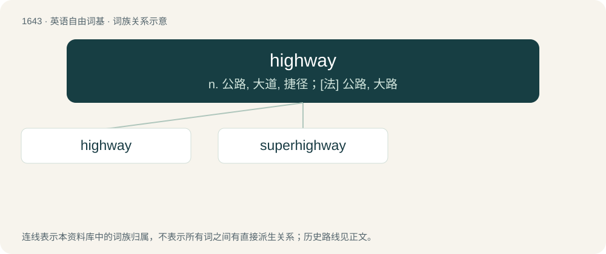

# 1742 · highway — n. 公路, 大道, 捷径；\[法\] 公路, 大路

[总目录](../00_总目录_按常用程度.md)

**类型**：英语自由词基　｜　**来源语言**：见词源记录

## 核心含义与来源

- 核心含义：n. 公路, 大道, 捷径；\[法\] 公路, 大路
- 英文含义：A main public road, especially a multi-lane, high-speed thoroughfare.
- 词形：highway

**来源记录 1**（名词；A main public road, especially a multi-lane, high-speed thoroughfare.）

From Middle English heiȝwai, heiȝwei, from Old English hēahweġ (“main road, highway”), corresponding to high + way. Compare highgate, high street, high road. Cognate with Scots heaway, heway, hieway, hichway, heichway (“highway”).

## 词族图

## 单词速览（常用到不常用）

| 单词 | 音标 | 释义 |
|---|---|---|
| [highway](#w-1) | /ˈhaɪweɪ/ | n. 公路, 大道, 捷径；\[法\] 公路, 大路 |
| [superhighway](#w-2) | /.sjuːpəˈhaiwei/ | n. 超级高速公路 |

## 逐词详解

### 1. highway

**词性**：名词　｜　**音标**：/ˈhaɪweɪ/

**中文释义**：n. 公路, 大道, 捷径；\[法\] 公路, 大路

**英文义项**：A main public road, especially a multi-lane, high-speed thoroughfare. / Any public road.

**构词拆分**：high + way

**词源与演化**：

From Middle English heiȝwai, heiȝwei, from Old English hēahweġ (“main road, highway”), corresponding to high + way. Compare highgate, high street, high road. Cognate with Scots heaway, heway, hieway, hichway, heichway (“highway”).

**例句**：

> You're on a highway to greatness.

该用例对应义项：A way; a path that leads to a certain destiny.

### 2. superhighway

**词性**：名词　｜　**音标**：/.sjuːpəˈhaiwei/

**中文释义**：n. 超级高速公路

**英文义项**：An expressway, especially one designed for high speeds. / A major route that carries most of the traffic going in a given direction by a specified mode of transportation.

**构词拆分**：super- + highway

**词源与演化**：

From super- + highway.

**例句**：

> The Internet was also called the information superhighway in the 1990s.
