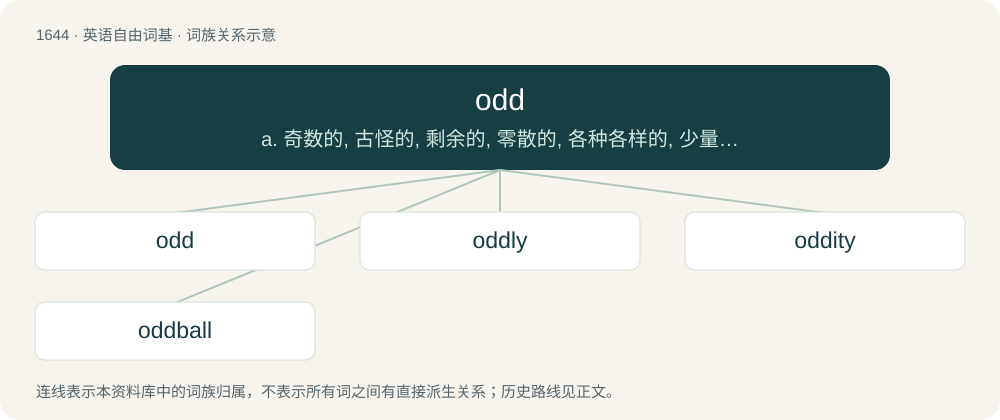

# 1743 · odd — a. 奇数的, 古怪的, 剩余的, 零散的, 各种各样的, 少量的；n. 奇特的事物, 怪人；\[计\] 奇数, 奇校验, 光数据数字转换器

[总目录](../00_总目录_按常用程度.md)

**类型**：英语自由词基　｜　**来源语言**：见词源记录

## 核心含义与来源

- 核心含义：a. 奇数的, 古怪的, 剩余的, 零散的, 各种各样的, 少量的；n. 奇特的事物, 怪人；\[计\] 奇数, 奇校验, 光数据数字转换器
- 英文含义：Differing from what is usual, ordinary or expected.
- 词形：odd

**来源记录 1**（形容词；Differing from what is usual, ordinary or expected.）

From Middle English odde, od (“odd (not even); leftover after division into pairs”), from Old Norse oddi (“odd, third or additional number; triangle”), from oddr (“point of a weapon”), from Proto-Germanic \*uzdaz (“point”), from Proto-Indo-European \*wes- (“to stick, prick, pierce, sting”) + \*dʰeh₁- (“to set, place”). Cognate to Icelandic oddi (“triangle, point of land, odd number”), Swedish udda (“odd”), udd (“a point”), Danish od (“point of weapon”) and odde (“a headland, point”), Norwegian Bokmål odde (“a point”, “odd”, “peculiar”); related to Old English ord (“a point”). Doublet of ord ("point").

## 词族图

## 单词速览（常用到不常用）

| 单词 | 音标 | 释义 |
|---|---|---|
| [odd](#w-1) | 英 /ɒd/；美 /ɑd/ | a. 奇数的, 古怪的, 剩余的, 零散的, 各种各样的, 少量的；n. 奇特的事物, 怪人；\[计\] 奇数, 奇校验, 光数据数字转换器 |
| [oddly](#w-2) | 英 /ˈɒdli/；美 /ˈɑdli/ | adv. 奇怪地 |
| [oddity](#w-3) | 英 /ˈɒdɪti/；美 /ˈɑdɪti/ | n. 奇异, 奇特, 怪人, 怪事, 怪僻 |
| [oddball](#w-4) | 美 /ˈɑːdˌbɔl/ | a. 古怪的, 奇怪的；n. 古怪的人 |

## 逐词详解

### 1. odd

**词性**：形容词　｜　**音标**：英 /ɒd/；美 /ɑd/

**中文释义**：a. 奇数的, 古怪的, 剩余的, 零散的, 各种各样的, 少量的；n. 奇特的事物, 怪人；\[计\] 奇数, 奇校验, 光数据数字转换器

**英文义项**：Differing from what is usual, ordinary or expected. / Peculiar, singular and strange in looks or character; eccentric, bizarre.

**词源与演化**：

From Middle English odde, od (“odd (not even); leftover after division into pairs”), from Old Norse oddi (“odd, third or additional number; triangle”), from oddr (“point of a weapon”), from Proto-Germanic \*uzdaz (“point”), from Proto-Indo-European \*wes- (“to stick, prick, pierce, sting”) + \*dʰeh₁- (“to set, place”). Cognate to Icelandic oddi (“triangle, point of land, odd number”), Swedish udda (“odd”), udd (“a point”), Danish od (“point of weapon”) and odde (“a headland, point”), Norwegian Bokmål odde (“a point”, “odd”, “peculiar”); related to Old English ord (“a point”). Doublet of ord ("point").

**例句**：

> I don't speak Latin well, so in hearing a dissertation in Latin, I would only be able to make out the odd word of it.

该用例对应义项：Scattered; occasional, infrequent; not forming part of a set or pattern.

### 2. oddly

**词性**：副词　｜　**音标**：英 /ˈɒdli/；美 /ˈɑdli/

**中文释义**：adv. 奇怪地

**英文义项**：In a peculiar manner; strangely; unusually. / In a manner measured by an odd number.

**构词拆分**：odd + -ly

**词源与演化**：

From Middle English oddely, odly, equivalent to odd + -ly.

**例句**：

> For December, it was oddly warm.

该用例对应义项：In a peculiar manner; strangely; unusually.

### 3. oddity

**词性**：名词　｜　**音标**：英 /ˈɒdɪti/；美 /ˈɑdɪti/

**中文释义**：n. 奇异, 奇特, 怪人, 怪事, 怪僻

**英文义项**：An odd or strange thing or opinion. / A strange person; an oddball.

**构词拆分**：odd + -ity

**词源与演化**：

From odd + -ity.

### 4. oddball

**词性**：名词　｜　**音标**：美 /ˈɑːdˌbɔl/

**中文释义**：a. 古怪的, 奇怪的；n. 古怪的人

**英文义项**：An eccentric or unusual person. / A deviant stimulus that appears among repetitive stimuli during an experiment, to trigger an event-related potential in the participant.

**构词拆分**：odd + ball

**词源与演化**：

Compound of odd + ball. First used in late 1930s, describing an extra ball played as a bonus in pin-ball type games. Well-attested since the 1940s, with the adjective appearing earlier than the noun.

**例句**：

> It was clear that the old oddball had to do everything differently again.
