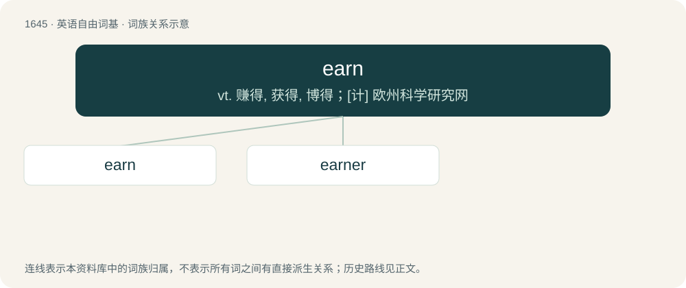

# 1744 · earn — vt. 赚得, 获得, 博得；\[计\] 欧州科学研究网

[总目录](../00_总目录_按常用程度.md)

**类型**：英语自由词基　｜　**来源语言**：见词源记录

## 核心含义与来源

- 核心含义：vt. 赚得, 获得, 博得；\[计\] 欧州科学研究网
- 英文含义：To gain (success, reward, recognition) through applied effort or work.
- 词形：earn

**来源记录 1**（动词；To gain (success, reward, recognition) through applied effort or work.）

From Middle English ernen, from Old English earnian, from Proto-West Germanic \*aʀanōn, from Proto-Germanic \*azanōną. This verb is denominal from the noun \*azaniz (“harvest”).

## 词族图

## 单词速览（常用到不常用）

| 单词 | 音标 | 释义 |
|---|---|---|
| [earn](#w-1) | 英 /ɜːn/；美 /ɝn/ | vt. 赚得, 获得, 博得；\[计\] 欧州科学研究网 |
| [earner](#w-2) | /ˈəːnə/ | n. 赚钱的人 |

## 逐词详解

### 1. earn

**词性**：动词　｜　**音标**：英 /ɜːn/；美 /ɝn/

**中文释义**：vt. 赚得, 获得, 博得；\[计\] 欧州科学研究网

**英文义项**：To gain (success, reward, recognition) through applied effort or work. / To receive payment for work or for a role or position held (regardless of whether effort was applied or whether the remuneration is deserved or commensurate).

**词源与演化**：

From Middle English ernen, from Old English earnian, from Proto-West Germanic \*aʀanōn, from Proto-Germanic \*azanōną. This verb is denominal from the noun \*azaniz (“harvest”).

**例句**：

> With their hard work and dedication, they earned respect and a seat at the table.

该用例对应义项：To gain (success, reward, recognition) through applied effort or work.

### 2. earner

**词性**：名词　｜　**音标**：/ˈəːnə/

**中文释义**：n. 赚钱的人

**英文义项**：One who earns money. / A profitable product or scheme; something that brings in good money.

**构词拆分**：earn + -er

**词源与演化**：

From earn + -er.

**例句**：

> Those Japanese radios were a nice little earner: we sold all of them by lunchtime.

该用例对应义项：A profitable product or scheme; something that brings in good money.
