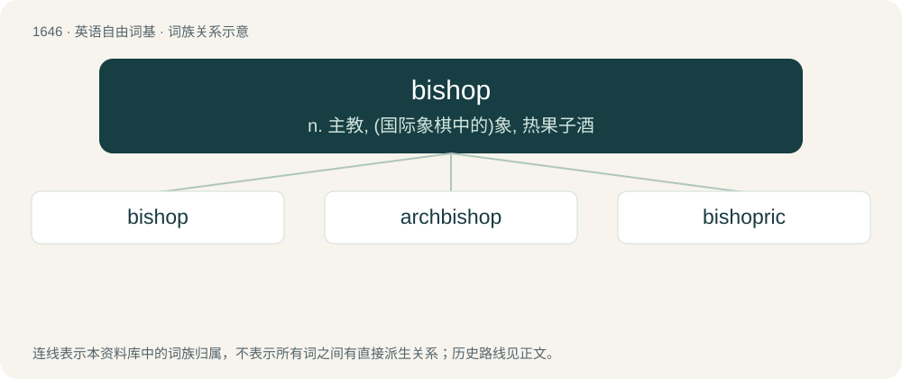

# 1745 · bishop — n. 主教, (国际象棋中的)象, 热果子酒

[总目录](../00_总目录_按常用程度.md)

**类型**：英语自由词基　｜　**来源语言**：见词源记录

## 核心含义与来源

- 核心含义：n. 主教, (国际象棋中的)象, 热果子酒
- 英文含义：An overseer of congregations: either any such overseer, generally speaking, or (in Eastern Orthodoxy, Catholicism, Anglicanism, etc.) an official in the church hierarchy (actively or nominally) governing a diocese, supervising the church's priests, deacons, and property in its territory.
- 词形：bishop

**来源记录 1**（名词；An overseer of congregations: either any such overseer, generally speaking, or (in Eastern Orthodoxy, Catholicism, Anglicanism, etc.) an official in the church hierarchy (actively or nominally) governing a diocese, supervising the church's priests, deacons, and property in its territory.）

From Middle English bischop, bishop, bisshop, biscop, from Old English bisċop (“bishop”), from Proto-West Germanic \*biskop, from Vulgar Latin (e)biscopus, from classical Latin episcopus (“overseer, supervisor”), from Ancient Greek ἐπίσκοπος (epískopos, “overseer”), from ἐπί (epí, “over”) + σκοπός (skopós, “watcher”), used in Greek and Latin both generally and as a title of civil officers. Cognate with all European terms for the position in various Christian churches; compare also Middle English bisp (“bishop”). \* The Tyndale Bible uses native English overseer instead.

## 词族图

## 单词速览（常用到不常用）

| 单词 | 音标 | 释义 |
|---|---|---|
| [bishop](#w-1) | /ˈbɪʃəp/ | n. 主教, (国际象棋中的)象, 热果子酒 |
| [archbishop](#w-2) | 英 /ˌɑː(ɹ)t͡ʃˈbɪʃəp/ | n. 大主教 |
| [bishopric](#w-3) | 英 /ˈbɪʃəpɹɪk/ | n. 主教的职位, 主教的辖区 |

## 逐词详解

### 1. bishop

**词性**：名词　｜　**音标**：/ˈbɪʃəp/

**中文释义**：n. 主教, (国际象棋中的)象, 热果子酒

**英文义项**：An overseer of congregations: either any such overseer, generally speaking, or (in Eastern Orthodoxy, Catholicism, Anglicanism, etc.) an official in the church hierarchy (actively or nominally) governing a diocese, supervising the church's priests, deacons, and property in its territory. / A chief of the Festival of Fools or St. Nicholas Day.

**词源与演化**：

From Middle English bischop, bishop, bisshop, biscop, from Old English bisċop (“bishop”), from Proto-West Germanic \*biskop, from Vulgar Latin (e)biscopus, from classical Latin episcopus (“overseer, supervisor”), from Ancient Greek ἐπίσκοπος (epískopos, “overseer”), from ἐπί (epí, “over”) + σκοπός (skopós, “watcher”), used in Greek and Latin both generally and as a title of civil officers. Cognate with all European terms for the position in various Christian churches; compare also Middle English bisp (“bishop”). \* The Tyndale Bible uses native English overseer instead.

**例句**：

> By taking the knight, the bishop put the opponent's king in check.

### 2. archbishop

**词性**：名词　｜　**音标**：英 /ˌɑː(ɹ)t͡ʃˈbɪʃəp/

**中文释义**：n. 大主教

**英文义项**：A senior bishop who is in charge of an archdiocese, and presides over a group of dioceses called a province (in Catholicism, Eastern Orthodoxy, Anglicanism, etc.) / A fairy chess piece which combines the moves of the bishop and the knight.

**构词拆分**：arch- + bishop

**词源与演化**：

From Middle English erchebischop, archebischop, from Old English arċebisċop (“archbishop”), from Late Latin or Ecclesiastical Latin archiepiscopus, from Ancient Greek ἀρχιεπίσκοπος (arkhiepískopos), from ἀρχι- (arkhi-, “first, chief”) + ἐπίσκοπος (epískopos, “overseer”), from ἐπισκοπέω (episkopéō, “to watch over”), from ἐπί (epí, “over”) + σκοπέω (skopéō, “to examine”), equivalent to arch- + bishop.

**例句**：

> The archbishop caused an uproar with his dismissive comments about the nuns' concerns.

### 3. bishopric

**词性**：名词　｜　**音标**：英 /ˈbɪʃəpɹɪk/

**中文释义**：n. 主教的职位, 主教的辖区

**英文义项**：A diocese: a region in which a bishop of a church governs. / The office or function of a bishop.

**构词拆分**：bishop + -ric

**词源与演化**：

From Middle English bischopriche, from Old English bisċoprīċe, equivalent to bishop + -ric (compare German Reich).

**例句**：

> Later that year, he was appointed to the bishopric of Lindesmeere.

该用例对应义项：A diocese: a region in which a bishop of a church governs.
