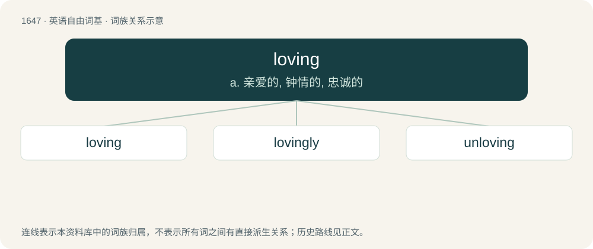

# 1746 · loving — a. 亲爱的, 钟情的, 忠诚的

[总目录](../00_总目录_按常用程度.md)

**类型**：英语自由词基　｜　**来源语言**：见词源记录

## 核心含义与来源

- 核心含义：a. 亲爱的, 钟情的, 忠诚的
- 英文含义：The action of the verb to love.
- 词形：loving

**来源记录 1**（名词；The action of the verb to love.）

Inherited from Middle English lovyng(e) (“love”), inherited from Old English lufung. By surface analysis, love + -ing.

## 词族图

## 单词速览（常用到不常用）

| 单词 | 音标 | 释义 |
|---|---|---|
| [loving](#w-1) | 英 /ˈlʌv.ɪŋ/ | a. 亲爱的, 钟情的, 忠诚的 |
| [lovingly](#w-2) | /ˈlʌviŋli/ | adv. 钟爱地, 亲切地 |
| [unloving](#w-3) | /ˈʌnˈlʌviŋ/ | a. 无爱心的 |

## 逐词详解

### 1. loving

**词性**：形容词　｜　**音标**：英 /ˈlʌv.ɪŋ/

**中文释义**：a. 亲爱的, 钟情的, 忠诚的

**英文义项**：Expressing a large amount of love to other people; affectionate.

**词源与演化**：

Inherited from Middle English lovyng(e) (“love”), inherited from Old English lufung. By surface analysis, love + -ing.

**用法示例／搭配（非完整句）**：

> his loving wife, her loving husband

该用例对应义项：Expressing a large amount of love to other people; affectionate.

### 2. lovingly

**词性**：副词　｜　**音标**：/ˈlʌviŋli/

**中文释义**：adv. 钟爱地, 亲切地

**英文义项**：In a loving manner, affectionately.

**构词拆分**：loving + -ly

**词源与演化**：

From loving + -ly.

**例句**：

> The kids asked Ziri for sweets and he reacted lovingly.

### 3. unloving

**词性**：形容词　｜　**音标**：/ˈʌnˈlʌviŋ/

**中文释义**：a. 无爱心的

**英文义项**：Not loving.

**构词拆分**：un- + loving

**词源与演化**：

From un- + loving.

**例句**：

> My mother was unloving towards me.
