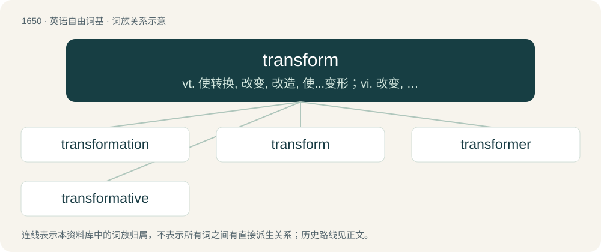

# 1747 · transform — vt. 使转换, 改变, 改造, 使...变形；vi. 改变, 转化, 变换；\[计\] 变换

[总目录](../00_总目录_按常用程度.md)

**类型**：英语自由词基　｜　**来源语言**：见词源记录

## 核心含义与来源

- 核心含义：vt. 使转换, 改变, 改造, 使...变形；vi. 改变, 转化, 变换；\[计\] 变换
- 英文含义：To change greatly the appearance or form of.
- 词形：transform

**来源记录 1**（动词；To change greatly the appearance or form of.）

From Middle English transformen, from Old French transformer, from Latin transformo, transformare, from trans (“across”, preposition) + forma (“form”).

## 词族图

## 单词速览（常用到不常用）

| 单词 | 音标 | 释义 |
|---|---|---|
| [transformation](#w-1) | 英 /ˌtɹæns.fə(ɹ)ˈmeɪ.ʃən/；美 /ˌtɹæns.fɔɹˈmeɪ.ʃən/ | n. 变形, 变质, 变化, 改革, 变换；\[化\] 转化; 变换 |
| [transform](#w-2) | 英 /tɹænsˈfɔːm/；美 /tɹænsˈfɔɹm/ | vt. 使转换, 改变, 改造, 使...变形；vi. 改变, 转化, 变换；\[计\] 变换 |
| [transformer](#w-3) | 英 /tɹænsˈfɔːmə/；美 /tɹænsˈfoɹməɹ/ | n. 变压器, 促使变化的人；\[化\] 变压器 |
| [transformative](#w-4) | 英 /trɑːnsˈfɔːmətɪv/；美 /tɹænsˈfɔɹmətɪv/ | a. 有改革能力的, 起改造作用的 |

## 逐词详解

### 1. transformation

**词性**：名词　｜　**音标**：英 /ˌtɹæns.fə(ɹ)ˈmeɪ.ʃən/；美 /ˌtɹæns.fɔɹˈmeɪ.ʃən/

**中文释义**：n. 变形, 变质, 变化, 改革, 变换；\[化\] 转化; 变换

**英文义项**：The act of transforming or the state of being transformed. / A marked change in appearance or character, especially one for the better.

**构词拆分**：transform + -ation

**词源与演化**：

Inherited from Middle English transformacioun, from Middle French, from Ecclesiastical Latin trānsfōrmātiō. Morphologically transform + -ation.

**用法示例／搭配（非完整句）**：

> undergo a radical transformation

该用例对应义项：The act of transforming or the state of being transformed.

### 2. transform

**词性**：动词　｜　**音标**：英 /tɹænsˈfɔːm/；美 /tɹænsˈfɔɹm/

**中文释义**：vt. 使转换, 改变, 改造, 使...变形；vi. 改变, 转化, 变换；\[计\] 变换

**英文义项**：To change greatly the appearance or form of. / To change the nature, condition or function of; to change in nature, disposition, heart, character, etc.; to convert.

**词源与演化**：

From Middle English transformen, from Old French transformer, from Latin transformo, transformare, from trans (“across”, preposition) + forma (“form”).

**例句**：

> The renovation will transform the empty warehouse into a library.

这次改造将把空仓库变成一座图书馆。

### 3. transformer

**词性**：名词　｜　**音标**：英 /tɹænsˈfɔːmə/；美 /tɹænsˈfoɹməɹ/

**中文释义**：n. 变压器, 促使变化的人；\[化\] 变压器

**英文义项**：Something that transforms, changing its own or another thing's shape. / A static device that transfers electric energy from one circuit to another by magnetic coupling; primarily used to transfer energy between different voltage levels, which allows the most appropriate voltages for power generation, transmission and distribution to be chosen separately.

**构词拆分**：transform + -er

**词源与演化**：

From transform + -er.

**例句**：

> A transformer converts alternating current to direct current for use in electronics.

### 4. transformative

**词性**：形容词　｜　**音标**：英 /trɑːnsˈfɔːmətɪv/；美 /tɹænsˈfɔɹmətɪv/

**中文释义**：a. 有改革能力的, 起改造作用的

**英文义项**：That causes a transformation; causing a notable and lasting change / Chiefly in transformative-generative: of or relating to a theory of generative grammar in which defined operations called transformations produce new sentences from existing ones; transformational.

**构词拆分**：transform + -ative

**词源与演化**：

From Medieval Latin transformātīvus (“transformative”), from Latin trānsfōrmātus (“transformed”) + -īvus (suffix attached to the perfect passive participial stems of verbs, forming deverbal adjectives meaning ‘doing or related to doing \[the verb\]’). Trānsfōrmātus is the perfect passive participle of trānsfōrmō (“to transform”), from trāns- (prefix meaning ‘across; beyond; through’) + fōrmō (“to fashion, form, format, shape”) (from fōrma (“appearance, figure, form, shape”); further etymology unknown, perhaps related to Ancient Greek μορφή (morphḗ, “a form, shape”)). The English word is analysable as transform + -ative.

**例句**：

> This transformative experience showed me the incredible potential we possess.
