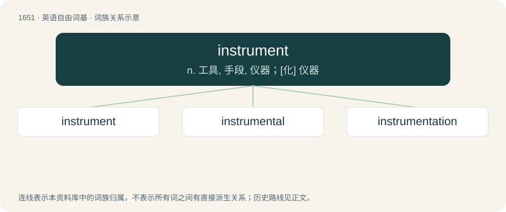

# 1748 · instrument — n. 工具, 手段, 仪器；\[化\] 仪器

[总目录](../00_总目录_按常用程度.md)

**类型**：英语自由词基　｜　**来源语言**：见词源记录

## 核心含义与来源

- 核心含义：n. 工具, 手段, 仪器；\[化\] 仪器
- 英文含义：A device used to produce music.
- 词形：instrument

**来源记录 1**（名词；A device used to produce music.）

From Middle English instrument, from Old French instrument, from Latin īnstrūmentum (“an implement, tool”), From īnstruō (“build, construct; arrange”) + -mentum.

## 词族图

## 单词速览（常用到不常用）

| 单词 | 音标 | 释义 |
|---|---|---|
| [instrument](#w-1) | /ˈɪnstɹəmənt/ | n. 工具, 手段, 仪器；\[化\] 仪器 |
| [instrumental](#w-2) | /ɪnstɹəˈmɛntəl/ | a. 仪器的, 器具的, 可作为手段的；\[医\] 器械的 |
| [instrumentation](#w-3) | /.instrumenˈteiʃən/ | n. 乐器法, 仪器制造学, 仪表化；\[医\] 器械用法, 器械操作法 |

## 逐词详解

### 1. instrument

**词性**：名词　｜　**音标**：/ˈɪnstɹəmənt/

**中文释义**：n. 工具, 手段, 仪器；\[化\] 仪器

**英文义项**：A device used to produce music. / A means or agency for achieving an aspect.

**词源与演化**：

From Middle English instrument, from Old French instrument, from Latin īnstrūmentum (“an implement, tool”), From īnstruō (“build, construct; arrange”) + -mentum.

**例句**：

> The scientist recorded the temperature with a thermometer, but wished he had a more accurate instrument.

该用例对应义项：A tool, implement used for manipulation or measurement.

### 2. instrumental

**词性**：形容词　｜　**音标**：/ɪnstɹəˈmɛntəl/

**中文释义**：a. 仪器的, 器具的, 可作为手段的；\[医\] 器械的

**英文义项**：Essential or central; of great importance or relevance. / Serving as an instrument, medium, means, or agency.

**构词拆分**：instrument + -al

**词源与演化**：

From Middle English instrumental, instrumentale, from Medieval Latin īnstrūmentālis, equivalent to instrument + -al.

**例句**：

> He was instrumental in conducting the business.

该用例对应义项：Essential or central; of great importance or relevance.

### 3. instrumentation

**词性**：名词　｜　**音标**：/.instrumenˈteiʃən/

**中文释义**：n. 乐器法, 仪器制造学, 仪表化；\[医\] 器械用法, 器械操作法

**英文义项**：The act of using or adapting as an instrument; a series or combination of instruments. / The arrangement of a musical composition for performance by a number of different instruments; instrumental composition; composition for an orchestra or military band.

**构词拆分**：instrument + -ation

**词源与演化**：

From instrument + -ation.

**例句**：

> The car's instrumentation included fuel, temperature, voltimeter and oil pressure gauges, along with a speedometer and tachometer.

该用例对应义项：On a vehicle, dashboard gauges monitoring engine functions and performance, along with other essential functions.
