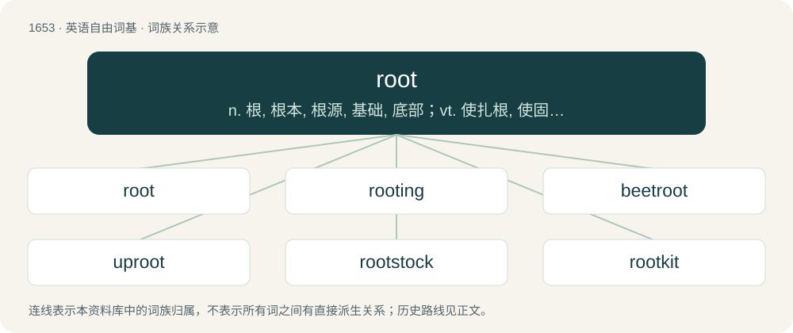

# 1749 · root — n. 根, 根本, 根源, 基础, 底部；vt. 使扎根, 使固定, 根除, 肃清, 搜出, 用鼻拱；vi. 生根, 固定, 源于, 用鼻拱土, 寻找, 捧场, 支持

[总目录](../00_总目录_按常用程度.md)

**类型**：英语自由词基　｜　**来源语言**：见词源记录

## 核心含义与来源

- 核心含义：n. 根, 根本, 根源, 基础, 底部；vt. 使扎根, 使固定, 根除, 肃清, 搜出, 用鼻拱；vi. 生根, 固定, 源于, 用鼻拱土, 寻找, 捧场, 支持
- 英文含义：The part of a plant, generally underground, that anchors and supports the plant body, absorbs and stores water and nutrients, and in some plants is able to perform vegetative reproduction.
- 词形：root

**多个词源／构词路径**：同一拼写可能有不同来源；以下按词性和含义分别列出。

**来源记录 1**（名词；The part of a plant, generally underground, that anchors and supports the plant body, absorbs and stores water and nutrients, and in some plants is able to perform vegetative reproduction.）

From Middle English rote, root, roote (“the underground part of a plant”), from late Old English rōt, from Old Norse rót (“root”), from Proto-Germanic \*wrōts (“root”), from Proto-Indo-European \*wréh₂ds (“root”); Doublet of wort, radish, and radix. Cognate with Scots ruit, rute (“root”), Danish rod (“root”), Faroese and Icelandic rót (“root”), Norwegian Bokmål, Norwegian Nynorsk, and Swedish rot (“root”).

**来源记录 2**（动词；To turn up or dig with the snout.）

From Middle English wrōten (“to dig with the snout”), from Old English wrōtan, from Proto-West Germanic \*wrōtan, from Proto-Germanic \*wrōtaną (“to dig out, to root”). Related to Old English wrōt (“snout; trunk”). Loss of initial w- probably due to influence from the related noun (Etymology 1).

**来源记录 3**（动词；To cheer (on); to show support (for) and hope for the success of. (See root for.)）

Possibly an alteration of rout (“to make a loud noise”), influenced by hoot.

## 词族图

## 单词速览（常用到不常用）

| 单词 | 音标 | 释义 |
|---|---|---|
| [root](#w-1) | 英 /ɹuːt/；美 /ɹut/ | n. 根, 根本, 根源, 基础, 底部；vt. 使扎根, 使固定, 根除, 肃清, 搜出, 用鼻拱；vi. 生根, 固定, 源于, 用鼻拱土, 寻找, 捧场, 支持 |
| [rooting](#w-2) | /ˈruːtiŋ/ | \[计\] 求根 |
| [beetroot](#w-3) | 英 /ˈbiːt.ɹuːt/；美 /ˈbit.ɹut/ | n. 甜菜根 |
| [uproot](#w-4) | 英 /ˌʌpˈɹuːt/；美 /ˌʌpˈɹut/ | vt. 连根拔起, 根除 |
| [rootstock](#w-5) | /ˈruːtstɒk/ | n. 根茎, 根源, 起源；\[医\] 根茎 |
| [rootkit](#w-6) | /rʊkɪt/ | n. 一种特殊类型的恶意软件 |
| [rooty](#w-7) | /ˈruːti/ | a. 多根的, 根似的 |
| [rooter](#w-8) | /ˈruːtə/ | n. 拔根者, 用鼻拱土的动物, 挖土机, 啦啦队员 |

## 逐词详解

### 1. root

**词性**：名词　｜　**音标**：英 /ɹuːt/；美 /ɹut/

**中文释义**：n. 根, 根本, 根源, 基础, 底部；vt. 使扎根, 使固定, 根除, 肃清, 搜出, 用鼻拱；vi. 生根, 固定, 源于, 用鼻拱土, 寻找, 捧场, 支持

**英文义项**：The part of a plant, generally underground, that anchors and supports the plant body, absorbs and stores water and nutrients, and in some plants is able to perform vegetative reproduction. / A root vegetable.

**词源与演化**：

From Middle English rote, root, roote (“the underground part of a plant”), from late Old English rōt, from Old Norse rót (“root”), from Proto-Germanic \*wrōts (“root”), from Proto-Indo-European \*wréh₂ds (“root”); Doublet of wort, radish, and radix. Cognate with Scots ruit, rute (“root”), Danish rod (“root”), Faroese and Icelandic rót (“root”), Norwegian Bokmål, Norwegian Nynorsk, and Swedish rot (“root”).

**例句**：

> The root diameter is the minor diameter of an external thread and the major diameter of an internal one.

该用例对应义项：The bottom of the thread of a threaded object.

### 2. rooting

**词性**：名词　｜　**音标**：/ˈruːtiŋ/

**中文释义**：\[计\] 求根

**英文义项**：A system of roots; a secure attachment (in something); a firm grounding. / The process of forming roots or taking roots.

**构词拆分**：root + -ing

**词源与演化**：

From Middle English rotynge (“rooting”); equivalent to root + -ing.

**例句**：

> These rootings may be as deep as two and a half feet, depending on how large a pig has been working.

该用例对应义项：A hole formed by a pig when it roots in the ground.

### 3. beetroot

**词性**：名词　｜　**音标**：英 /ˈbiːt.ɹuːt/；美 /ˈbit.ɹut/

**中文释义**：n. 甜菜根

**英文义项**：A normally deep-red-colored root vegetable usually cooked or pickled before eating. / The edible part of the root of a beet plant, raw or prepared.

**构词拆分**：beet + root

**词源与演化**：

From beet + root.

**例句**：

> Beetroot was offered to Apollo in his temple at Delphi.

### 4. uproot

**词性**：动词　｜　**音标**：英 /ˌʌpˈɹuːt/；美 /ˌʌpˈɹut/

**中文释义**：vt. 连根拔起, 根除

**英文义项**：To tear up (a plant, etc.) by the roots, or as if by the roots; to extirpate, to root up. / To destroy (something) utterly; to eradicate, exterminate.

**构词拆分**：up- (prefix indicating a higher direction or position) + root (“to tear up by the roots; (figuratively) to remove forcibly from a place; to eradicate, exterminate”, verb)

**词源与演化**：

From up- (prefix indicating a higher direction or position) + root (“to tear up by the roots; (figuratively) to remove forcibly from a place; to eradicate, exterminate”, verb). Root is derived from root (“underground part of a plant”, noun), from Middle English rote, from Old English rōt, rōte, from Old Norse rót, from Proto-Germanic \*wrōts, ultimately from Proto-Indo-European \*wréh₂ds (“root”).

**例句**：

> Uproot the vine that has spread all over the garden.

该用例对应义项：pull up by or as if by the roots

### 5. rootstock

**词性**：名词　｜　**音标**：/ˈruːtstɒk/

**中文释义**：n. 根茎, 根源, 起源；\[医\] 根茎

**英文义项**：A healthy and vigorous-rooted plant that is used in grafting, most commonly as a sound base to support a scion that bears desirable fruit in orchard culture. / The necessary basis for something to develop.

**构词拆分**：root + stock

**词源与演化**：

From root + stock.

**例句**：

> The orchardist grafted an apple bud onto the rootstock.

### 6. rootkit

**词性**：名词　｜　**音标**：/rʊkɪt/

**中文释义**：n. 一种特殊类型的恶意软件

**英文义项**：A set of software tools used by a third party to gain unauthorized access to a computer system and control the system while concealing itself from the user.

**构词拆分**：root + kit

**词源与演化**：

From root + kit.

### 7. rooty

**词性**：形容词　｜　**音标**：/ˈruːti/

**中文释义**：a. 多根的, 根似的

**英文义项**：Full of roots. / Resembling or characteristic of roots.

**构词拆分**：root + -y

**词源与演化**：

From root + -y.

**例句**：

> The vegetable stew had an earthy, rooty flavour.

该用例对应义项：Resembling or characteristic of roots.

### 8. rooter

**词性**：名词　｜　**音标**：/ˈruːtə/

**中文释义**：n. 拔根者, 用鼻拱土的动物, 挖土机, 啦啦队员

**英文义项**：One who, or that which, roots; one that tears up by the roots. / A type of heavy machinery similar to a plow for breaking up soil, concrete, asphalt, etc.

**构词拆分**：root + -er

**词源与演化**：

From root + -er.
