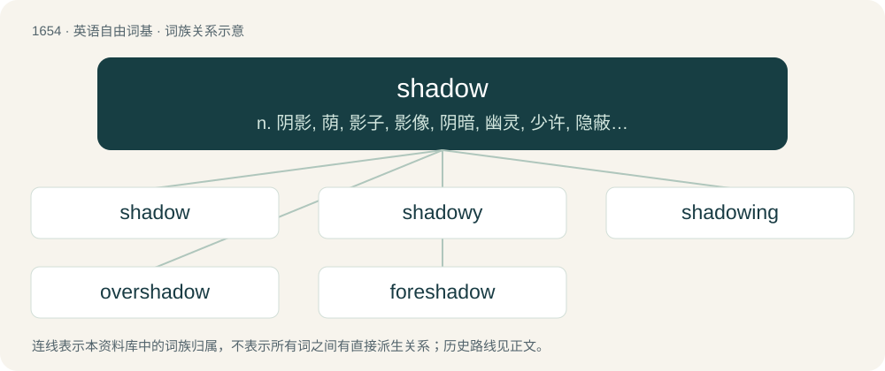

# 1750 · shadow — n. 阴影, 荫, 影子, 影像, 阴暗, 幽灵, 少许, 隐蔽处, 庇护；vt. 遮蔽, 使朦胧, 预示, 尾随；vi. 渐变, 变阴暗

[总目录](../00_总目录_按常用程度.md)

**类型**：英语自由词基　｜　**来源语言**：见词源记录

## 核心含义与来源

- 核心含义：n. 阴影, 荫, 影子, 影像, 阴暗, 幽灵, 少许, 隐蔽处, 庇护；vt. 遮蔽, 使朦胧, 预示, 尾随；vi. 渐变, 变阴暗
- 英文含义：A dark image projected onto a surface where light (or other radiation) is blocked by the shade of an object.
- 词形：shadow

**多个词源／构词路径**：同一拼写可能有不同来源；以下按词性和含义分别列出。

**来源记录 1**（名词；A dark image projected onto a surface where light (or other radiation) is blocked by the shade of an object.）

From Middle English schadowe, schadewe, schadwe (also schade &gt; shade), from Old English sċeaduwe, sċeadwe, oblique form of sċeadu (“shadow, shade; darkness; protection”), from Proto-West Germanic \*skadu, from Proto-Germanic \*skaduz (“shade, shadow”), from Proto-Indo-European \*(s)ḱeh₃- (“darkness”). Doublet of shade. Cognates Cognate with Scots shedda (“shadow”), Saterland Frisian Skaad, Skade (“shade, shadow”), West Frisian skaad, skâd (“shade, shadow”), Central Franconian and Limburgish Schatte (“shadow”), Dutch schade, schaduw (“shadow”), German Schatten (“shade, shadow”), German Low German Scharr, Scharre (“shade, shadow”), Luxembourgish Schiet (“shade, shadow”), Vilamovian siota (“shadow”), Yiddish שאָטן (shotn, “shadow”), Faroese skadda (“thick wet mountain fog”), Icelandic skodda, skoddi (“shadow”), Norwegian Bokmål skodde (“fog, mist”), Norwegian Nynorsk skodde, skåddj, skåidd (“fog; ice fog”), Gothic 𐍃𐌺𐌰𐌳𐌿𐍃 (skadus, “shadow”); also Breton skeud (“shadow; reflection; ghost”), Cornish skeus (“shadow; reflection”), Irish scáth (“shadow”), Manx scaa, skæ (“shield; shade, shadow”), Scottish Gaelic sgàth (“shade, shadow”), Latin obscurus (“dark, dusky, shadowy”), Ancient Greek σκότος (skótos, “darkness, gloom”) (whence English scoto-), Belarusian сівы́ (sivý, “grey”), Czech and Slovak sivý (“grey”), Macedonian осој (osoj, “shady place”), Polish siwy (“grey”), Russian си́вый (sívyj, “grey”), Serbo-Croatian сив, siv (“grey”), Slovene osoja (“shady place”), Ukrainian си́вий (sývyj, “grey”), Armenian սեաւ (seaw), սեւ (sew, “black”), Ossetian сау (saw, “black”), Persian سه (sah), سیه (siyah), سیاه (siyâh, “black”), Sanskrit श्याम (śyāma, “black”), श्याव (śyāva, “dark”).

**来源记录 2**（动词；To shade, cloud, or darken.）

From Middle English schadowen, from Old English sċeadwian, from sċeadu (“shadow; shade”) + -ian (suffix forming verbs).

## 词族图

## 单词速览（常用到不常用）

| 单词 | 音标 | 释义 |
|---|---|---|
| [shadow](#w-1) | 英 /ˈʃædəʊ̯/；美 /ˈʃædoʊ̯/ | n. 阴影, 荫, 影子, 影像, 阴暗, 幽灵, 少许, 隐蔽处, 庇护；vt. 遮蔽, 使朦胧, 预示, 尾随；vi. 渐变, 变阴暗 |
| [shadowy](#w-2) | 英 /ˈʃæd.əʊ.i/；美 /ˈʃæd.oʊ.i/ | a. 有影的, 暗黑的, 朦胧的, 虚幻的 |
| [shadowing](#w-3) | 英 /ˈʃædəʊɪŋ/；美 /ʃædoʊɪŋ/ | n. 遮蔽 |
| [overshadow](#w-4) | 英 /ˌəʊ.vəˈʃæd.əʊ/；美 /ˌoʊ.vɚˈʃæd.oʊ/ | vt. 遮阴, 使阴暗, 使失色, 使相形见绌, 使蒙上阴影 |
| [foreshadow](#w-5) | /fɔːˈʃædəʊ/ | vt. 成为前兆, 预示 |

## 逐词详解

### 1. shadow

**词性**：名词　｜　**音标**：英 /ˈʃædəʊ̯/；美 /ˈʃædoʊ̯/

**中文释义**：n. 阴影, 荫, 影子, 影像, 阴暗, 幽灵, 少许, 隐蔽处, 庇护；vt. 遮蔽, 使朦胧, 预示, 尾随；vi. 渐变, 变阴暗

**英文义项**：A dark image projected onto a surface where light (or other radiation) is blocked by the shade of an object. / Relative darkness, especially as caused by the interruption of light; gloom; obscurity.

**词源与演化**：

From Middle English schadowe, schadewe, schadwe (also schade &gt; shade), from Old English sċeaduwe, sċeadwe, oblique form of sċeadu (“shadow, shade; darkness; protection”), from Proto-West Germanic \*skadu, from Proto-Germanic \*skaduz (“shade, shadow”), from Proto-Indo-European \*(s)ḱeh₃- (“darkness”). Doublet of shade. Cognates Cognate with Scots shedda (“shadow”), Saterland Frisian Skaad, Skade (“shade, shadow”), West Frisian skaad, skâd (“shade, shadow”), Central Franconian and Limburgish Schatte (“shadow”), Dutch schade, schaduw (“shadow”), German Schatten (“shade, shadow”), German Low German Scharr, Scharre (“shade, shadow”), Luxembourgish Schiet (“shade, shadow”), Vilamovian siota (“shadow”), Yiddish שאָטן (shotn, “shadow”), Faroese skadda (“thick wet mountain fog”), Icelandic skodda, skoddi (“shadow”), Norwegian Bokmål skodde (“fog, mist”), Norwegian Nynorsk skodde, skåddj, skåidd (“fog; ice fog”), Gothic 𐍃𐌺𐌰𐌳𐌿𐍃 (skadus, “shadow”); also Breton skeud (“shadow; reflection; ghost”), Cornish skeus (“shadow; reflection”), Irish scáth (“shadow”), Manx scaa, skæ (“shield; shade, shadow”), Scottish Gaelic sgàth (“shade, shadow”), Latin obscurus (“dark, dusky, shadowy”), Ancient Greek σκότος (skótos, “darkness, gloom”) (whence English scoto-), Belarusian сівы́ (sivý, “grey”), Czech and Slovak sivý (“grey”), Macedonian осој (osoj, “shady place”), Polish siwy (“grey”), Russian си́вый (sívyj, “grey”), Serbo-Croatian сив, siv (“grey”), Slovene osoja (“shady place”), Ukrainian си́вий (sývyj, “grey”), Armenian սեաւ (seaw), սեւ (sew, “black”), Ossetian сау (saw, “black”), Persian سه (sah), سیه (siyah), سیاه (siyâh, “black”), Sanskrit श्याम (śyāma, “black”), श्याव (śyāva, “dark”).

**例句**：

> The neopagan ritual was only a pale shadow of the ones the Greeks held thousands of years ago.

该用例对应义项：An imperfect and faint representation.

### 2. shadowy

**词性**：形容词　｜　**音标**：英 /ˈʃæd.əʊ.i/；美 /ˈʃæd.oʊ.i/

**中文释义**：a. 有影的, 暗黑的, 朦胧的, 虚幻的

**英文义项**：In shadow; darkened by shadows. / Dark, obscure.

**构词拆分**：shadow + -y

**词源与演化**：

From Middle English schadwy, schadowy, equivalent to shadow + -y.

**例句**：

> He was a shadowy man who rarely spoke.

该用例对应义项：Dark, obscure.

### 3. shadowing

**词性**：名词　｜　**音标**：英 /ˈʃædəʊɪŋ/；美 /ʃædoʊɪŋ/

**中文释义**：n. 遮蔽

**英文义项**：The effect of being shadowed (in the sense of blocked), as from a light source or radio transmission. / The situation where a person repeats speech immediately as they hear it (usually through earphones).

**构词拆分**：shadow (verb) + -ing (suffix forming nouns denoting the act of doing something, an action, or the embodiment of an action; or forming present participles of verbs)

**词源与演化**：

From shadow (verb) + -ing (suffix forming nouns denoting the act of doing something, an action, or the embodiment of an action; or forming present participles of verbs).

**例句**：

> I want to be able to speak Japanese, so when I have the spare time, I'll do some shadowing.

### 4. overshadow

**词性**：动词　｜　**音标**：英 /ˌəʊ.vəˈʃæd.əʊ/；美 /ˌoʊ.vɚˈʃæd.oʊ/

**中文释义**：vt. 遮阴, 使阴暗, 使失色, 使相形见绌, 使蒙上阴影

**英文义项**：To obscure something by casting a shadow. / To dominate something and make it seem insignificant.

**构词拆分**：over- + shadow

**词源与演化**：

From Middle English overschadwen, overschadewe, from Old English ofersċeadwian (“to overshadow”), equivalent to over- + shadow. Compare with West Frisian oerskaduwe (“to overshadow”), Dutch overschaduwen (“to overshadow”), German überschatten (“to overshadow”), Gothic 𐌿𐍆𐌰𐍂𐍃𐌺𐌰𐌳𐍅𐌾𐌰𐌽 (ufarskadwjan, “to overshadow”), and more distantly, Old Norse yfirskyggja (“to overshadow”), Danish overskygge (“to overshadow”), Swedish överskugga (“to overshadow”), Old English ofersċūwan (“to overshadow”).

**例句**：

> The English teacher's insensitive comments overshadow the progress and achievements of foreign learners.

### 5. foreshadow

**词性**：动词　｜　**音标**：/fɔːˈʃædəʊ/

**中文释义**：vt. 成为前兆, 预示

**英文义项**：To suggest (someone or something) in advance; to prefigure, to presage. / Of a person: to have an intuition or premonition about (something); to forebode.

**构词拆分**：fore- (prefix meaning ‘before with respect to time, earlier’) + shadow (“to shade, cloud, or darken”, verb)；fore- + shadow (“faint and imperfect representation”, noun)

**词源与演化**：

The verb is derived from fore- (prefix meaning ‘before with respect to time, earlier’) + shadow (“to shade, cloud, or darken”, verb). The noun is derived from fore- + shadow (“faint and imperfect representation”, noun), probably modelled after the verb which is attested earlier.
