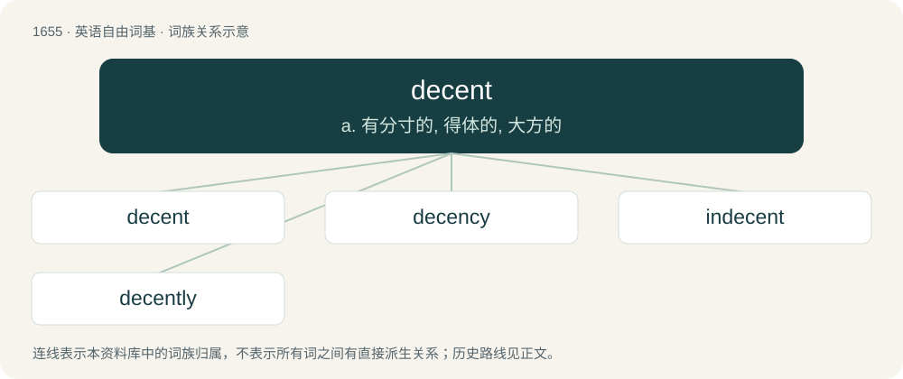

# 1751 · decent — a. 有分寸的, 得体的, 大方的

[总目录](../00_总目录_按常用程度.md)

**类型**：英语自由词基　｜　**来源语言**：见词源记录

## 核心含义与来源

- 核心含义：a. 有分寸的, 得体的, 大方的
- 英文含义：Appropriate; suitable for the circumstances.
- 词形：decent

**来源记录 1**（形容词；Appropriate; suitable for the circumstances.）

Borrowed from Middle French décent, or its source, Latin decēns, present participle of decet (“it is fitting or suitable”), from Proto-Indo-European \*deḱ- (“to take, accept, to receive, greet, be suitable”) (compare Ancient Greek δοκέω (dokéō, “to appear, seem, think”), δέχομαι (dékhomai, “to accept”); Sanskrit दशस्यति (daśasyáti, “shows honor, is gracious”), दाशति (dāśati, “makes offerings, bestows”)). Meaning ‘kind, pleasant’ is from 1902.

## 词族图

## 单词速览（常用到不常用）

| 单词 | 音标 | 释义 |
|---|---|---|
| [decent](#w-1) | 英 /ˈdiː.sənt/；美 /ˈdi.sənt/ | a. 有分寸的, 得体的, 大方的 |
| [decency](#w-2) | 英 /ˈdiːsənsi/；美 /ˈdisənsi/ | n. 得体, 礼貌, 正派；\[法\] 正当, 正派, 合乎礼仪 |
| [indecent](#w-3) | 英 /ɪnˈdiːs(ə)nt/；美 /ɪnˈdi.sənt/ | a. 下流的, 不礼貌的；\[医\] 猥亵的 |
| [decently](#w-4) | 英 /ˈdiːsəntli/ | adv. 合适地；高雅地；正派地；亲切地 |

## 逐词详解

### 1. decent

**词性**：形容词　｜　**音标**：英 /ˈdiː.sənt/；美 /ˈdi.sənt/

**中文释义**：a. 有分寸的, 得体的, 大方的

**英文义项**：Appropriate; suitable for the circumstances. / Having a suitable conformity to basic moral standards; showing integrity, fairness, or other characteristics associated with moral uprightness.

**词源与演化**：

Borrowed from Middle French décent, or its source, Latin decēns, present participle of decet (“it is fitting or suitable”), from Proto-Indo-European \*deḱ- (“to take, accept, to receive, greet, be suitable”) (compare Ancient Greek δοκέω (dokéō, “to appear, seem, think”), δέχομαι (dékhomai, “to accept”); Sanskrit दशस्यति (daśasyáti, “shows honor, is gracious”), दाशति (dāśati, “makes offerings, bestows”)). Meaning ‘kind, pleasant’ is from 1902.

**例句**：

> He's a decent saxophonist, but probably not good enough to make a career of it.

该用例对应义项：Fair; acceptable; okay.

### 2. decency

**词性**：名词　｜　**音标**：英 /ˈdiːsənsi/；美 /ˈdisənsi/

**中文释义**：n. 得体, 礼貌, 正派；\[法\] 正当, 正派, 合乎礼仪

**英文义项**：The quality of being decent; propriety. / That which is proper or becoming.

**构词拆分**：decent + -cy

**词源与演化**：

From Latin decentia, from decens. Equivalent to decent + -cy. Compare French décence.

**例句**：

> Tom didn't even have the decency to admit it was his fault.

### 3. indecent

**词性**：形容词　｜　**音标**：英 /ɪnˈdiːs(ə)nt/；美 /ɪnˈdi.sənt/

**中文释义**：a. 下流的, 不礼貌的；\[医\] 猥亵的

**英文义项**：Offensive to good taste. / Not in keeping with conventional moral values; improper, immodest, or unseemly.

**构词拆分**：in- + decent

**词源与演化**：

From in- + decent.

**用法示例／搭配（非完整句）**：

> indecent comment

该用例对应义项：Offensive to good taste.

### 4. decently

**词性**：副词　｜　**音标**：英 /ˈdiːsəntli/

**中文释义**：adv. 合适地；高雅地；正派地；亲切地

**英文义项**：In a decent manner. / To a reasonable or acceptable degree.

**构词拆分**：decent + -ly

**词源与演化**：

From decent + -ly.

**例句**：

> You need to be decently attired to enter the restaurant.

该用例对应义项：In a decent manner.
