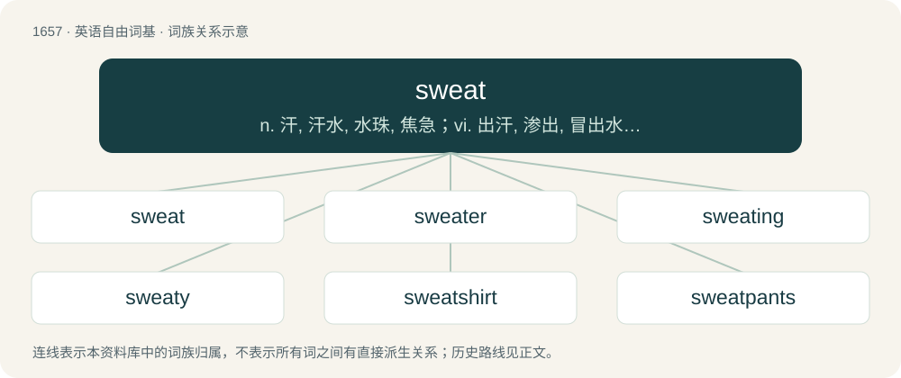

# 1752 · sweat — n. 汗, 汗水, 水珠, 焦急；vi. 出汗, 渗出, 冒出水气, 结水珠, 烦恼, 懊恼；vt. 使出汗, 流出, 榨出, 使汗流浃背

[总目录](../00_总目录_按常用程度.md)

**类型**：英语自由词基　｜　**来源语言**：见词源记录

## 核心含义与来源

- 核心含义：n. 汗, 汗水, 水珠, 焦急；vi. 出汗, 渗出, 冒出水气, 结水珠, 烦恼, 懊恼；vt. 使出汗, 流出, 榨出, 使汗流浃背
- 英文含义：Fluid that exits the body through pores in the skin usually due to physical stress and/or high temperature for the purpose of regulating body temperature and removing certain compounds from the circulation.
- 词形：sweat

**多个词源／构词路径**：同一拼写可能有不同来源；以下按词性和含义分别列出。

**来源记录 1**（名词；Fluid that exits the body through pores in the skin usually due to physical stress and/or high temperature for the purpose of regulating body temperature and removing certain compounds from the circulation.）

From Middle English swete, swet, swate, swote, from Old English swāt, from Proto-Germanic \*swait-, \*swaitą, from Proto-Indo-European \*swoyd- (“to sweat”), o-grade of \*sweyd- (“to sweat”). Cognate with West Frisian swit, Dutch zweet, German Schweiß, Danish sved, Norwegian Bokmål svette, Norwegian Nynorsk sveitte, Swedish svett, Yiddish שוויצן (shvitsn) (English shvitz), Latin sudor, French sueur, Italian sudore, Spanish sudor, Portuguese suor, Persian خوی (xway, “sweat”), Sanskrit स्वेद (svéda), Lithuanian sviedri, Tocharian B syā-, Albanian djersë, and Welsh chwys.

**来源记录 2**（动词；To emit sweat.）

From Middle English sweten, from Old English swǣtan, from Proto-Germanic \*swaitijaną (“to sweat”). Compare Dutch zweten, German schwitzen, Danish svede. Doublet of shvitz.

## 词族图

## 单词速览（常用到不常用）

| 单词 | 音标 | 释义 |
|---|---|---|
| [sweat](#w-1) | /swɛt/ | n. 汗, 汗水, 水珠, 焦急；vi. 出汗, 渗出, 冒出水气, 结水珠, 烦恼, 懊恼；vt. 使出汗, 流出, 榨出, 使汗流浃背 |
| [sweater](#w-2) | 英 /ˈswɛtə/；美 /ˈswɛtɚ/ | n. 毛衣, 毛线衫, 运动衫, 出汗者；\[化\] 发汗器 |
| [sweating](#w-3) | /ˈswɛtɪŋ/ | \[化\] 发汗；\[医\] 出汗；\[经\] 汗损 |
| [sweaty](#w-4) | /ˈswɛti/ | a. 出汗的, 吃力的 |
| [sweatshirt](#w-5) | /ˈswɛtʃəːt/ | n. 园领长袖运动衫 |
| [sweatpants](#w-6) | 美 /ˈswɛtˌpænts/ | n. 运动裤 |
| [sweatshop](#w-7) | 英 /ˈswɛtˌʃɒp/；美 /ˈswɛtˌʃɑp/ | n. 血汗工厂 |

## 逐词详解

### 1. sweat

**词性**：名词　｜　**音标**：/swɛt/

**中文释义**：n. 汗, 汗水, 水珠, 焦急；vi. 出汗, 渗出, 冒出水气, 结水珠, 烦恼, 懊恼；vt. 使出汗, 流出, 榨出, 使汗流浃背

**英文义项**：Fluid that exits the body through pores in the skin usually due to physical stress and/or high temperature for the purpose of regulating body temperature and removing certain compounds from the circulation. / The state of one who is sweating; diaphoresis.

**词源与演化**：

From Middle English swete, swet, swate, swote, from Old English swāt, from Proto-Germanic \*swait-, \*swaitą, from Proto-Indo-European \*swoyd- (“to sweat”), o-grade of \*sweyd- (“to sweat”). Cognate with West Frisian swit, Dutch zweet, German Schweiß, Danish sved, Norwegian Bokmål svette, Norwegian Nynorsk sveitte, Swedish svett, Yiddish שוויצן (shvitsn) (English shvitz), Latin sudor, French sueur, Italian sudore, Spanish sudor, Portuguese suor, Persian خوی (xway, “sweat”), Sanskrit स्वेद (svéda), Lithuanian sviedri, Tocharian B syā-, Albanian djersë, and Welsh chwys.

**例句**：

> Just thinking about the interview tomorrow puts me into a nervous sweat.

该用例对应义项：The state of one who is sweating; diaphoresis.

### 2. sweater

**词性**：名词　｜　**音标**：英 /ˈswɛtə/；美 /ˈswɛtɚ/

**中文释义**：n. 毛衣, 毛线衫, 运动衫, 出汗者；\[化\] 发汗器

**英文义项**：A knitted jacket or jersey, usually of thick wool, worn by athletes before or after exercise. / A similar garment worn for warmth.

**构词拆分**：sweat + -er

**词源与演化**：

From Middle English swētere, equivalent to sweat + -er.

**例句**：

> As the day got cooler, I had to put on a sweater.

### 3. sweating

**词性**：形容词　｜　**音标**：/ˈswɛtɪŋ/

**中文释义**：\[化\] 发汗；\[医\] 出汗；\[经\] 汗损

**英文义项**：Giving off sweat.

**构词拆分**：sweat + -ing (gerund ending)

**词源与演化**：

From Middle English sweting, swetynge, equivalent to sweat + -ing (gerund ending).

**例句**：

> A sweating man stepped out of the sauna, wrapping himself in a towel.

该用例对应义项：Giving off sweat.

### 4. sweaty

**词性**：形容词　｜　**音标**：/ˈswɛti/

**中文释义**：a. 出汗的, 吃力的

**英文义项**：Covered in sweat. / Having a tendency to sweat.

**构词拆分**：sweat + -y

**词源与演化**：

From Middle English swety, equivalent to sweat + -y.

**例句**：

> I stick to casual because ranked lobbies are way too sweaty.

该用例对应义项：Attracting many extremely competitive players.

### 5. sweatshirt

**词性**：名词　｜　**音标**：/ˈswɛtʃəːt/

**中文释义**：n. 园领长袖运动衫

**英文义项**：A loose shirt, usually made of a knit fleece, for athletic wear and now often used as casual apparel. / A shirt worn against the skin, usually under other clothing, to absorb sweat.

**构词拆分**：sweat + shirt

**词源与演化**：

From sweat + shirt.

**例句**：

> The suspect was last seen wearing blue jeans and an orange sweatshirt.

### 6. sweatpants

**词性**：名词　｜　**音标**：美 /ˈswɛtˌpænts/

**中文释义**：n. 运动裤

**英文义项**：Informal cotton trousers, with an elasticated or drawstring waist, used for exercise etc.

**构词拆分**：sweat + pants

**词源与演化**：

From sweat + pants.

**例句**：

> Tom was wearing sweatpants when I saw him this morning.

### 7. sweatshop

**词性**：名词　｜　**音标**：英 /ˈswɛtˌʃɒp/；美 /ˈswɛtˌʃɑp/

**中文释义**：n. 血汗工厂

**英文义项**：A factory or other place of work where pay is low and conditions are poor or even illegal.

**构词拆分**：sweat (“to extract money, labour, etc.”, verb) + shop

**词源与演化**：

From sweat (“to extract money, labour, etc.”, verb) + shop.

**例句**：

> Many Jews were employed in the garment industry, working under sweatshop conditions.
