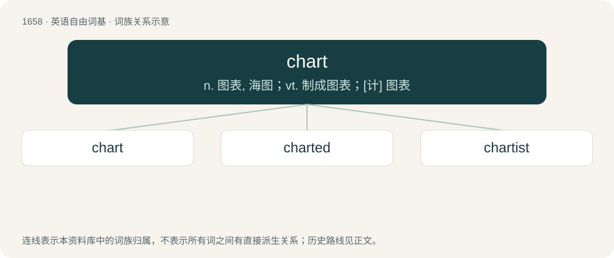

# 1753 · chart — n. 图表, 海图；vt. 制成图表；\[计\] 图表

[总目录](../00_总目录_按常用程度.md)

**类型**：英语自由词基　｜　**来源语言**：见词源记录

## 核心含义与来源

- 核心含义：n. 图表, 海图；vt. 制成图表；\[计\] 图表
- 英文含义：A map illustrating the geography of a specific phenomenon.
- 词形：chart

**来源记录 1**（名词；A map illustrating the geography of a specific phenomenon.）

Borrowed from Middle French charte (“card, map”), from Late Latin charta (“paper, card, map”), Latin charta (“papyrus, writing”), from Ancient Greek χάρτης (khártēs, “papyrus, thin sheet”). Doublet of card and carte; related to charter.

## 词族图

## 单词速览（常用到不常用）

| 单词 | 音标 | 释义 |
|---|---|---|
| [chart](#w-1) | 英 /tʃɑːt/；美 /t͡ʃɑɹt/ | n. 图表, 海图；vt. 制成图表；\[计\] 图表 |
| [charted](#w-2) |  | v. 绘制…的图；制订（chart的过去式） |
| [chartist](#w-3) | /ˈtʃɑːtist/ | n. 宪章派, 宪章运动者；\[经\] 图解专家 |

## 逐词详解

### 1. chart

**词性**：名词　｜　**音标**：英 /tʃɑːt/；美 /t͡ʃɑɹt/

**中文释义**：n. 图表, 海图；vt. 制成图表；\[计\] 图表

**英文义项**：A map illustrating the geography of a specific phenomenon. / A navigator's map.

**词源与演化**：

Borrowed from Middle French charte (“card, map”), from Late Latin charta (“paper, card, map”), Latin charta (“papyrus, writing”), from Ancient Greek χάρτης (khártēs, “papyrus, thin sheet”). Doublet of card and carte; related to charter.

**例句**：

> I snuck a look at his chart. It doesn't look good.

该用例对应义项：A record of a patient's diagnosis, care instructions, and recent history.

### 2. charted

**词性**：形容词

**中文释义**：v. 绘制…的图；制订（chart的过去式）

**英文义项**：Containing charts. / Appearing on a chart.

**构词拆分**：chart + -ed

**词源与演化**：

From chart + -ed. Piecewise doublet of carded.

**例句**：

> I charted our course with a compass, map and plenty of hope.

### 3. chartist

**词性**：名词　｜　**音标**：/ˈtʃɑːtist/

**中文释义**：n. 宪章派, 宪章运动者；\[经\] 图解专家

**英文义项**：A financial analyst who attempts to predict future movements in the prices of shares or other financial instruments by looking for patterns in charts of historical data.

**构词拆分**：chart + -ist

**词源与演化**：

From chart + -ist.
