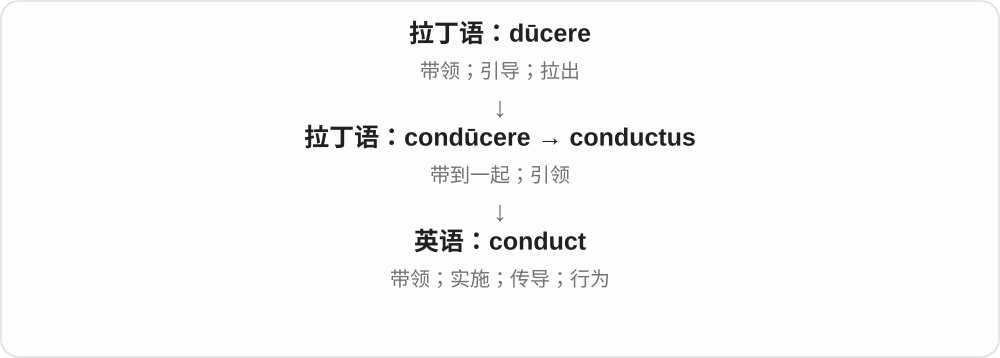
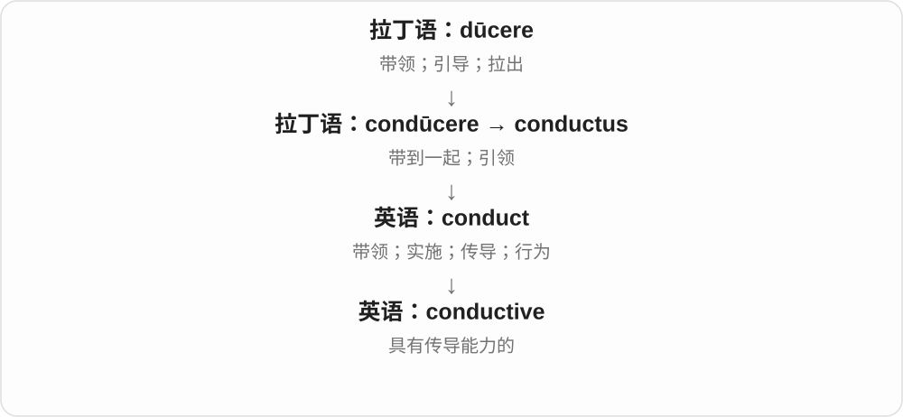

# 1755 · conduct — 引导、做事与让热电通过各有搭配

[逐词精讲目录](../00_逐词精讲目录.md) · [总目录](../00_总目录_按常用程度.md)

## 核心词根与来源

名词 conduct 品行常前重音，动词 conduct 引导、进行、传导常后重音。conductance 后重音，专门量义别和 conduction 过程混用。

**CONDUCT：带着走，导过去，或一个人的行为**

conduct、misconduct 接行为等；conductive、conduction、conductance 接传导。

- **行为、进行与不当行为**：conduct · misconduct
- **传导性质、过程与量**：conductive · conduction · conductance
- **conducts 的后重音动作形式**：conduct · conducts

## 词形与演化规律

拉丁 condūcere、conductus 等 → conduct；mis- + conduct；相关传导形容词、过程名词；conduct + -ance → conductance。

conducts 作动词三单，重读后面，不沿用名词 conduct 行为的前重音。

## 单词速览（按词族由简到繁）

同一基础词的相关扩展放在一起，先读基础形式，再读扩展；各组之间优先读常用的。具体词源关系见各词讲解。

| 单词 | 音标 | 核心意思 |
|---|---|---|
| [conduct](#w-1) | 动词 /kənˈdʌkt/；名词 英 /ˈkɒndʌkt/、美 /ˈkɑːndʌkt/ | 进行；指挥；传导；行为 |
| [conducts](#w-6) | /kənˈdʌkts/ | 指挥、开展、传导〔第三人称单数〕 |
| [conductive](#w-3) | /kənˈdʌktɪv/ | 导电的；导热的 |
| [conduction](#w-4) | /kənˈdʌkʃən/ | 传导 |
| [conductance](#w-5) | /kənˈdʌktəns/ | 电导；传导能力 |
| [misconduct](#w-2) | 名词英 /ˌmɪsˈkɒndʌkt/；美 /ˌmɪsˈkɑːndʌkt/ | 不当行为；失职；违规行为 |

## 逐词讲解

### 1. conduct — 进行；指挥；传导；行为

**音标**：动词 /kənˈdʌkt/；名词 英 /ˈkɒndʌkt/、美 /ˈkɑːndʌkt/

**先抓住这个画面**

conduct 的画面是“把一个过程带着走”：带领乐队演奏，组织调查进行，让电流通过材料；名词则说一个人怎样行事。

**怎么拆**

来自拉丁语 condūcere 及 conductus，con-（一起）+ dūcere（带领）。不是英语 con“骗局”加 duct。

**怎么变成今天的意思**

同一引导画面在不同对象上形成不同意思：人和活动被组织，热或电被传导。conduct oneself 是支配自己的举止，名词 conduct 因而是行为。

**常见搭配与例句**

conduct a survey（开展调查）；conduct an orchestra（指挥乐队）；conduct electricity（导电）；professional conduct（职业行为）。

> The team conducted a survey of local residents.

团队对当地居民开展了一项调查。

> His conduct during the meeting was calm and respectful.

他在会上表现得冷静而尊重他人。

**别混淆**

动词重音在后，名词在前。conduct an experiment 是实施实验，不是介绍实验。

### 2. conducts — 指挥、开展、传导〔第三人称单数〕

**音标**：/kənˈdʌkts/

**先抓住这个画面**

把人、活动或能量引着往前走：他指挥乐队，她开展研究，金属传导热，都可用 conducts。

**怎么拆**

conduct + -s，/t/ 后读 /s/。它是后重音动词形式，拉丁 con- 一起与 ducere 带领的材料保留在基础词历史里。

**怎么变成今天的意思**

**拉丁 con- + ducere → conducere、conductus**  
带到一起、引领

↓

**conduct、拉丁 conductor 及法语相关人物名 → 英语词族**  
指挥、实施、传导；指挥者、列车员、导体

↓

**动词 conduct + -s → conducts**  
他、她、它指挥、开展或传导

conducts an orchestra 是指挥乐队，conducts research 是开展研究，conducts heat 是传热。

**常见搭配与例句**

conducts experiments 做实验；conducts electricity 导电。

> She conducts the orchestra with clear gestures.

她用清晰的手势指挥乐队。

> This material conducts heat well.

这种材料导热良好。

**别混淆**

名词 conduct 行为常前重音，动词 conducts 后重音；主语、宾语能帮你判断是实施还是传导。

### 3. conductive — 导电的；导热的

**音标**：/kənˈdʌktɪv/

**先抓住这个画面**

conductive 形容一条通得过去的路：某种材料能让电或热通过。

**怎么拆**

conduct + -ive，形成形容词。这里的 conduct 用的是“传导”义。

**怎么变成今天的意思**

常见于材料说明。electrically conductive 指导电；thermally conductive 指导热，最好看清修饰词。

**常见搭配与例句**

conductive material（导电或导热材料）；conductive ink（导电油墨）；thermally conductive（导热的）。

> The sensor uses a thin layer of conductive ink.

传感器使用了一层薄薄的导电油墨。

> The design requires a thermally conductive material.

这项设计需要一种导热材料。

**别混淆**

conductive 谈传导性能；conducive to 谈某个条件有利于某种结果。不能说 a conducive wire 表示导线导电。

### 4. conduction — 传导

**音标**：/kənˈdʌkʃən/

**先抓住这个画面**

conduction 像把接力棒一段段传过去：热、电或神经信号通过某种材料或组织传递。

**怎么拆**

来自拉丁语 conductiō“带到一起”，现代可对照 conduct + -ion 理解。

**怎么变成今天的意思**

最常见的学习场景是热传导和电传导。把它想成“通过接触或介质内部传递”有帮助，但具体机制依领域而异。

**常见搭配与例句**

heat conduction（热传导）；electrical conduction（电传导）；nerve conduction（神经传导）。

> Heat reaches the handle by conduction through the metal.

热量通过金属传导到把手上。

> The experiment compared electrical conduction in two materials.

实验比较了两种材料的导电情况。

**别混淆**

conduction 是过程；conductor 是材料或参与传导的对象。convection“对流”依靠流体整体运动，是另一种传热方式。

### 5. conductance — 电导；传导能力

**音标**：/kənˈdʌktəns/

**先抓住这个画面**

电阻像给电流设阻碍，电导从另一面问：这段路径让电流通过有多容易。是一个量，不是泛指“导电这件事”。

**怎么拆**

conduct 传导 + -ance，形成量、性质名词，十九世纪出现。接 conduct 的物理传导一支，不接人的品行一支。

**怎么变成今天的意思**

**拉丁 condūcere、conductus 词族 → conduct**  
带领、引导；英语中发展传导等用法

↓

**conduct + -ance → conductance**  
传导能力、电导这一量

electrical conductance 电导，measure conductance 测电导。通常电导 G = 1/R，对应电阻倒数；常用单位 siemens，符号 S。

**常见搭配与例句**

electrical conductance；measure conductance；high conductance。

> The experiment measured the conductance of the wire.

实验测量了这段导线的电导。

> A lower resistance means a higher conductance.

电阻越低，电导越高。

**别混淆**

conductance 指具体对象的电导，conductivity 常说材料电导率；对象长度、粗细改变时，两者不能直接视为同一个量。

### 6. misconduct — 不当行为；失职；违规行为

**音标**：名词英 /ˌmɪsˈkɒndʌkt/；美 /ˌmɪsˈkɑːndʌkt/

**先抓住这个画面**

行为越过了应遵守的职业、组织或道德界线。

**怎么拆**

mis- “不当” + conduct“行为”；历史也有管理不善的用法。

**怎么变成今天的意思**

**日耳曼语系的 mis-，古英语已有**  
方向或结果不对；不是希腊“厌恶”

↓

**英语 mis- + conduct**  
不当的管理或行为

↓

**常用名词 misconduct**  
失职、违规或其他不当行为

misconduct 常出现在调查和纪律处分的语境：academic misconduct 是学术不端，professional misconduct 是职业失当。它比普通 mistake 更强调行为规范出了问题，但词本身不等于已经被判犯罪。

**常见搭配与例句**

professional misconduct；academic misconduct；an allegation of misconduct。

> The university investigated allegations of academic misconduct.

大学调查了有关学术不端的指控。

> The report found evidence of serious misconduct by senior staff.

报告发现了高级员工严重失当行为的证据。

**别混淆**

misconduct 通常不可数；an instance of misconduct 才是在数一件事。mistake 可以只是无心算错，misconduct 常涉及应遵守的规则。

## 这一组要分清什么

conduct 名词动词重音；conduction/conductance 传导过程与量；conductance/conductivity 对象电导与材料电导率。

## 串起来练习

The material conducts electricity, but this experiment measures the conductance of one specific sample.

这种材料能导电，而这次实验测的是某个具体样品的电导。
