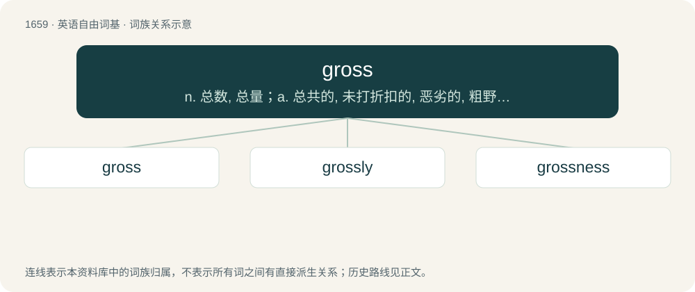

# 1756 · gross — n. 总数, 总量；a. 总共的, 未打折扣的, 恶劣的, 粗野的；vt. 总共收入

[总目录](../00_总目录_按常用程度.md)

**类型**：英语自由词基　｜　**来源语言**：见词源记录

## 核心含义与来源

- 核心含义：n. 总数, 总量；a. 总共的, 未打折扣的, 恶劣的, 粗野的；vt. 总共收入
- 英文含义：remarkably great, big, vast in an often unpleasant way; (of behaviour) Highly or conspicuously offensive.
- 词形：gross

**来源记录 1**（形容词；remarkably great, big, vast in an often unpleasant way; (of behaviour) Highly or conspicuously offensive.）

From Middle English gros (“large, thick, full-bodied; coarse, unrefined, simple”), from Old French gros, from Latin grossus (“big, fat, thick”, in Late Latin also “coarse, rough”), of uncertain further origin but perhaps related to Proto-Celtic \*brassos (“great, violent”).

## 词族图

## 单词速览（常用到不常用）

| 单词 | 音标 | 释义 |
|---|---|---|
| [gross](#w-1) | 英 /ɡɹəʊs/；美 /ɡɹoʊs/ | n. 总数, 总量；a. 总共的, 未打折扣的, 恶劣的, 粗野的；vt. 总共收入 |
| [grossly](#w-2) | 英 /ˈɡɹəʊsli/；美 /ˈɡɹoʊsli/ | adv. 非常, 很, 粗 |
| [grossness](#w-3) | 英 /ˈɡɹəʊsnəs/ | n. 肥满, 粗杂, 粗劣 |

## 逐词详解

### 1. gross

**词性**：形容词　｜　**音标**：英 /ɡɹəʊs/；美 /ɡɹoʊs/

**中文释义**：n. 总数, 总量；a. 总共的, 未打折扣的, 恶劣的, 粗野的；vt. 总共收入

**英文义项**：remarkably great, big, vast in an often unpleasant way; (of behaviour) Highly or conspicuously offensive. / Excluding any deductions; including all associated amounts.

**词源与演化**：

From Middle English gros (“large, thick, full-bodied; coarse, unrefined, simple”), from Old French gros, from Latin grossus (“big, fat, thick”, in Late Latin also “coarse, rough”), of uncertain further origin but perhaps related to Proto-Celtic \*brassos (“great, violent”).

**例句**：

> I threw up all over the bed. It was totally gross.

该用例对应义项：Causing disgust.

### 2. grossly

**词性**：副词　｜　**音标**：英 /ˈɡɹəʊsli/；美 /ˈɡɹoʊsli/

**中文释义**：adv. 非常, 很, 粗

**英文义项**：Greatly; to a large degree, especially one large enough to be frankly appreciable. / To a serious, severe, or offensive degree.

**构词拆分**：gross + -ly

**词源与演化**：

From gross + -ly.

**例句**：

> The men were talking grossly about their sexual conquests.

该用例对应义项：In a gross (disgusting) manner; without delicacy.

### 3. grossness

**词性**：名词　｜　**音标**：英 /ˈɡɹəʊsnəs/

**中文释义**：n. 肥满, 粗杂, 粗劣

**英文义项**：Lack of refinement in character, behaviour etc.; coarseness. / The quality of being repulsive or disgusting.

**构词拆分**：gross + -ness

**词源与演化**：

From gross + -ness.
