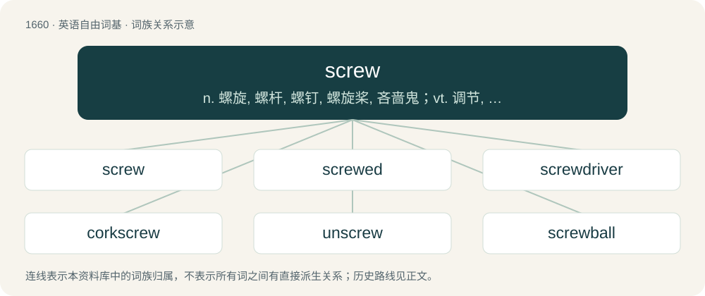

# 1758 · screw — n. 螺旋, 螺杆, 螺钉, 螺旋桨, 吝啬鬼；vt. 调节, 扭紧, 旋, 拧, 加强, 压榨, 勒索；vi. 转动, 旋, 拧

[总目录](../00_总目录_按常用程度.md)

**类型**：英语自由词基　｜　**来源语言**：见词源记录

## 核心含义与来源

- 核心含义：n. 螺旋, 螺杆, 螺钉, 螺旋桨, 吝啬鬼；vt. 调节, 扭紧, 旋, 拧, 加强, 压榨, 勒索；vi. 转动, 旋, 拧
- 英文含义：A simple machine, a helical inclined plane.
- 词形：screw

**来源记录 1**（名词；A simple machine, a helical inclined plane.）

From Middle English screw, scrue (“screw”); apparently, despite the difference in meaning, from Old French escroue (“nut, cylindrical socket, screwhole”), from Latin scrōfa (“female pig”) through comparison with the corkscrew shape of a pig's penis. There is also the Old French escruve (“screw”), from Old Dutch \*scrūva ("screw"; whence Middle Dutch schruyve (“screw”)), which probably influenced or conflated with the aforementioned, resulting in the Middle English word. more on the etymology of screw Old French escroue (whence Medieval Latin scrofa (“nut, screwhole”)), is believed to be an adaptation of Latin scrōfa (“sow, female pig”); but this development is not found in other Romance languages. (For change in meaning, compare also Spanish puerca, Portuguese porca, both ‘sow; screw nut’, and is based on the fact that a boar's penis has a screw-like tip, making the sow's vulva equivalent to a screw nut by analogy). Old Dutch \*scrūva possibly derives from Proto-Germanic \*skrūbō (“screw”), from \*skru- (“to cut”), from Proto-Indo-European \*(s)keru-, \*(s)ker- (“to cut”), and is related to German Schraube (“screw”), Low German schruve, schruwe (“screw”), Dutch schroef (“screw”), West Frisian skroef (“screw”), Danish skrue (“screw”), Swedish skruv (“screw, peg”), Icelandic skrúfa (“screw”). Compare also Occitan escrofa (“screw nut”), Calabrese scrufina (“screw nut”), which may be borrowings of the Old French word, or parallel developments.

## 词族图

## 单词速览（常用到不常用）

| 单词 | 音标 | 释义 |
|---|---|---|
| [screw](#w-1) | 英 /ˈskɹuː/；美 /ˈskɹu/ | n. 螺旋, 螺杆, 螺钉, 螺旋桨, 吝啬鬼；vt. 调节, 扭紧, 旋, 拧, 加强, 压榨, 勒索；vi. 转动, 旋, 拧 |
| [screwed](#w-2) | /skruːd/ | a. 以螺丝拧紧的, 螺丝状的, 喝醉了的 |
| [screwdriver](#w-3) | 美 /ˈskɹuˌdɹaɪvɚ/ | n. 螺丝起子；\[机\] 活动扳手 |
| [corkscrew](#w-4) | 英 /ˈkɔːk.skɹuː/；美 /ˈkɔɹk.skɹu/ | n. 拔塞钻；a. 螺旋形的；vt. 硬拉出, 探听 |
| [unscrew](#w-5) | /.ʌnˈskruː/ | v. 旋开, 旋松 |
| [screwball](#w-6) | /ˈskɹuːbɔːl/ | n. 怪人, 疯子, 内曲线球；a. 怪僻的, 精神有点怪的 |
| [screwy](#w-7) | /ˈskɹuː.i/ | a. 螺旋形的, 扭曲的, 乖诞的, 疯颠的, 讨价精明苛刻的 |

## 逐词详解

### 1. screw

**词性**：名词　｜　**音标**：英 /ˈskɹuː/；美 /ˈskɹu/

**中文释义**：n. 螺旋, 螺杆, 螺钉, 螺旋桨, 吝啬鬼；vt. 调节, 扭紧, 旋, 拧, 加强, 压榨, 勒索；vi. 转动, 旋, 拧

**英文义项**：A simple machine, a helical inclined plane. / A (usually) metal fastener consisting of a partially or completely threaded shank, sometimes with a threaded point, and a head used to both hold the top material and to drive the screw either directly into a soft material or into a prepared hole.

**词源与演化**：

From Middle English screw, scrue (“screw”); apparently, despite the difference in meaning, from Old French escroue (“nut, cylindrical socket, screwhole”), from Latin scrōfa (“female pig”) through comparison with the corkscrew shape of a pig's penis. There is also the Old French escruve (“screw”), from Old Dutch \*scrūva ("screw"; whence Middle Dutch schruyve (“screw”)), which probably influenced or conflated with the aforementioned, resulting in the Middle English word. more on the etymology of screw Old French escroue (whence Medieval Latin scrofa (“nut, screwhole”)), is believed to be an adaptation of Latin scrōfa (“sow, female pig”); but this development is not found in other Romance languages. (For change in meaning, compare also Spanish puerca, Portuguese porca, both ‘sow; screw nut’, and is based on the fact that a boar's penis has a screw-like tip, making the sow's vulva equivalent to a screw nut by analogy). Old Dutch \*scrūva possibly derives from Proto-Germanic \*skrūbō (“screw”), from \*skru- (“to cut”), from Proto-Indo-European \*(s)keru-, \*(s)ker- (“to cut”), and is related to German Schraube (“screw”), Low German schruve, schruwe (“screw”), Dutch schroef (“screw”), West Frisian skroef (“screw”), Danish skrue (“screw”), Swedish skruv (“screw, peg”), Icelandic skrúfa (“screw”). Compare also Occitan escrofa (“screw nut”), Calabrese scrufina (“screw nut”), which may be borrowings of the Old French word, or parallel developments.

**例句**：

> Before potato crisps were sold pre-salted each packet would contain a screw of salt.

该用例对应义项：A twist of paper, especially one containing a small quantity of a material such as salt or tobacco.

### 2. screwed

**词性**：形容词　｜　**音标**：/skruːd/

**中文释义**：a. 以螺丝拧紧的, 螺丝状的, 喝醉了的

**英文义项**：Beset with unfortunate circumstances that seem difficult or impossible to overcome; in imminent danger. / Intoxicated.

**构词拆分**：screw + -ed

**词源与演化**：

From screw + -ed. \* The modern sense of screwed originates in the mid-1600s with a sense of to screw as a means of "exerting pressure or coercion", probably in reference to instruments of torture (e.g. thumbscrews). It quickly gained a wider general sense of "in a bind; in unfortunate inescapable circumstances". When the verb screw gained a sexual connotation in the early 1700s, it joined the long-lasting association of sexual imagery as a metaphor for domination, leading to screwed gaining synonyms like fucked and shagged. On a more general note, this is a prime example of the frequent tendency for verb participles to evolve into participial adjectives. \* The sense meaning "intoxicated" is from the early 1800s, and is associated with the term screwy, and the idiom to have a screw loose.

**例句**：

> They found out about our betrayal, so now we're screwed.

该用例对应义项：Beset with unfortunate circumstances that seem difficult or impossible to overcome; in imminent danger.

### 3. screwdriver

**词性**：名词　｜　**音标**：美 /ˈskɹuˌdɹaɪvɚ/

**中文释义**：n. 螺丝起子；\[机\] 活动扳手

**英文义项**：A hand tool or power tool which engages with the head of a screw and allows torque to be applied to turn the screw, thus driving it in or loosening it. / A cocktail made of vodka and orange juice.

**构词拆分**：screw + driver

**词源与演化**：

Compound of screw + driver.

**例句**：

> If you want to unscrew these screws, you should use a screwdriver.

### 4. corkscrew

**词性**：名词　｜　**音标**：英 /ˈkɔːk.skɹuː/；美 /ˈkɔɹk.skɹu/

**中文释义**：n. 拔塞钻；a. 螺旋形的；vt. 硬拉出, 探听

**英文义项**：An implement for opening bottles that are sealed by a cork. Sometimes specifically such an implement that includes a screw-shaped part, or worm. / The screw-shaped worm of a typical corkscrew.

**构词拆分**：cork + screw

**词源与演化**：

From cork + screw.

**例句**：

> I opened the wine with a corkscrew.

该用例对应义项：An implement for opening bottles that are sealed by a cork. Sometimes specifically such an implement that includes a screw-shaped part, or worm.

### 5. unscrew

**词性**：动词　｜　**音标**：/.ʌnˈskruː/

**中文释义**：v. 旋开, 旋松

**英文义项**：To loosen a screw or thing by turning it.

**构词拆分**：un- + screw

**词源与演化**：

From un- + screw.

**例句**：

> I'm having some trouble unscrewing the lid of this jar.

该用例对应义项：To loosen a screw or thing by turning it.

### 6. screwball

**词性**：名词　｜　**音标**：/ˈskɹuːbɔːl/

**中文释义**：n. 怪人, 疯子, 内曲线球；a. 怪僻的, 精神有点怪的

**英文义项**：A pitch thrown with added pressure by the index finger and a twisting wrist motion resulting in a motion to the right when thrown by a right-handed pitcher. / One who behaves in a crazy manner.

**构词拆分**：screw + ball

**词源与演化**：

From screw + ball. Compare typologically German Spinner (akin to spin). Also compare weirdo and weird, from Old English wyrd (“fate”), ultimately derived from Proto-Indo-European \*wert- (“to turn, to spin”).

**例句**：

> The screwball is not thrown much because it tends to damage pitcher's arms.

该用例对应义项：A pitch thrown with added pressure by the index finger and a twisting wrist motion resulting in a motion to the right when thrown by a right-handed pitcher.

### 7. screwy

**词性**：形容词　｜　**音标**：/ˈskɹuː.i/

**中文释义**：a. 螺旋形的, 扭曲的, 乖诞的, 疯颠的, 讨价精明苛刻的

**英文义项**：Crazy; silly; ridiculous

**构词拆分**：screw + -y

**词源与演化**：

From screw + -y. 1820, original meaning “tipsy, slightly drunk”; meaning “crazy, ridiculous” first recorded 1887.

**例句**：

> That's a screwy idea; I am not going to fly all the way to Antarctica just to see a penguin!

该用例对应义项：Crazy; silly; ridiculous
