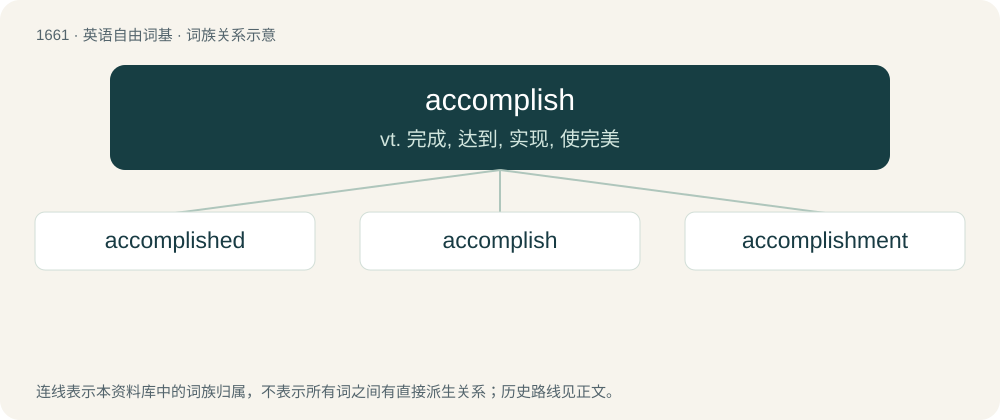

# 1759 · accomplish — vt. 完成, 达到, 实现, 使完美

[总目录](../00_总目录_按常用程度.md)

**类型**：英语自由词基　｜　**来源语言**：见词源记录

## 核心含义与来源

- 核心含义：vt. 完成, 达到, 实现, 使完美
- 英文含义：To finish successfully.
- 词形：accomplish

**来源记录 1**（动词；To finish successfully.）

From Middle English accomplisshen, acomplissen, from Old French acompliss-, extended stem of acomplir (Modern French accomplir), from Vulgar Latin \*(ac)complīre, from Latin complēre (“fill up/out, complete”, whence English complete). First attested in the late 14th century.

## 词族图

## 单词速览（常用到不常用）

| 单词 | 音标 | 释义 |
|---|---|---|
| [accomplished](#w-1) | 英 /əˈkʌm.plɪʃt/；美 /əˈkɑm.plɪʃt/ | a. 完成的, 实现的, 有造诣的, 熟练的, 善社交的 |
| [accomplish](#w-2) | 英 /əˈkʌm.plɪʃ/；美 /əˈkɑm.plɪʃ/ | vt. 完成, 达到, 实现, 使完美 |
| [accomplishment](#w-3) | 英 /əˈkɒm.plɪʃ.mənt/；美 /əˈkɑm.plɪʃ.mənt/ | n. 成就, 完成 |

## 逐词详解

### 1. accomplished

**词性**：形容词　｜　**音标**：英 /əˈkʌm.plɪʃt/；美 /əˈkɑm.plɪʃt/

**中文释义**：a. 完成的, 实现的, 有造诣的, 熟练的, 善社交的

**英文义项**：Completed; effected; established. / Having many accomplishments, often as a result of study or training.

**构词拆分**：accomplish + -ed

**词源与演化**：

\* First attested in the late 15th century, from accomplish + -ed.

**例句**：

> When he described the settlers' dominance as accomplished, he meant that it was a fait accompli.

该用例对应义项：Completed; effected; established.

### 2. accomplish

**词性**：动词　｜　**音标**：英 /əˈkʌm.plɪʃ/；美 /əˈkɑm.plɪʃ/

**中文释义**：vt. 完成, 达到, 实现, 使完美

**英文义项**：To finish successfully. / To complete, as time or distance.

**词源与演化**：

From Middle English accomplisshen, acomplissen, from Old French acompliss-, extended stem of acomplir (Modern French accomplir), from Vulgar Latin \*(ac)complīre, from Latin complēre (“fill up/out, complete”, whence English complete). First attested in the late 14th century.

**用法示例／搭配（非完整句）**：

> to accomplish a design, an object, a promise

该用例对应义项：To execute fully; to fulfill; to complete successfully.

### 3. accomplishment

**词性**：名词　｜　**音标**：英 /əˈkɒm.plɪʃ.mənt/；美 /əˈkɑm.plɪʃ.mənt/

**中文释义**：n. 成就, 完成

**英文义项**：The act of accomplishing; completion; fulfilment. / That which completes, perfects, or equips thoroughly; acquirement; attainment; that which constitutes excellence of mind, or elegance of manners, acquired by education or training.

**构词拆分**：accomplish + -ment

**词源与演化**：

\* First attested in the early 15th century. \* (completes, perfects, equips): First attested around 1600. \* accomplish + -ment \* Borrowed from French accomplissement, from accomplir

**例句**：

> Increasing sales by 20% in the last quarter was seen as a major accomplishment for the business.

该用例对应义项：Something accomplished; an achievement.
