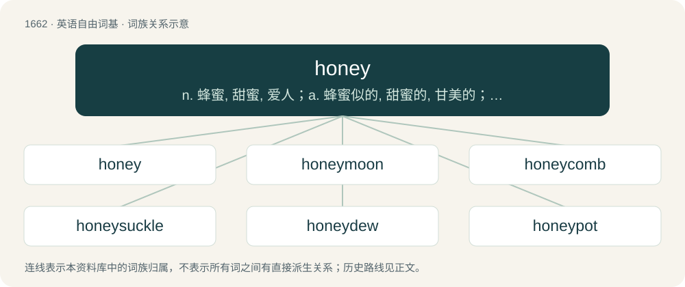

# 1762 · honey — n. 蜂蜜, 甜蜜, 爱人；a. 蜂蜜似的, 甜蜜的, 甘美的；vt. 加蜜使甜, 对...说甜言蜜语

[总目录](../00_总目录_按常用程度.md)

**类型**：英语自由词基　｜　**来源语言**：见词源记录

## 核心含义与来源

- 核心含义：n. 蜂蜜, 甜蜜, 爱人；a. 蜂蜜似的, 甜蜜的, 甘美的；vt. 加蜜使甜, 对...说甜言蜜语
- 英文含义：A sweet, viscous, gold-colored fluid produced from plant nectar by bees, and often consumed by humans.
- 词形：honey

**来源记录 1**（名词；A sweet, viscous, gold-colored fluid produced from plant nectar by bees, and often consumed by humans.）

From Middle English hony, honi, from Old English huniġ, from Proto-West Germanic \*hunag, from Proto-Germanic \*hunagą (compare Saterland Frisian Hunich, West Frisian hunich, German Low German Honnig, German Honig), from earlier \*hunangą (compare North Frisian honning, hönning, West Frisian huning, Dutch honing, Danish, Norwegian Bokmål, and Norwegian Nynorsk honning, Swedish honung, Faroese hunangur, Icelandic hunang), from Proto-Indo-European \*kn̥h₂onk-o-s, from \*kn̥h₂ónks. Cognate with Middle Welsh canecon (“gold”), Latin canicae pl (“bran”), Tocharian B kronkśe (“bee”), Albanian qengjë (“beehive”), Ancient Greek κνῆκος (knêkos, “safflower”), Northern Kurdish şan (“beehive”), Northern Luri گونج (gonj, “bee”), Finnish hunaja.

## 词族图

## 单词速览（常用到不常用）

| 单词 | 音标 | 释义 |
|---|---|---|
| [honey](#w-1) | 英 /ˈhʌni/ | n. 蜂蜜, 甜蜜, 爱人；a. 蜂蜜似的, 甜蜜的, 甘美的；vt. 加蜜使甜, 对...说甜言蜜语 |
| [honeymoon](#w-2) | /ˈhʌn.iˌmuːn/ | n. 蜜月, 蜜月假期；vi. 渡蜜月 |
| [honeycomb](#w-3) | 英 /ˈhʌnikəʊm/；美 /ˈhʌniˌkoʊm/ | n. 蜂巢, 蜂房, 蜂窝；a. 蜂巢的；vt. 使成蜂巢状 |
| [honeysuckle](#w-4) | 英 /ˈhʌnɪsʌk(ə)l/；美 /ˈhʌn.i.sʌk.əl/ | n. 忍冬, 杜鹃花 |
| [honeydew](#w-5) | 英 /ˈhʌnɪdjuː/；美 /ˈhʌniˌd(j)u/ | n. 蜜汁, 蜜露 |
| [honeypot](#w-6) | /ˈhʌnipɒt/ | n. 装蜜的罐子; 极有吸引力的事物 |
| [honeyed](#w-7) | /ˈhʌnid/ | a. 加了蜜的, 甜如蜜的, 多蜜的 |

## 逐词详解

### 1. honey

**词性**：名词　｜　**音标**：英 /ˈhʌni/

**中文释义**：n. 蜂蜜, 甜蜜, 爱人；a. 蜂蜜似的, 甜蜜的, 甘美的；vt. 加蜜使甜, 对...说甜言蜜语

**英文义项**：A sweet, viscous, gold-colored fluid produced from plant nectar by bees, and often consumed by humans. / A variety of this substance.

**词源与演化**：

From Middle English hony, honi, from Old English huniġ, from Proto-West Germanic \*hunag, from Proto-Germanic \*hunagą (compare Saterland Frisian Hunich, West Frisian hunich, German Low German Honnig, German Honig), from earlier \*hunangą (compare North Frisian honning, hönning, West Frisian huning, Dutch honing, Danish, Norwegian Bokmål, and Norwegian Nynorsk honning, Swedish honung, Faroese hunangur, Icelandic hunang), from Proto-Indo-European \*kn̥h₂onk-o-s, from \*kn̥h₂ónks. Cognate with Middle Welsh canecon (“gold”), Latin canicae pl (“bran”), Tocharian B kronkśe (“bee”), Albanian qengjë (“beehive”), Ancient Greek κνῆκος (knêkos, “safflower”), Northern Kurdish şan (“beehive”), Northern Luri گونج (gonj, “bee”), Finnish hunaja.

**例句**：

> Man, there are some fine honeys here tonight!

该用例对应义项：A woman, especially an attractive one.

### 2. honeymoon

**词性**：名词　｜　**音标**：/ˈhʌn.iˌmuːn/

**中文释义**：n. 蜜月, 蜜月假期；vi. 渡蜜月

**英文义项**：The period of time immediately following a marriage. / A trip taken by a newly married couple during this period.

**构词拆分**：honey + moon

**词源与演化**：

From earlier hony moone, originally denoting the period of time following a wedding, equivalent to honey + moon. The original reference was to affection waning like the moon, but later the sense became "the first month, or moon after marriage", which tends to be the sweetest. Compare Middle Low German suckermânt (“honeymoon”, literally “sugar-month”), German Low German Hönnigweken (“honeymoon”, literally “honey-weeks”). The German Honigmond (literally “honey-moon”) is a calque of French lune de miel, itself a calque of the English term.

**例句**：

> Now that the honeymoon is over, it’s time for us to get down to the business at hand.

该用例对应义项：A period of goodwill at the beginning of a new term or relationship (e.g. towards a newly elected politician or in respect of a new business arrangement).

### 3. honeycomb

**词性**：名词　｜　**音标**：英 /ˈhʌnikəʊm/；美 /ˈhʌniˌkoʊm/

**中文释义**：n. 蜂巢, 蜂房, 蜂窝；a. 蜂巢的；vt. 使成蜂巢状

**英文义项**：A substance made by bees (clade Anthophila) primarily from beeswax which has hexagonal cells to hold their larvae, and for storing pollen and honey to feed the larvae and themselves when other food is scarce; it is also eaten by humans as part of comb-honey; (countable) a single sheet made up of two layers of this substance. / Something resembling honeycomb (noun sense 1) in having numerous cells or small holes.

**构词拆分**：honey + comb

**词源与演化**：

The noun is derived from Middle English honycomb, from Old English huniġcamb, from huniġ (“honey”) (ultimately from Proto-Indo-European \*kn̥h₂ónks (“honey”)) + camb (“comb”) (ultimately from Proto-Indo-European \*ǵómbʰos (“peg; tooth; row of teeth”)). The English word is analysable as honey + comb. The Oxford English Dictionary posits that the arrangement of several plates of wax “hanging parallel to each other from the roof of the hive suggests a comb with its teeth”. The verb is derived from the noun. Compare Saterland Frisian Hunichmoarte (“honeycomb”), West Frisian huningskiif (“honeycomb”), Dutch honingraat (“honeycomb”), German Honigwabe (“honeycomb”).

**例句**：

> The wood porch was a honeycomb of termite tunnels before we replaced it.

该用例对应义项：Something resembling honeycomb (noun sense 1) in having numerous cells or small holes.

### 4. honeysuckle

**词性**：名词　｜　**音标**：英 /ˈhʌnɪsʌk(ə)l/；美 /ˈhʌn.i.sʌk.əl/

**中文释义**：n. 忍冬, 杜鹃花

**英文义项**：Any of the many species of arching shrubs and climbing vines of the genus Lonicera in the Caprifoliaceae family, many with sweet-smelling, bell-shaped flowers. / A light yellow color inspired by the color of honeysuckle blossoms.

**构词拆分**：honey + suck + -le；honeysuck + -le

**词源与演化**：

From Middle English honysokel, honisokel, honysocle, hunisuccle, perhaps an alteration of Middle English honysoke, honysouke (“honeysuckle”) (whence honeysuck), from Old English huniġsūce, huniġsūge (“honeysuckle”); equivalent to honey + suck + -le, or honeysuck + -le.

**例句**：

> The trellis was covered with honeysuckle.

### 5. honeydew

**词性**：名词　｜　**音标**：英 /ˈhʌnɪdjuː/；美 /ˈhʌniˌd(j)u/

**中文释义**：n. 蜜汁, 蜜露

**英文义项**：A sweet, sticky substance deposited on leaves and other plant parts by insects (especially aphids and scale insects) feeding on plant sap, or by fungi. / A sweet liquid substance resembling the substance mentioned in sense 1, such as honey, nectar, or manna in the Bible.

**构词拆分**：honey + dew

**词源与演化**：

The noun is derived from honey + dew, originally believed to be a form of dew that fell from the sky like rain onto plants (see sense 1). The adjective is derived from the noun.

**例句**：

> She'd like to have honeydew melon for dessert.

### 6. honeypot

**词性**：名词　｜　**音标**：/ˈhʌnipɒt/

**中文释义**：n. 装蜜的罐子; 极有吸引力的事物

**英文义项**：A pot of honey. / A romantic pet name; "honey".

**构词拆分**：honey + pot

**词源与演化**：

From Middle English hwny pott; equivalent to honey + pot.

**例句**：

> Boys flocked to the attractive woman like flies around a honeypot.

### 7. honeyed

**词性**：形容词　｜　**音标**：/ˈhʌnid/

**中文释义**：a. 加了蜜的, 甜如蜜的, 多蜜的

**英文义项**：Sweetened, with, or as if with, honey. / Sugary, syrupy.

**构词拆分**：honey + -ed

**词源与演化**：

From Middle English honyed; equivalent to honey + -ed.

**例句**：

> You can't fool me with your honeyed words.
