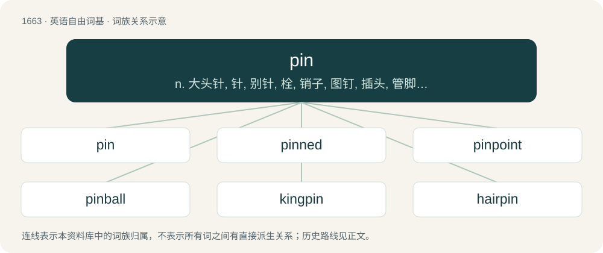

# 1764 · pin — n. 大头针, 针, 别针, 栓, 销子, 图钉, 插头, 管脚, 品(液量单位)；vt. 将...用针别住, 钉住, 压住, 牵制, 使不能动, 归罪于；a. 针的, 销子的, 闩的

[总目录](../00_总目录_按常用程度.md)

**类型**：英语自由词基　｜　**来源语言**：见词源记录

## 核心含义与来源

- 核心含义：n. 大头针, 针, 别针, 栓, 销子, 图钉, 插头, 管脚, 品(液量单位)；vt. 将...用针别住, 钉住, 压住, 牵制, 使不能动, 归罪于；a. 针的, 销子的, 闩的
- 英文含义：A needle without an eye (usually) made of drawn-out steel wire with one end sharpened and the other flattened or rounded into a head, used for fastening.
- 词形：pin

**来源记录 1**（名词；A needle without an eye (usually) made of drawn-out steel wire with one end sharpened and the other flattened or rounded into a head, used for fastening.）

From Middle English pinne, from Old English pinn (“pin, peg, bolt”), from Proto-Germanic \*pinnaz, \*pinnō, \*pint- (“protruding point, peak, peg, pin, nail”), from Proto-Indo-European \*bend- (“protruding object, pointed peg, nail, edge”). Related to pen (“enclosure”). Cognate with Dutch pin (“peg, pin”), Low German pin, pinne (“pin, point, nail, peg”), German Pinn, Pinne (“pin, tack, peg”), Bavarian Pfonzer, Pfunzer (“sharpened point”), Danish pind (“pin, pointed stick”), Norwegian pinn (“stick”), Swedish pinne (“peg, rod, stick”), Icelandic pinni (“pin”). More at pintle. No relation to classical Latin pinna (“fin, flipper, wing-like appendage, wing, feather”), which was extended to mean "ridge, peak, point" (compare pinnacle), and often confused with Latin penna (“wing, feather”). More at feather and pen (Etymology 3).

## 词族图

## 单词速览（常用到不常用）

| 单词 | 音标 | 释义 |
|---|---|---|
| [pin](#w-1) | 英 /pɪn/ | n. 大头针, 针, 别针, 栓, 销子, 图钉, 插头, 管脚, 品(液量单位)；vt. 将...用针别住, 钉住, 压住, 牵制, 使不能动, 归罪于；a. 针的, 销子的, 闩的 |
| [pinned](#w-2) | /pɪnd/ | v. 用针别住(pin的过去分词); 刺穿; 牵制；a. 用针别住的; 被压制的 |
| [pinpoint](#w-3) | /ˈpɪnpɔɪnt/ | n. 极小之物, 针尖, 立锥之地, 精确位置；vt. 精确地找到, 准确地轰炸, 刺穿, 准确描述, 使突出, 强调；a. 针尖的, 极微的, 精确的, 详尽的, 精确定位的 |
| [pinball](#w-4) | /ˈpɪnˌbɔːl/ | n. 钉球戏, 弹球戏 |
| [kingpin](#w-5) | /ˈkɪŋ.pɪn/ | n. 中心立轴, (非正式)中心人物, 首脑, 关键人物, (非正式)主要成分 |
| [hairpin](#w-6) | 英 /ˈhɛə.pɪn/；美 /ˈhɛɚ.pɪn/ | n. 簪, 束发夹, 夹发针 |
| [underpin](#w-7) | 英 /ˌʌn.dəˈpɪn/；美 /ˌʌn.dɚˈpɪn/ | vt. 从下面支承, 支撑, 支持；\[经\] 支撑 |
| [pinhole](#w-8) | 美 /ˈpɪnˌhoʊl/ | n. 针孔, 小孔, 蛀洞；\[机\] 针孔, 砂眼 |
| [pinstripe](#w-9) | /ˈpɪnˌstɹaɪp/ | n. 细条纹, 细条纹布料 |
| [pinhead](#w-10) | /ˈpɪn.hɛd/ | n. 针头, 小东西, 微不足道的东西 |
| [pinner](#w-11) | /ˈpɪnə(ɹ)/ | n. 用针操作的工人(或机器), 垂片头饰 |
| [pincushion](#w-12) | 英 /ˈpɪnˌkʊʃn̩/；美 /ˈpɪnˌkʊʃ(ə)n/ | n. 针垫 |

## 逐词详解

### 1. pin

**词性**：名词　｜　**音标**：英 /pɪn/

**中文释义**：n. 大头针, 针, 别针, 栓, 销子, 图钉, 插头, 管脚, 品(液量单位)；vt. 将...用针别住, 钉住, 压住, 牵制, 使不能动, 归罪于；a. 针的, 销子的, 闩的

**英文义项**：A needle without an eye (usually) made of drawn-out steel wire with one end sharpened and the other flattened or rounded into a head, used for fastening. / A small nail with a head and a sharp point.

**词源与演化**：

From Middle English pinne, from Old English pinn (“pin, peg, bolt”), from Proto-Germanic \*pinnaz, \*pinnō, \*pint- (“protruding point, peak, peg, pin, nail”), from Proto-Indo-European \*bend- (“protruding object, pointed peg, nail, edge”). Related to pen (“enclosure”). Cognate with Dutch pin (“peg, pin”), Low German pin, pinne (“pin, point, nail, peg”), German Pinn, Pinne (“pin, tack, peg”), Bavarian Pfonzer, Pfunzer (“sharpened point”), Danish pind (“pin, pointed stick”), Norwegian pinn (“stick”), Swedish pinne (“peg, rod, stick”), Icelandic pinni (“pin”). More at pintle. No relation to classical Latin pinna (“fin, flipper, wing-like appendage, wing, feather”), which was extended to mean "ridge, peak, point" (compare pinnacle), and often confused with Latin penna (“wing, feather”). More at feather and pen (Etymology 3).

**例句**：

> The UK standard connector for domestic mains electricity has three pins.

该用例对应义项：Any of the individual connecting elements of a multipole electrical connector.

### 2. pinned

**词性**：形容词　｜　**音标**：/pɪnd/

**中文释义**：v. 用针别住(pin的过去分词); 刺穿; 牵制；a. 用针别住的; 被压制的

**英文义项**：Having (a specified kind or number of) pins.

**构词拆分**：pin + -ed

**词源与演化**：

From pin + -ed.

**用法示例／搭配（非完整句）**：

> a three-pinned arch

该用例对应义项：Having (a specified kind or number of) pins.

### 3. pinpoint

**词性**：形容词　｜　**音标**：/ˈpɪnpɔɪnt/

**中文释义**：n. 极小之物, 针尖, 立锥之地, 精确位置；vt. 精确地找到, 准确地轰炸, 刺穿, 准确描述, 使突出, 强调；a. 针尖的, 极微的, 精确的, 详尽的, 精确定位的

**英文义项**：Extremely precise or specific, especially regarding location.

**构词拆分**：pin + point

**词源与演化**：

From pin + point.

**例句**：

> The machine assembles parts at high speed and with pinpoint accuracy.

该用例对应义项：Extremely precise or specific, especially regarding location.

### 4. pinball

**词性**：名词　｜　**音标**：/ˈpɪnˌbɔːl/

**中文释义**：n. 钉球戏, 弹球戏

**英文义项**：A game, played on a device with a sloping base (a pinball machine), in which the player operates a spring-loaded plunger to shoot a ball, between obstacles, and attempts to hit targets and score points. / The ball used in pinball.

**构词拆分**：pin + ball

**词源与演化**：

From pin + ball.

**例句**：

> It's hard to find a totally mechanical pinball machine. These days, they're all electronic.

### 5. kingpin

**词性**：名词　｜　**音标**：/ˈkɪŋ.pɪn/

**中文释义**：n. 中心立轴, (非正式)中心人物, 首脑, 关键人物, (非正式)主要成分

**英文义项**：The axis around which steered wheels pivot; a bolt that holds the axis in place. / The pivot or connector between a tractor and trailer in the fifth-wheel coupling of semi-trailer truck.

**构词拆分**：king + pin

**词源与演化**：

From king + pin.

### 6. hairpin

**词性**：名词　｜　**音标**：英 /ˈhɛə.pɪn/；美 /ˈhɛɚ.pɪn/

**中文释义**：n. 簪, 束发夹, 夹发针

**英文义项**：A pin or fastener for the hair. / A kind of ribozyme; hairpin ribozyme.

**构词拆分**：hair + pin

**词源与演化**：

From hair + pin, 1788 (as hair pin). Adjective sense 1906 in hairpin turn etc.

**例句**：

> She unlocked the car door by means of a hairpin.

### 7. underpin

**词性**：动词　｜　**音标**：英 /ˌʌn.dəˈpɪn/；美 /ˌʌn.dɚˈpɪn/

**中文释义**：vt. 从下面支承, 支撑, 支持；\[经\] 支撑

**英文义项**：To support from below with props or masonry. / To give support to; to form a basis of; to corroborate.

**构词拆分**：under- + pin

**词源与演化**：

From under- + pin.

**例句**：

> You should underpin the mine roof to prevent further collapse.

该用例对应义项：To support from below with props or masonry.

### 8. pinhole

**词性**：名词　｜　**音标**：美 /ˈpɪnˌhoʊl/

**中文释义**：n. 针孔, 小孔, 蛀洞；\[机\] 针孔, 砂眼

**英文义项**：A small hole, of a size that could have been made by a pin / The aperture in a pinhole camera or camera obscura

**构词拆分**：pin + hole

**词源与演化**：

From pin + hole.

**例句**：

> You can build a pinhole camera with a shoe box.

### 9. pinstripe

**词性**：名词　｜　**音标**：/ˈpɪnˌstɹaɪp/

**中文释义**：n. 细条纹, 细条纹布料

**英文义项**：A very thin stripe on a fabric or other surface. / A fabric decorated with such stripes.

**构词拆分**：pin + stripe

**词源与演化**：

From pin + stripe.

**例句**：

> Tom painted his white car red, with a yellow pinstripe along its whole length.

### 10. pinhead

**词性**：名词　｜　**音标**：/ˈpɪn.hɛd/

**中文释义**：n. 针头, 小东西, 微不足道的东西

**英文义项**：The head of a pin. (Frequently used in size comparisons.) / A foolish or stupid person.

**构词拆分**：pin + head

**词源与演化**：

From pin + head.

**例句**：

> The Cenobites' most iconic member is Pinhead, also known as the Hell Priest, who serves as their leader and spokesperson.

### 11. pinner

**词性**：名词　｜　**音标**：/ˈpɪnə(ɹ)/

**中文释义**：n. 用针操作的工人(或机器), 垂片头饰

**英文义项**：A headdress like a cap, with long lappets. / A cloth band for a gown.

**构词拆分**：pin + -er

**词源与演化**：

From Middle English pynner, pynnere, pinnere, equivalent to pin + -er.

**例句**：

> This sickened her of America, and she came back to live with a maiden aunt at Pinner, in Middlesex.

### 12. pincushion

**词性**：名词　｜　**音标**：英 /ˈpɪnˌkʊʃn̩/；美 /ˈpɪnˌkʊʃ(ə)n/

**中文释义**：n. 针垫

**英文义项**：A device, originally like a small, stuffed cushion, designed to have sewing pins and needles stuck into it to store them safely; some modern pincushions hold the objects magnetically. / A flowering plant in the genus Leucospermum.

**构词拆分**：pin + cushion

**词源与演化**：

The noun is derived from pin + cushion. The verb is derived from the noun.

**例句**：

> Insulin-dependent diabetics are human pincushions.

该用例对应义项：A person who is pricked or stabbed multiple times with sharp objects; specifically, someone who receives regular hypodermic needle injections.
