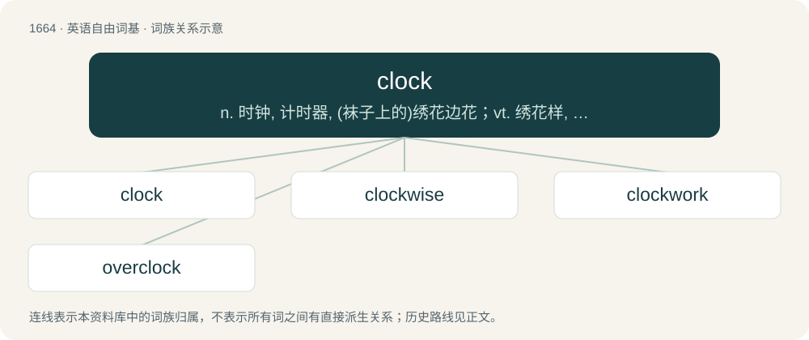

# 1765 · clock — n. 时钟, 计时器, (袜子上的)绣花边花；vt. 绣花样, 记时, 记录；vi. 记录时间

[总目录](../00_总目录_按常用程度.md)

**类型**：英语自由词基　｜　**来源语言**：见词源记录

## 核心含义与来源

- 核心含义：n. 时钟, 计时器, (袜子上的)绣花边花；vt. 绣花样, 记时, 记录；vi. 记录时间
- 英文含义：A chronometer, an instrument that measures time, particularly the time of day.
- 词形：clock

**多个词源／构词路径**：同一拼写可能有不同来源；以下按词性和含义分别列出。

**来源记录 1**（名词；A chronometer, an instrument that measures time, particularly the time of day.）

First use appears c. 1370. From Middle English clokke, clok, cloke (“clock”), from Middle Dutch clocke (“bell, clock”), from Old Dutch \*klokka, from Medieval Latin clocca (“bell, clock, cloak”), probably of Celtic origin, from Proto-Celtic \*klokkos (“bell”) (compare Welsh cloch (“bell”), Old Irish cloc (“bell, clock”)), either onomatopoeic or from Proto-Indo-European \*klek- (“to laugh, cackle”) (compare Proto-Germanic \*hlahjaną (“to laugh”)). Cognate with Old English clucge (“bell”), Saterland Frisian Klokke (“bell, clock”), Dutch klok (“clock, bell”), Low German Klock (“bell, clock”), German Glocke (“bell”), Danish and Norwegian klokke (“clock, bell”), Faroese klokka (“clock, bell”), Icelandic klukka (“clock, bell”), Swedish klocka (“clock, bell”), Asturian llueca (“cowbell”), Galician and Portuguese choca (“cowbell”), Doublet of cloak and cloche.

**来源记录 2**（名词；A pattern near the heel of a sock or stocking.）

Uncertain; designs may have originally been bell-shaped and thus related to Etymology 1, above.

**来源记录 3**（动词；To make the sound of a hen; to cluck.）

From Middle English clokken, from Old English cloccian, ultimately imitative; compare Dutch klokken, English cluck.

## 词族图

## 单词速览（常用到不常用）

| 单词 | 音标 | 释义 |
|---|---|---|
| [clock](#w-1) | 英 /klɒk/；美 /klɑk/ | n. 时钟, 计时器, (袜子上的)绣花边花；vt. 绣花样, 记时, 记录；vi. 记录时间 |
| [clockwise](#w-2) | /ˈklɒkwaɪz/ | a. 顺时针方向的；adv. 顺时针方向地 |
| [clockwork](#w-3) | 英 /ˈklɒkwɜːk/；美 /ˈklɑkwɝk/ | n. 钟表装置, 发条装置；\[电\] 时钟开关 |
| [overclock](#w-4) | /əʊvəkˈlɒk/ | vi. 超频 |

## 逐词详解

### 1. clock

**词性**：名词　｜　**音标**：英 /klɒk/；美 /klɑk/

**中文释义**：n. 时钟, 计时器, (袜子上的)绣花边花；vt. 绣花样, 记时, 记录；vi. 记录时间

**英文义项**：A chronometer, an instrument that measures time, particularly the time of day. / A common noun relating to an instrument that measures or keeps track of time.

**词源与演化**：

First use appears c. 1370. From Middle English clokke, clok, cloke (“clock”), from Middle Dutch clocke (“bell, clock”), from Old Dutch \*klokka, from Medieval Latin clocca (“bell, clock, cloak”), probably of Celtic origin, from Proto-Celtic \*klokkos (“bell”) (compare Welsh cloch (“bell”), Old Irish cloc (“bell, clock”)), either onomatopoeic or from Proto-Indo-European \*klek- (“to laugh, cackle”) (compare Proto-Germanic \*hlahjaną (“to laugh”)). Cognate with Old English clucge (“bell”), Saterland Frisian Klokke (“bell, clock”), Dutch klok (“clock, bell”), Low German Klock (“bell, clock”), German Glocke (“bell”), Danish and Norwegian klokke (“clock, bell”), Faroese klokka (“clock, bell”), Icelandic klukka (“clock, bell”), Swedish klocka (“clock, bell”), Asturian llueca (“cowbell”), Galician and Portuguese choca (“cowbell”), Doublet of cloak and cloche.

**例句**：

> A 12-hour clock system; an antique clock sale; Acme is a clock manufacturer.

该用例对应义项：A common noun relating to an instrument that measures or keeps track of time.

### 2. clockwise

**词性**：形容词　｜　**音标**：/ˈklɒkwaɪz/

**中文释义**：a. 顺时针方向的；adv. 顺时针方向地

**英文义项**：Moving clockwise; having rotary motion in the manner of a clock.

**构词拆分**：clock + -wise

**词源与演化**：

From clock + -wise.

**例句**：

> In the southern hemisphere the flow of air around a low-pressure system is clockwise.

该用例对应义项：Moving clockwise; having rotary motion in the manner of a clock.

### 3. clockwork

**词性**：名词　｜　**音标**：英 /ˈklɒkwɜːk/；美 /ˈklɑkwɝk/

**中文释义**：n. 钟表装置, 发条装置；\[电\] 时钟开关

**英文义项**：A mechanism powered by a coiled spring and regulated by some form of escapement; the power is transmitted through toothed gearwheels and used to drive a mechanical clock, toy, or other device. / The action of behaving mechanically in the manner of a clock.

**构词拆分**：clock + -work

**词源与演化**：

From clock + -work.

**例句**：

> The universe confuses me and I cannot imagine how this clockwork can exist without a clockmaker.

### 4. overclock

**词性**：动词　｜　**音标**：/əʊvəkˈlɒk/

**中文释义**：vi. 超频

**英文义项**：To run a processor (CPU), or any electronic logic device, at a speed higher than is recommended by the manufacturer.

**构词拆分**：over- + clock

**词源与演化**：

From over- + clock.
