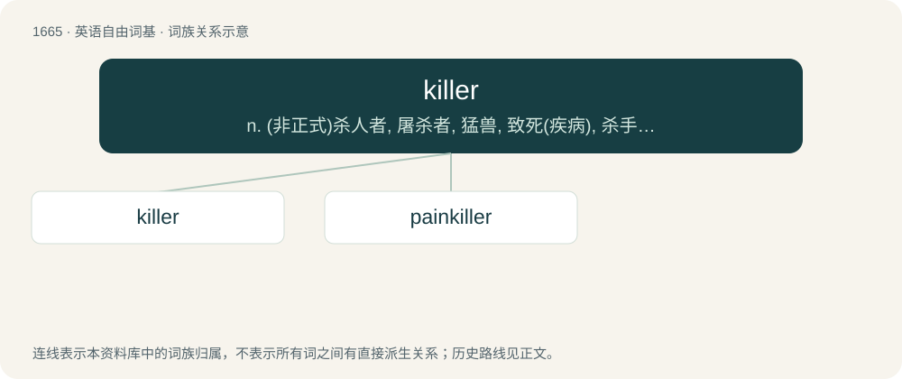

# 1766 · killer — n. (非正式)杀人者, 屠杀者, 猛兽, 致死(疾病), 杀手, 止痛药, 限制器, 瞄准器；\[计\] 删除程序; 断路器

[总目录](../00_总目录_按常用程度.md)

**类型**：英语自由词基　｜　**来源语言**：见词源记录

## 核心含义与来源

- 核心含义：n. (非正式)杀人者, 屠杀者, 猛兽, 致死(疾病), 杀手, 止痛药, 限制器, 瞄准器；\[计\] 删除程序; 断路器
- 英文含义：One who or that which kills.
- 词形：killer

**来源记录 1**（名词；One who or that which kills.）

From Middle English killer, kyller. By surface analysis, kill + -er.

## 词族图

## 单词速览（常用到不常用）

| 单词 | 音标 | 释义 |
|---|---|---|
| [killer](#w-1) | 英 /ˈkɪlə/；美 /ˈkɪlɚ/ | n. (非正式)杀人者, 屠杀者, 猛兽, 致死(疾病), 杀手, 止痛药, 限制器, 瞄准器；\[计\] 删除程序; 断路器 |
| [painkiller](#w-2) | /ˈpeɪnˌkɪlə(ɹ)/ | n. 解痛药, 止痛片, 止痛药 |

## 逐词详解

### 1. killer

**词性**：名词　｜　**音标**：英 /ˈkɪlə/；美 /ˈkɪlɚ/

**中文释义**：n. (非正式)杀人者, 屠杀者, 猛兽, 致死(疾病), 杀手, 止痛药, 限制器, 瞄准器；\[计\] 删除程序; 断路器

**英文义项**：One who or that which kills. / That which causes stress or is extremely difficult, especially that which may cause failure at a task.

**构词拆分**：By surface analysis, kill + -er

**词源与演化**：

From Middle English killer, kyller. By surface analysis, kill + -er.

**例句**：

> The final hill in the race course was a killer.

该用例对应义项：That which causes stress or is extremely difficult, especially that which may cause failure at a task.

### 2. painkiller

**词性**：名词　｜　**音标**：/ˈpeɪnˌkɪlə(ɹ)/

**中文释义**：n. 解痛药, 止痛片, 止痛药

**英文义项**：A drug that numbs the pain in the body.

**构词拆分**：From pain + killer.

**词源与演化**：

From pain + killer.

**例句**：

> If you have pain, take a painkiller.
